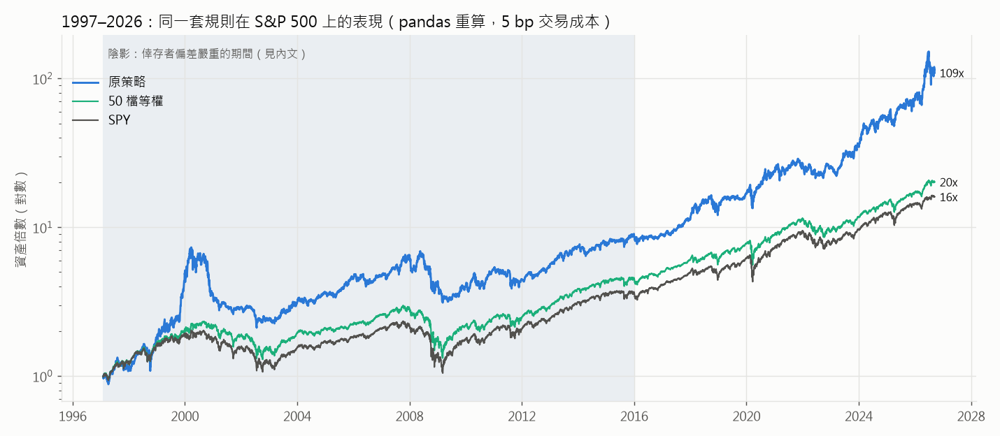
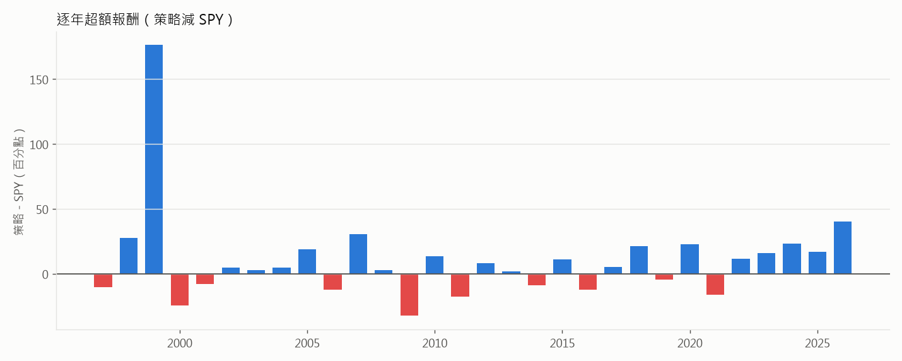
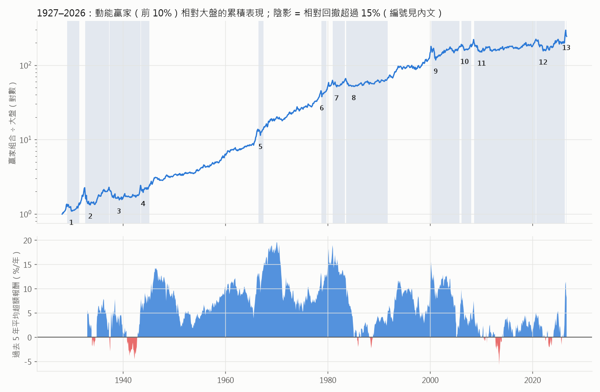
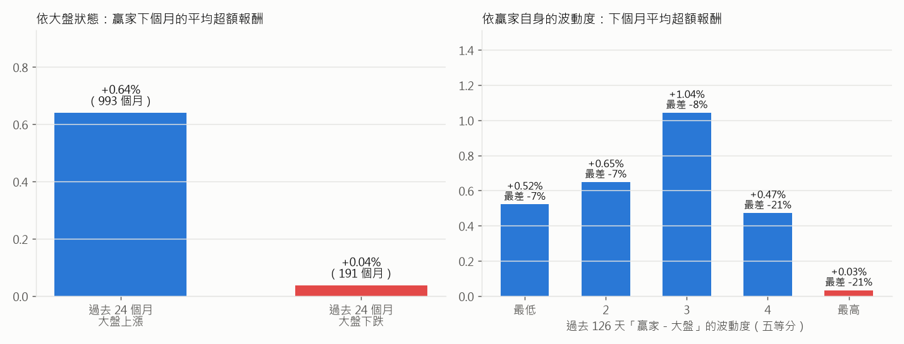
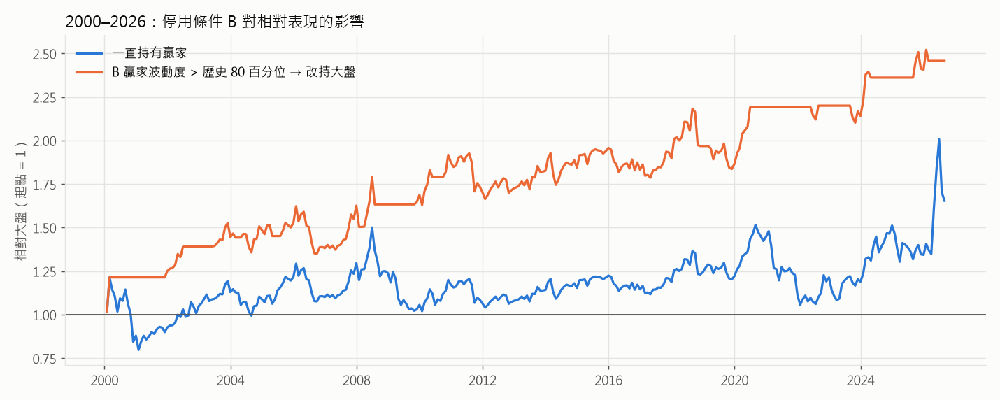
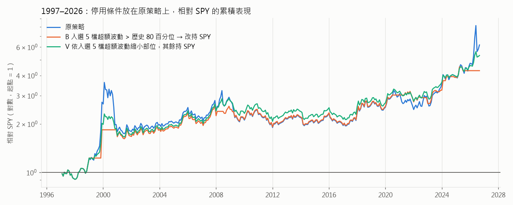

# 把動能策略拉長來看：哪些年代有效、哪些年代失效，以及什麼時候該停

`strategy-explained.md` 只看了 2021-09 → 2026-09 這 5 年，而那 5 年剛好是
這個策略表現最好的一段。這份文件把時間拉長，回答三個問題：

1. 同一套規則放到更早的年代，表現如何？
2. 以「年」為單位來看，是否能清楚分出好的年代和壞的年代？轉換點有沒有明確的事件？
3. 有沒有一個**事先就看得到**的條件，可以告訴我們「現在該停用動能」？

文中的數字都是實際跑出來的，重現指令在最後。

---

## 先講結論

- **最近 5 年（年化 31.6%）不能代表這個策略的長期表現。** 同一套規則放到 1997–2026，
  年化約 16.8%（SPY 9.8%）。但其中 **2000–2019 這 20 年，策略年化 5.5%，SPY 5.9%，等於沒有超額報酬**。
  2000 年 3 月的資產高點要到 **2013 年 11 月**才收復。
- **一百年的資料顯示，大型股動能的超額報酬是真的，但會一次停擺好幾年。**
  贏家組合相對大盤曾經 5 年（2000–2005）、8 年（1983–1991）、甚至 **12 年（2008–2020）** 沒創新高。
- **壞年代都是突然開始的，而開始的那一刻幾乎都對應到明確的事件**，大致分兩類：
  - **題材泡沫破裂**：贏家全擠在同一個題材，題材一反轉就一起跌。例如 1980 能源、2000 網路、2008 原物料、2021 疫情成長股、2026 記憶體。
  - **空頭底部的暴力反彈**：大盤從谷底反彈時，漲最多的是之前跌最兇的股票，而不是過去的贏家。例如 1932、2009。
- **要修正的一個直覺：** 學術上最有名的動能停用條件是「大盤處於空頭時停用」，
  但它主要保護的是**放空輸家的那一邊**。這個策略只做多，套用這個條件**幾乎沒有幫助**。
- **對只做多的動能，真正有效的訊號是「贏家本身變得多波動」。** 它無法讓報酬變高，
  但能把「相對大盤的最大回撤」砍掉一半左右，用來當作降低部位的條件比較合適，不適合當作完全停用的開關。

---

## 你原本的想法，哪些要修正

| 原本的想法 | 修正 |
|---|---|
| 把回測拉長到「最早能找到滿足策略的資料」 | 免費資料可以拉到 1997 年，但**越早偏差越大**：Yahoo 沒有已下市公司的資料，1997 年的 S&P 500 成分股只有 41% 有價格。偏偏被漏掉的正是 2000、2008 崩盤的主角（Lucent、Nortel、Sun、Yahoo、WorldCom、Enron、Lehman、Merrill……）。所以除了「拉長原策略」，本文另外用**含下市公司的 CRSP 資料**（Kenneth French 資料庫）把動能效應本身追溯到 1927 年。 |
| 以年為單位，切出好壞時間段 | 方向是對的：確實有長達 10 年以上的好年代和壞年代。但**壞年代都是在 1–2 個月內突然開始，之後要好幾年才回復**，日曆年的界線意義不大。比較有用的切法是看「市場處在什麼狀態」，因為狀態事先就看得到。 |
| 缺點是缺少停止條件，想找一個事件當作停止訊號 | 事件確實存在，但**事件發生的當下才知道，就已經太晚了**（例如 2026-07 一個月跌 32%）。能事先看到的是「事件發生前的狀態」：贏家集中在同一個題材、漲幅極端、波動度飆高。而且停止之後不該改持現金，應該改持大盤，因為要避開的是「贏家輸給大盤」，不是「股市下跌」。 |

---

## 第一部分：原策略拉長到 1997–2026

### 資料：S&P 500 歷史成分股 + Yahoo 價格，越早越不完整

用同一個 `convert_data.py universe` 工具，把成分股資料從 1996-01 建到 2026-09
（`data-sp500-long/`）。1996–2026 間曾經是 S&P 500 成員的公司共 1,209 檔：

- **775 檔**有 Yahoo 價格資料。
- **434 檔沒有**，幾乎都是被併購或破產下市的公司。
- 股數（用來估市值）Yahoo 只給到 **2015 年 10 月**以後，更早的市值是用 2015 年的股數往回推，排名會有誤差。

每年平均「有價格的成分股比例」：

| 1997 | 2000 | 2003 | 2006 | 2009 | 2012 | 2015 | 2018 | 2021 | 2024 |
|---|---|---|---|---|---|---|---|---|---|
| 41% | 48% | 53% | 58% | 65% | 70% | 76% | 85% | 92% | 97% |

**還有一個問題是代號被重複使用。** 例如 1990 年代的 `WM` 是華盛頓互惠銀行，
但 Yahoo 的 `WM` 是 Waste Management。我檢查過 2010 年前入選的 85 檔股票，
沒有看到明顯張冠李戴的情況，但不能保證完全沒有。

**偏差的方向。** 下市的公司大多是因為崩盤或被併購而消失。動能策略在 2000 年持有的就是當時的強勢科技股，
如果資料完整，Sun、Lucent、Nortel、EMC、Yahoo 這些在 2000–2002 年跌掉 80–95% 的公司都會是候選，
所以 **2000–2002 的真實虧損很可能比這裡顯示的更大**。
1999 年的 +198% 也要打折扣：那一年的前 5 名裡，QCOM 一年漲了 26 倍，這是真的；
但如果有完整資料，選出來的會是另一組股票，結果無法事先確定。

**結論：2016 年以後的數字可以信，2008–2015 可以參考，1997–2007 只能看大方向。**

### 驗證：pandas 重算和 LEAN 一致

`long_backtest.py` 用 pandas 重算每個月的選股（和 `explain_figures.py` 同樣的漏斗），
在 2021–2026 和 LEAN 的 60 次換股**逐月比對，0 次不符**。之後才用它來跑 30 年和各種變形，
因為比 LEAN 快很多。LEAN 本身的 1997–2026 回測（年化 17.3%、最大回撤 71.3%）附在文末附錄。

### 結果



| 1997-02 → 2026-09 | 本策略 | 50 檔等權 | SPY |
|---|---|---|---|
| 年化報酬 | **16.8%** | 10.7% | 9.8% |
| 最大回撤（月底） | **−65.5%** | −51.7% | −51.3% |
| Sharpe（月報酬，rf=0） | 0.70 | 0.73 | 0.67 |
| 相對 SPY 的最大回撤 | **−52%** | −10% | — |

（pandas 重算，以換股日開盤價成交，交易成本每單位換手 5 bp。）

分段來看就很清楚了：

| 期間 | 本策略年化 | SPY 年化 | 每年超額 | 說明 |
|---|---|---|---|---|
| 1997–2007 | 18.1% | 7.5% | +12.8% | 幾乎全部來自 1998–99 網路泡沫 |
| **2000–2019** | **5.5%** | **5.9%** | **+0.9%** | **20 年沒有超額報酬** |
| 2008–2015 | 3.4% | 6.2% | −1.8% | 輸給大盤 |
| 2016–2026 | 26.4% | 15.0% | +11.9% | 資料可靠的一段 |
| 2021-10–2026 | 33.1% | 13.5% | +20.6% | 原本那份回測 |



最重要的三個事實：

1. **2000 年 3 月的資產高點，要到 2013 年 11 月才收復，一共 13 年 8 個月。**
2. **相對 SPY 而言，2000 年 3 月的高點要到 2024 年 1 月才被超越。**
   就算扣掉被偏差放大的 1999 年，2000–2017 年策略相對大盤也只是原地打轉。
3. **「跳過最近一個月」的學術版 12-2 動能**（下表的 12-2）和原版差不多，
   1997–2026 年化 16.2% 對 16.8%，回撤略小。學術文獻常說要跳過最近一個月，
   但在這 50 檔大型股裡差異不大。

---

## 第二部分：1927–2026，用沒有倖存者偏差的資料看動能效應

### 為什麼可以拿來代表這個策略

Kenneth French 資料庫的動能投資組合是用 CRSP 算的，**包含下市公司**，從 1927 年開始。
這裡用的是：

- **D10**：過去 12 個月（跳過最近 1 個月）漲幅前 10% 的股票，市值加權。
- **MKT**：全市場，市值加權。

它不是同一個策略：它持有幾百檔，本策略只持有 5 檔。但是在 2021-11 → 2026-08 的 58 個月重疊期間，
**本策略相對 SPY 的月超額報酬，和 D10 相對 MKT 的月超額報酬，相關係數 0.84**。
所以用它來研究「什麼時候動能有效」是合理的，只是本策略的漲跌幅會更極端。

### 一百年的全貌



上圖是 D10 ÷ MKT 的累積走勢（對數座標），下圖是過去 5 年平均每年的超額報酬。

**長期來看動能效應很明確：** 1927–2026 平均每年贏大盤約 6.5 個百分點。
**但分佈非常不平均：**

| 年代 | 每年平均超額 | 當月贏過大盤的比例 |
|---|---|---|
| 1920s | +8.6% | 67% |
| 1930s | +2.7% | 58% |
| 1940s | +8.5% | 56% |
| 1950s | +6.8% | 58% |
| 1960s | **+12.9%** | 60% |
| 1970s | +10.4% | 66% |
| 1980s | +2.7% | 57% |
| 1990s | +10.1% | 58% |
| **2000s** | **+1.7%** | 57% |
| **2010s** | **+2.3%** | 57% |
| 2020s（至 2026-08） | +6.6% | 53% |

**2000 年以後的動能明顯比以前弱。** 常見的解釋是：動能效應被廣泛知道、ETF 化，
加上市場的題材輪動越來越快。1960、70 年代那種「穩穩贏」的年代沒有再出現過。

### 壞年代從哪裡開始：13 次相對回撤超過 15%

圖中編號對應下表。「開始 → 谷底 → 回復」是指 D10 相對 MKT 的走勢。

| # | 開始 | 谷底 | 回復 | 相對回撤 | 事件 | 類型 |
|---|---|---|---|---|---|---|
| 1 | 1929-01 | 1929-11 | 1931-05 | −20% | 1929 股災：1928 年的投機贏家跌得更兇 | 泡沫破裂 |
| 2 | 1932-07 | 1933-07 | 1937-03 | **−41%** | 大蕭條谷底反彈：1932-07、08 兩個月大盤漲 34%、37%，贏家落後 21 個百分點 | 空頭反彈 |
| 3 | 1937-04 | 1939-03 | 1943-05 | −32% | 1937–38 衰退、1938 反彈、1942 戰時谷底反彈 | 空頭反彈 |
| 4 | 1943-06 | 1943-11 | 1945-02 | −20% | 戰時行情延續，落後股補漲 | 空頭反彈 |
| 5 | 1966-05 | 1966-10 | 1967-05 | −17% | 1966 信用緊縮，成長股（Go-Go 股）重挫 | 泡沫破裂 |
| 6 | 1978-09 | 1978-10 | 1979-09 | −17% | 1978 年 10 月美元危機大屠殺，一個月內發生 | 泡沫破裂 |
| 7 | 1980-12 | 1981-09 | 1983-04 | −18% | **能源泡沫頂點**（油價高點），Volcker 升息 | 泡沫破裂 |
| 8 | 1983-07 | 1985-01 | 1991-08 | −22% | 1983 年中科技／小型成長股頂點，之後**8 年**沒有創新高 | 泡沫破裂 |
| 9 | 2000-03 | 2001-01 | 2005-09 | **−34%** | **網路泡沫破裂** | 泡沫破裂 |
| 10 | 2006-02 | 2006-09 | 2007-12 | −17% | 2006 年 5 月原物料、新興市場急跌 | 泡沫破裂 |
| 11 | 2008-07 | 2010-01 | **2020-08** | −32% | **油價頂點** → 金融海嘯 → **2009-03 谷底反彈**，之後 **12 年**沒有創新高 | 兩者皆是 |
| 12 | 2020-09 | 2022-01 | 2026-04 | −30% | 2020-11 疫苗消息帶動價值股輪動，2021 成長股崩跌 | 泡沫破裂 |
| 13 | 2026-07 | 2026-08 | 未回復 | −18% | 記憶體／半導體股崩跌 | 泡沫破裂 |

**所以，回答「時間段之間是否有明確事件」：有。** 13 次裡有 9 次是「題材泡沫破裂」，
4 次是「空頭谷底反彈」。動能的壞年代有兩種起因：

1. **題材泡沫破裂（只做多的策略最該怕的）。** 動能會自動把資金集中到漲最多的題材，
   題材越熱，集中度越高（本策略 2026-06 的 5 檔是 SNDK、MU、INTC、AMD、LRCX，全是記憶體與半導體）。
   題材一反轉，持股會一起跌。這種崩盤**常常發生在大盤還在漲的時候**（2026-07 SPY 是上漲的）。
2. **空頭谷底反彈（Daniel & Moskowitz 2016 所說的 "momentum crash"）。**
   熊市裡跌最兇的股票，在谷底反彈時漲最多（1932、2009-03～05）。
   這主要傷害的是**放空輸家**的那一邊。只做多的贏家組合通常還是會漲，只是漲得比大盤少。

---

## 第三部分：事先看得到的停止條件

### 測試兩個候選訊號

所有訊號都**只用換股日之前就有的資料**。門檻用的是訊號自己「過去」的百分位數（expanding），
不是用整段資料事後算出來的。



**左圖：大盤狀態（過去 24 個月大盤是否下跌）。** 這是學術上最常見的停用條件。
大盤上漲時，贏家下個月平均贏大盤 **0.64%**（t = 6.0，993 個月）；
大盤下跌時只剩 **0.04%**（191 個月），等於沒有超額。所以「空頭時動能沒用」是對的。
**但對只做多的策略來說，沒用不等於會輸**，所以停用它也賺不到什麼，下面的回測會看到。

**右圖：贏家自己的波動度**（過去 126 天「大型贏家 − 大盤」日報酬的標準差）。
最高的五分之一，下個月平均超額只剩 **0.03%**，而且最差的月份是 −21%。
**泡沫在破裂之前，通常已經先變得非常顛簸**，所以這個訊號抓得到第一類崩盤。
（右圖的五等分是用全部資料切的，只是描述；下面的回測用的是不偷看未來的門檻。）

### 在一百年的資料上回測

規則：條件成立的那個月，**改持大盤**；否則持有贏家（D10）。

| 1928–1975 | 年化 | 最大回撤 | Sharpe | 每年超額 | 資訊比率 | 相對大盤最大回撤 |
|---|---|---|---|---|---|---|
| 一直持有贏家 | 15.5% | −75.8% | 0.65 | +7.5% | 0.61 | −41.3% |
| A 大盤 24 個月下跌 → 改持大盤 | 15.4% | −84.6% | 0.61 | +7.8% | 0.83 | −26.4% |
| **B 贏家波動度 > 歷史 80 百分位 → 改持大盤** | **16.2%** | −70.4% | **0.67** | +8.0% | **0.82** | **−19.6%** |
| C 大盤 24 個月下跌 → 改持現金 | 14.9% | −58.5% | 0.71 | +6.0% | 0.32 | −61.4% |

| 1976–2026 | 年化 | 最大回撤 | Sharpe | 每年超額 | 資訊比率 | 相對大盤最大回撤 |
|---|---|---|---|---|---|---|
| 一直持有贏家 | 17.3% | −51.3% | 0.65 | +5.6% | 0.45 | −34.3% |
| A 大盤 24 個月下跌 → 改持大盤 | 16.9% | −57.9% | 0.63 | +5.2% | 0.44 | −35.6% |
| **B 贏家波動度 > 歷史 80 百分位 → 改持大盤** | **18.1%** | −48.5% | **0.73** | +5.9% | **0.63** | **−25.5%** |
| C 大盤 24 個月下跌 → 改持現金 | 15.8% | −43.2% | 0.61 | +4.0% | 0.29 | −52.6% |

| 2000–2026 | 年化 | 最大回撤 | Sharpe | 每年超額 | 資訊比率 | 相對大盤最大回撤 |
|---|---|---|---|---|---|---|
| 一直持有贏家 | 10.6% | −51.3% | 0.48 | +3.2% | 0.22 | −34.3% |
| A 大盤 24 個月下跌 → 改持大盤 | 9.9% | −57.9% | 0.45 | +2.5% | 0.19 | −35.6% |
| **B 贏家波動度 > 歷史 80 百分位 → 改持大盤** | **12.3%** | −48.5% | **0.61** | +4.0% | **0.44** | **−16.8%** |
| C 大盤 24 個月下跌 → 改持現金 | 8.9% | −43.2% | 0.43 | +1.2% | 0.07 | −52.6% |

- **A（空頭濾網）在 1976 年以後沒有用**，甚至略差。1932 年那種崩盤它擋得住，但現代的崩盤大多是第一類。
- **C（空頭時改持現金）最差**：它其實是在擇時大盤，錯過了每一次谷底反彈。
- **B 在三個時期都有改善**，而且換參數仍然成立：波動度視窗 63／126／252 天、
  門檻 70／80／90 百分位，9 種組合在三個時期的資訊比率和相對最大回撤**全部**優於不停用。

逐次檢查 13 次回撤（相對大盤的損失，從開始到谷底）：

| # | 事件 | 不停用 | 用 B | B 停用的比例 |
|---|---|---|---|---|
| 2 | 1932 谷底反彈 | −41% | **−2%** | 92% |
| 6 | 1978-10 | −17% | **0%** | 100% |
| 9 | 2000 網路泡沫 | −34% | **0%** | 100% |
| 11 | 2008 原物料 → 2009 反彈 | −32% | **−9%** | 79% |
| 12 | 2020-11 疫苗輪動 | −30% | **0%** | 100% |
| 13 | 2026-07 記憶體 | −18% | **0%** | 100% |
| 1 | 1929 | −20% | −20% | 0% |
| 7 | 1981 能源 | −18% | **−24%**（更差） | 40% |
| 10 | 2006 原物料 | −17% | −17% | 0% |

13 次裡擋住 6 次、部分擋住 4 次、**沒擋住 3 次**。它不是萬靈丹，而且有代價：
在 2000-03、2020-09、2026-07 它都是「早就已經停用」，代表它**也錯過了泡沫最後那段最瘋狂的上漲**。



### 放回原策略（1997–2026）

把同樣的想法用在本策略上。B 和 V 用的是**本策略自己算得出來的訊號**：
換股當天入選的 5 檔，過去 126 天相對 50 檔等權的超額報酬波動度。

| 1997–2026 | 年化 | 最大回撤 | Sharpe | 每年超額 | 相對 SPY 最大回撤 |
|---|---|---|---|---|---|
| 原策略 | **16.8%** | −65.5% | 0.70 | +8.5% | −52.0% |
| 12-2 動能（跳過最近一個月） | 16.2% | −58.8% | 0.70 | +7.8% | −53.5% |
| A 過去 24 個月 SPY 下跌 → 改持 SPY | 17.1% | −67.3% | 0.71 | +8.8% | −50.6% |
| B 入選 5 檔超額波動 > 歷史 80 百分位 → 改持 SPY | 15.3% | −52.1% | 0.75 | +6.0% | −26.3% |
| B′ 用 French 的贏家波動度訊號 → 改持 SPY | 18.0% | −54.8% | 0.81 | +8.7% | −27.3% |
| **V 依超額波動縮小部位，其餘持 SPY** | 16.2% | **−51.9%** | **0.81** | +6.6% | **−28.1%** |

V 是 Barroso & Santa-Clara（2015）的作法：部位 = min(1, 歷史中位數波動 ÷ 目前波動)，
剩下的放 SPY。平均持有動能約 86%，波動越大持有越少。

| V 在各時期 | 原策略年化 | V 年化 | 原策略 Sharpe | V Sharpe | 原策略相對 SPY 最大回撤 | V 相對 SPY 最大回撤 |
|---|---|---|---|---|---|---|
| 2000–2019 | 5.5% | **7.4%** | 0.35 | **0.48** | −52% | **−28%** |
| 2008–2015 | 3.4% | **5.2%** | 0.26 | **0.35** | −41% | **−28%** |
| 2016–2026 | **26.4%** | 23.6% | 1.00 | **1.16** | −31% | **−16%** |
| 2021-10–2026 | **33.1%** | 26.7% | 1.03 | **1.20** | −31% | **−12%** |



**怎麼解讀：**

- **A（空頭濾網）對本策略也沒有用**，和一百年的結果一致。
- **B、V 都把相對 SPY 的最大回撤從 −52% 砍到 −26～−28%**，Sharpe 也提高。
  代價是在「題材行情持續加速」的年份少賺：2026 年 1–9 月入選股的波動一直很高，
  B 整年都停用，V 的部位從 54% 一路降到 23%，所以錯過了 4–6 月的大漲，但也躲過了 7 月的 −32%。
- **這和一百年資料有一點不同：** 在本策略上，波動度最高的那五分之一月份，
  下個月的平均超額其實**最高**（+1.4%／月），只是標準差是其他月份的 2–5 倍，最差一個月 −31%。
  也就是說，**在 5 檔集中持股的版本裡，高波動時期同時包含最大的賺和最大的賠**。
  波動度訊號降低的是風險，不是讓報酬變高。
- **B′ 的好成績大多來自 2000 年那一次**（它在泡沫頂點前就已停用）。2002–2026 B′ 的年化是 13.8%，
  反而低於原策略的 15.5%。一次事件撐起來的結果不要太相信。
  另外 French 的資料每月更新、有一兩個月的落差，實際使用時要自己算。

---

## 建議

1. **把這個策略的預期報酬下修。** 最近 5 年年化 31.6% 是在一段非常有利的題材行情裡量到的。
   比較可靠的長期參考是：**每年贏大盤幾個百分點，但可能連續 10 年以上沒有贏**（2000–2019）。
2. **不要用「大盤空頭」當作停用條件。** 對只做多的動能，它在一百年和 30 年的資料上都沒有幫助；
   改持現金的版本更差。
3. **如果要加一個條件，用「入選股的波動度」來縮小部位（V），並把縮下來的部位放 SPY，不要放現金。**
   它在兩份資料、各個時期都把相對大盤的最大回撤大約砍半，Sharpe 提高。
   要接受的是：題材行情最瘋狂的那幾個月會少賺。
4. **留意事件型的警訊，把它當作「降低部位」而不是「全部出場」的理由：**
   5 檔集中在同一個產業、入選股的 12 個月漲幅是 50 檔中位數的好幾倍（2026-07 的 SNDK +4,722%、
   1999-12 的 QCOM +1,220%）、入選股的波動度創新高。2000-03 時入選 5 檔平均漲幅是 50 檔中位數的 39 倍，
   波動度在 30 年歷史的第 97 百分位；2026-07 是 34 倍、第 100 百分位。
   但要注意，這些警訊在 1999-10 和 2026-04 就已經出現，之後還大漲了好幾個月。
   所以它們只能告訴你「風險很高」，沒辦法告訴你「什麼時候會崩」。
5. **如果要在 QuantConnect 雲端驗證，從 2000 年以前開始跑。** 雲端有 Morningstar 的完整歷史資料、
   包含下市公司，可以拿來檢驗本文 1997–2007 那一段被倖存者偏差影響了多少。

---

## 延伸

好時期與壞時期的起點、終點有什麼共同特徵，以及一套三盞燈的停用規則，見 [regimes.md](regimes.md)。

---

## 附錄：LEAN 回測 1997–2026

`run_local.py` 在 `data-sp500-long/` 上的結果（起始 1997-02-03，LEAN 預設 IB 手續費）：

| | 本策略（LEAN） | SPY 買進持有（LEAN） | 本策略（pandas 重算） |
|---|---|---|---|
| 年化報酬 | **17.29%** | 9.79% | 16.76% |
| 最大回撤（日資料） | **71.3%** | 55.1% | 65.5%（月底） |
| Sharpe（LEAN，含無風險利率） | 0.522 | 0.355 | — |
| 下單次數 | 2,265 | 1 | — |
| 回撤回復天數 | **5,052 天（約 13.8 年）** | 2,404 天 | 2000-03 → 2013-11 |

逐月比對選股：1998-12 以後的 **337 次換股，LEAN 和 pandas 完全一致**；
1997-02 到 1998-11 的 18 次有差異，原因是開頭那段 LEAN 算出的 252 日動能和 pandas 略有不同
（例如 1997-02-03 的 INTC，LEAN 是 +180%，pandas 是 +187%），
排在第 5 名附近的股票因此互換。這只發生在資料起點後的頭兩年，
年化報酬兩者相差約 0.5 個百分點，不影響本文的結論。

---

## 重現

```
# 1. 1996 年起的 S&P 500 成分股資料（約 1,209 檔，第一次約 1.5 小時，之後讀快取）
uv run --group data convert_data.py universe --etf SPY \
    --start 1996-01-02 --end 2026-09-15 --out data-sp500-long

# 2. LEAN 回測（選用，用來和 pandas 重算對照）
uv run run_local.py "Momentum Effect Top5 1997-2026" --data-folder data-sp500-long
uv run run_local.py "SPY Buy & Hold 1997-2026" --data-folder data-sp500-long

# 3. pandas 重算 + 一百年資料 + 圖表
uv run python research/momentum_effect/long_backtest.py
uv run python research/momentum_effect/ff_history.py
uv run python research/momentum_effect/long_figures.py
```

`ff_history.py` 第一次執行時會從 Kenneth French 的網站下載資料，
存在 `research/momentum_effect/long/ff/`（不進 git）。

參考文獻：

- Jegadeesh & Titman (1993), *Returns to Buying Winners and Selling Losers*.
- Cooper, Gutierrez & Hameed (2004), *Market States and Momentum*：過去 36 個月大盤下跌後，動能報酬消失。
- Daniel & Moskowitz (2016), *Momentum Crashes*：崩盤集中在空頭後的大盤反彈，主要來自放空端。
- Barroso & Santa-Clara (2015), *Momentum Has Its Moments*：用動能自身的波動度縮放部位，大幅降低崩盤。
