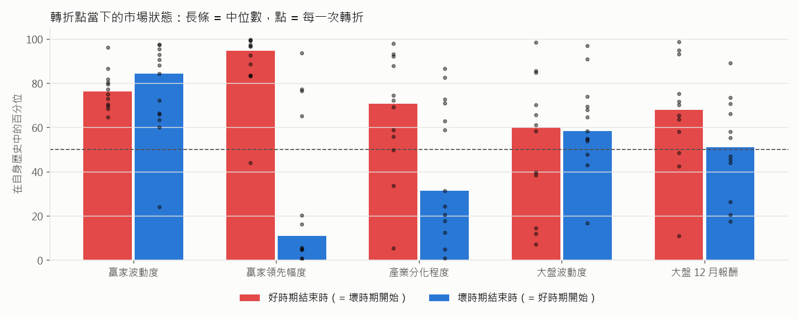
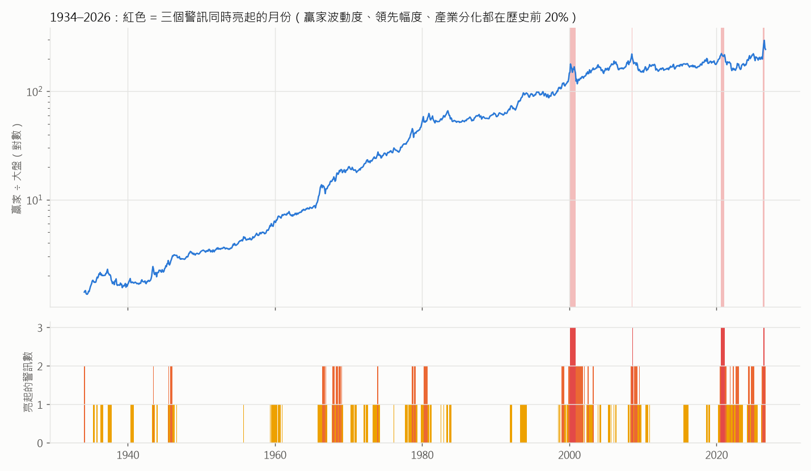

# 動能什麼時候有利、什麼時候該停：從轉折點找共同點

`long-history.md` 發現動能的超額報酬集中在幾段時期。這份文件反過來問：

> 把每一段「好時期」和「壞時期」的起點與終點找出來，它們有沒有共同的特徵？
> 能不能變成一套**事先看得到**的規則，告訴我們什麼時候該用、什麼時候該停？

數字都是實際跑出來的，重現指令在最後（`regimes.py`）。

---

## 先講結論

- **好時期結束時（= 壞時期開始），幾乎都長得一樣：** 動能贏家在過去 12 個月已經大幅甩開大盤，
  贏家變得非常顛簸，市場被一兩個產業主導（產業之間的漲幅差距很大）。白話說就是**題材過熱**。
- **好時期開始時，也幾乎都長得一樣：** 前一個題材剛崩完，贏家領先幅度被打回原點，
  產業之間的差距收斂。白話說就是**題材重新洗牌之後**。
- 把三個特徵做成三盞警示燈（贏家波動度、贏家領先幅度、產業分化程度，各自高於自己歷史的 80 百分位就亮燈）：
  - **0 盞燈：有利。** 本策略未來 12 個月平均贏 SPY 7.6 個百分點，75% 的時候是贏的。
  - **1–2 盞燈：小心。** 平均還是贏，但勝率掉到 56–57%，波動變大。
  - **3 盞燈：停用。** 只出現過 18 個月（2000 網路泡沫頂、2008-07 油價頂、2020-08 → 2021-01 疫情成長股頂、2026-05、06 記憶體頂），
    **之後 12 個月本策略平均輸 SPY 36 個百分點，18 次裡沒有一次贏。**
- 用「亮幾盞燈就減碼 1/3，減下來的放 SPY」放回 1997–2026 的原策略：
  年化 16.8% → 17.9%，Sharpe 0.70 → 0.92，**相對 SPY 的最大回撤從 −52% 降到 −22%**。
  訊號晚 1–2 個月才拿到（資料發佈的延遲）結果也差不多。
- **最大的限制：3 盞燈同時亮只發生過 4 次，而且都在 1999 年以後。** 樣本很少，要當作「強烈警訊」，不是保證。

---

## 一、把一百年切成好時期和壞時期

用 `long-history.md` 第二部分的 French 資料（含下市公司）：動能前 10% 的贏家組合（D10）÷ 大盤（MKT）。
只要相對走勢從高點回落 15% 以上，就算一段「壞時期」；從低點回升 15% 以上，就算一段「好時期」。
1928–2026 一共切出 13 段好時期、13 段壞時期：

| 好時期 | 長度 | 贏家相對大盤 | 這段時期的主題 |
|---|---|---|---|
| 1928-01 → 1932-06 | 4.4 年 | +127% | 大蕭條：防禦股相對抗跌 |
| 1933-07 → 1937-03 | 3.7 年 | +73% | 新政復甦 |
| 1939-03 → 1943-05 | 4.2 年 | +57% | 二戰：戰時經濟 |
| **1943-11 → 1966-04** | **22.4 年** | **+606%** | 戰後繁榮 |
| 1966-10 → 1978-08 | 11.8 年 | +298% | Nifty Fifty 成長股 → 70 年代通膨與能源 |
| 1978-10 → 1980-11 | 2.1 年 | +66% | 能源、原物料（通膨高峰） |
| 1981-09 → 1983-06 | 1.8 年 | +29% | 衰退後的反通膨行情 |
| **1985-01 → 2000-02** | **15.1 年** | **+246%** | 利率長期下降 → 科技股 |
| 2001-01 → 2003-11 | 2.8 年 | +50% | 空頭：防禦股、價值股、房地產 |
| 2004-08 → 2006-01 | 1.4 年 | +30% | 原物料超級循環 |
| 2006-09 → 2008-06 | 1.8 年 | +39% | 原物料、中國需求 |
| 2010-01 → 2020-08 | 10.6 年 | +49% | 很慢的 10 年（平均每年不到 4%） |
| 2022-01 → 2026-06 | 4.4 年 | +90% | 升息衝擊 → 能源 → AI → 記憶體 |

壞時期大致對應 `long-history.md` 表中的那 13 次相對回撤（1932、1937、1966、1978、1981、1983、2000、2006、2008、2020、2026 等）。

**每一段好時期都有一個主題撐著**（戰爭、通膨、利率下降、科技、原物料、AI），
動能策略做的事就是自動跟上那個主題。**主題結束，好時期就結束。**

---

## 二、轉折點當下，市場長什麼樣子

在每一個轉折點，記錄五個「當時就看得到」的數字，換算成它在**自己過去歷史**中的百分位（0 = 史上最低，100 = 史上最高）：

| 指標 | 定義 | 白話 |
|---|---|---|
| 贏家波動度 | 過去 126 天「大型贏家 − 大盤」日報酬的標準差 | 贏家顛不顛 |
| 贏家領先幅度 | 過去 12 個月贏家組合減大盤的報酬 | 贏家跑多遠了 |
| 產業分化程度 | 49 個產業過去 12 個月報酬的標準差 | 是不是一兩個產業獨強 |
| 大盤波動度 | 過去 126 天大盤日報酬的標準差 | 市場平不平靜 |
| 大盤 12 月報酬 | 過去 12 個月大盤漲跌 | 多頭還是空頭 |



| 中位數百分位 | 贏家波動度 | 贏家領先幅度 | 產業分化程度 | 大盤波動度 | 大盤 12 月報酬 |
|---|---|---|---|---|---|
| **好時期結束時**（壞時期開始） | 76 | **95** | **71** | 60 | 68 |
| **壞時期結束時**（好時期開始） | 78 | **11** | **31** | 58 | 51 |

**看得出來的共同點：**

1. **好時期結束時，贏家領先幅度幾乎都在歷史最高的那一段。** 12 次裡有 11 次在 83 百分位以上
   （唯一例外是 1937-03）。題材行情走到最後，贏家和大盤的差距被拉到極端。
2. **好時期開始時，贏家領先幅度通常剛被打回原點。** 已結束的 11 段壞時期裡，有 8 段結束時在 20 百分位以下。
   也就是說，**新的好時期幾乎都從上一個題材崩完之後開始**。
3. **產業分化程度也有同樣的方向：** 好時期結束時偏高（中位數 71），開始時偏低（中位數 31）。
   一兩個產業獨強，代表資金過度集中在一個主題。
4. **贏家波動度在兩種轉折點都偏高（76、78）。** 它代表「要變了」，但不告訴你往哪個方向變，
   所以單獨用它判斷方向不夠，要搭配前兩個。
5. **大盤本身的狀態（波動度、多空）在兩種轉折點差不多**，對分辨轉折方向幫助不大。

**要特別說明一個陷阱：** 「好時期結束時贏家領先幅度很高」有一部分是**必然的**。
好時期就是贏家一直贏，結束那一刻，過去 12 個月的領先幅度當然很高。
所以不能只看轉折點，還要檢查：**在任何一個月，這些指標高的時候，接下來是不是真的比較差？**

---

## 三、往前看的檢驗：指標高的時候，接下來真的比較差嗎？

把 1934–2026 每一個月依指標分成五等分，看贏家組合**接下來 12 個月**贏大盤多少（%）。
分兩段看，前後半段都成立才算數：

| 指標（低 → 高） | 1934–1975 | 1976–2026 |
|---|---|---|
| 產業分化程度 | 10.9, 7.9, 7.9, 4.2, **4.7** | 6.9, 6.2, 3.9, 4.6, **−0.9** |
| 大盤波動度 | 11.1, 9.6, 4.9, 5.1, **4.8** | 7.9, 3.7, 4.9, 2.6, **1.6** |
| 贏家波動度 | 5.8, 9.8, 9.2, 5.8, **5.0** | 6.4, 6.5, 6.4, 1.0, **0.4** |
| 贏家領先幅度 | 7.2, 6.9, 7.1, 7.7, 6.8 | 6.0, 7.0, 4.2, 3.9, **−0.4** |
| 大盤 12 月報酬 | 5.6, 8.7, 8.6, 6.8, 5.9 | 3.9, 6.9, 5.8, 3.6, **0.6** |

- **最穩定的兩個是「產業分化程度」和「大盤波動度」。** 前後兩段都是越高越差。
  動能最有利的環境是：**市場平靜、沒有單一產業獨強**。
- 「贏家波動度」最高的兩組在 1976 年後幾乎沒有超額報酬。
- 「贏家領先幅度」單獨看，在 1976 年以前沒有預測力，1976 年以後最高那組才轉負。
  所以它**單獨用不可靠**，要和其他指標一起看。

---

## 四、三盞燈的計分卡

把轉折點最明顯的三個特徵（贏家波動度、贏家領先幅度、產業分化程度）做成警示燈，
**各自高於自己過去歷史的 80 百分位就亮燈**。百分位只用當時以前的資料計算，不偷看未來。



### 在一百年的資料上（French 贏家組合 D10 相對大盤）

| 亮燈數 | 月數 | 下個月超額（年化） | 未來 12 個月超額 | 未來 12 個月贏的比例 |
|---|---|---|---|---|
| 0 | 761 | +6.7% | +6.5% | 78% |
| 1 | 231 | +7.1% | +4.8% | 63% |
| 2 | 92 | −2.0% | +3.5% | 65% |
| **3** | **16** | **−36.7%** | **−21.0%** | **0%** |

### 放到本策略上（1997–2026，相對 SPY）

| 亮燈數 | 月數 | 下個月超額（年化） | 未來 12 個月超額 | 未來 12 個月贏的比例 |
|---|---|---|---|---|
| 0 | 190 | +10.4% | +7.6% | **75%** |
| 1 | 89 | +6.2% | +10.7% | 57% |
| 2 | 59 | +23.9% | +4.7% | 56% |
| **3** | **18** | **−50.3%** | **−35.7%** | **0%** |

**3 盞燈全亮的月份：** 2000-02 → 2000-10、2008-07、2020-08 → 2021-01、2026-05、2026-06。
正好就是網路泡沫、油價、疫情成長股、記憶體這四個題材的頂部。

1–2 盞燈時，本策略的平均報酬其實還不錯，但勝率掉到五成多，而且這段時間包含了最大的漲幅和最大的跌幅
（例如 1999 年、2026 年 2–4 月）。**1–2 盞燈代表「熱」，3 盞燈代表「過熱」。**

### 變成交易規則

| 1997–2026 | 年化 | 最大回撤 | Sharpe | 每年超額 | 相對 SPY 最大回撤 |
|---|---|---|---|---|---|
| 原策略 | 16.8% | −65.5% | 0.70 | +8.5% | −52.0% |
| 3 盞燈全亮 → 改持 SPY | **20.5%** | −49.6% | 0.85 | +11.1% | −39.3% |
| **亮幾盞減碼幾個 1/3，減下來的放 SPY** | 17.9% | **−46.9%** | **0.92** | +7.9% | **−22.2%** |

| 各時期：年化／Sharpe／相對 SPY 最大回撤 | 原策略 | 3 燈 → SPY | 依燈數減碼 |
|---|---|---|---|
| 2000–2019 | 5.5%／0.35／−52% | 8.9%／0.52／−39% | **9.5%／0.59／−22%** |
| 2016–2026 | 26.4%／1.00／−31% | **29.8%／1.19／−16%** | 25.9%／1.26／−14% |

- **「3 盞燈全亮就停用」報酬最高**，因為它只在最危險的 18 個月出場，其他時候照常參與。
- **「依燈數減碼」最平穩**：Sharpe 最高，相對 SPY 的最大回撤砍到不到一半。
- **兩種都在 2000–2019 那段「動能失效的 20 年」裡明顯改善**，那段時間原策略幾乎沒有贏 SPY。

### 晚 1–2 個月拿到訊號還有用嗎？

French 資料庫大約每月更新一次，實際上會晚 1–2 個月。把訊號往後延：

| 1997–2026 | 不延遲 | 延遲 1 個月 | 延遲 2 個月 |
|---|---|---|---|
| 3 燈 → SPY：年化／Sharpe | 20.5%／0.85 | 20.6%／0.85 | 19.1%／0.79 |
| 依燈數減碼：年化／Sharpe | 17.9%／0.92 | 18.3%／0.90 | 17.2%／0.84 |
| 原策略 | 16.8%／0.70 | | |

延遲 2 個月仍然比原策略好。原因是「過熱」通常會持續好幾個月（2000 年亮了 9 個月）。

---

## 五、限制，以及哪些地方不要過度解讀

1. **3 盞燈全亮只發生過 4 次（2000、2008、2020、2026），全都在 1999 年以後。**
   1934–1975 年從來沒有 3 盞燈同時亮過。結果很一致，但獨立樣本只有 4 個。
2. **1–2 盞燈在 1976 年以前並不代表會變差。** 這套計分卡在現代市場比較靈光，可能是因為
   現代的題材行情更集中、更極端。
3. **這是市場層面的訊號，不是本策略自己的訊號。** 我試過只用本策略入選的 5 檔來算，
   亮燈太早（1999 年整年、2026 年 2–7 月都亮），反而錯過大漲。
   5 檔集中持股本來就永遠「很極端」，要看的是**整個市場的動能**有沒有過熱。
4. **用我們自己的 S&P 500 資料重建這三盞燈，只部分成功**：產業（這裡用個股代替）分化程度和
   French 的相關係數 0.74，領先幅度 0.60，但波動度只有 0.11。重建版的 3 盞燈抓到 2000 和 2026，
   沒抓到 2008 和 2020。目前比較可靠的做法是直接用 French 的日資料計算
   （`25_Portfolios_ME_Prior_12_2_Daily` 和 `49_Industry_Portfolios`），可以接受 1–2 個月延遲。
5. **轉折的起因常常是事件**（升息、戰爭、疫苗消息、油價），但**事件本身沒辦法事先知道**。
   這套方法做的是：**看到「一旦有事件就會很慘」的狀態，就先減碼。**

---

## 實際使用

每個月換股前看一次三盞燈（都是相對自己過去歷史的百分位）：

| 狀態 | 意思 | 建議 |
|---|---|---|
| 0 盞 | 沒有過熱。好時期通常從這裡開始，尤其是剛經歷一次動能崩盤之後 | 照常執行 |
| 1–2 盞 | 題材在升溫 | 照常執行，或減碼 1/3 ～ 2/3 放 SPY |
| 3 盞 | 題材過熱，歷史上 4 次都接著崩 | 停用，改持 SPY；等燈號回到 0–1 盞再回來 |

**目前的狀態（2026-08 底）：亮 2 盞**（贏家波動度在歷史第 97 百分位、領先幅度第 94 百分位，
產業分化程度降到第 73 百分位）。2026-05、06 是 3 盞全亮，接著就是 7 月的記憶體股崩跌。

---

## 重現

```
uv run python research/momentum_effect/long_backtest.py     # 先要有 data-sp500-long/
uv run python research/momentum_effect/ff_history.py
uv run python research/momentum_effect/regimes.py           # 加 --sp500 會另外用自己的資料重建訊號（約 2 分鐘）
```
