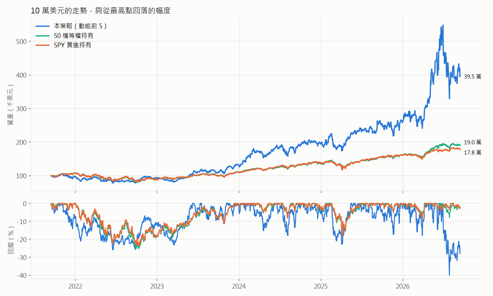
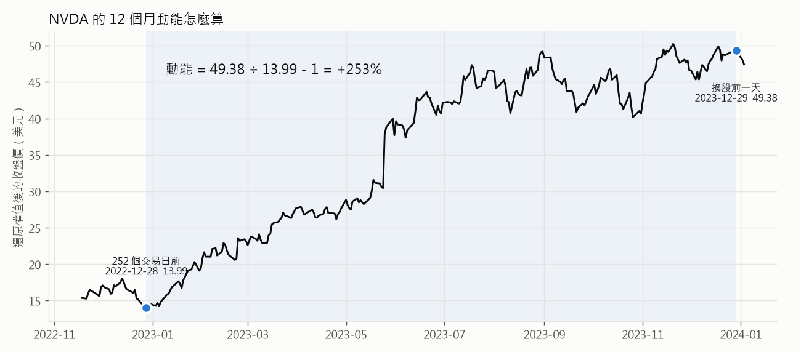
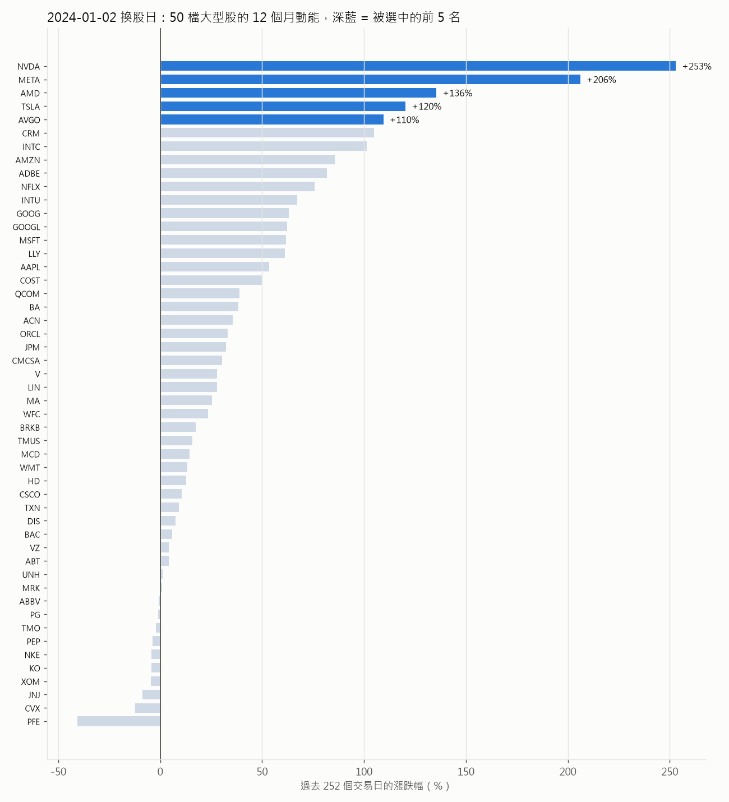
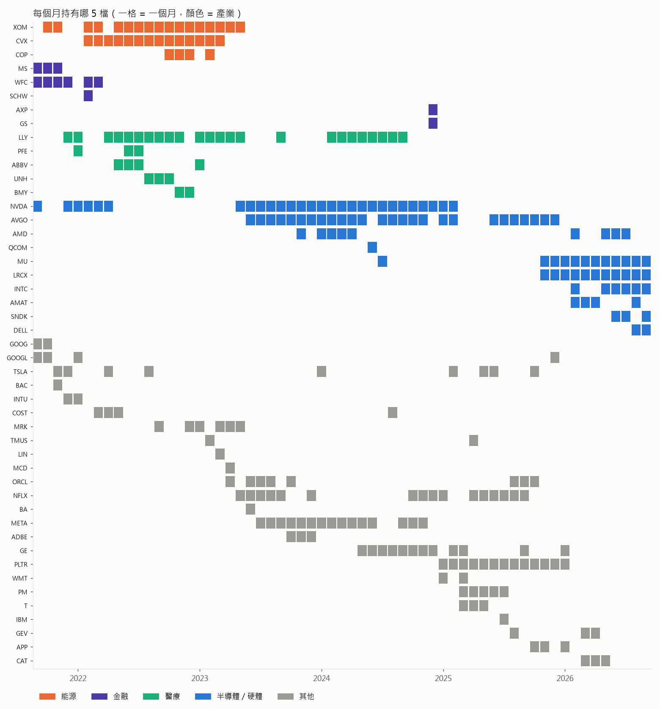
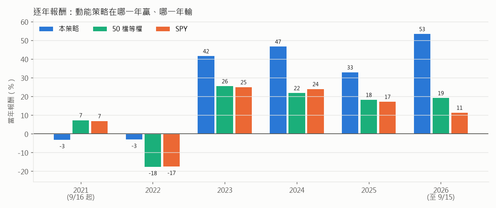

# 大型股動能輪動：買過去一年漲最多的 5 檔，每月換一次

這份文件解釋 `algorithms/momentum_effect.py`（QuantConnect 的
`MomentumEffectAlgorithm`，出自 [Quantpedia #14](https://quantpedia.com/Screener/Details/14)）
實際上在做什麼。

文中的圖和數字都是**真的跑出來的**。LEAN 回測產生交易紀錄和資產曲線；
`explain_figures.py` 會用同一份 `data-sp500/` 資料，自己用 pandas 重算一次
每個月的選股漏斗和 252 日動能，再逐月對照 LEAN 實際選出的 5 檔：
**61 次換股，0 次不符**。所以下面每一個「某個月為什麼持有某檔」的解釋，
都已經對照過引擎的實際行為。

```
uv run run_local.py "Momentum Effect Top5" --data-folder data-sp500
uv run run_local.py "SPY Buy & Hold 2021-2026" --data-folder data-sp500
uv run python research/momentum_effect/explain_figures.py
```

回測期間：**2021-09-16 → 2026-09-15**（原版是 `end_date - 5 年`），
起始資金 10 萬美元。

---

## 一句話版本

> 每個月第一個交易日，從「又大又好買賣」的 50 檔美股裡，挑出**過去 12 個月漲幅最大的 5 檔**，
> 每檔放 20% 的資金，抱一個月，下個月再重新挑一次。

背後的想法是學術上很有名的**動能效應（momentum effect）**：過去 3 到 12 個月
相對強勢的股票，接下來幾個月傾向繼續強勢。這個策略不預測、不看基本面，只做一件事：
**跟著強者走。**

## 結果先講



| | 本策略 | 50 檔等權持有（每月重設） | SPY 買進持有 |
|---|---|---|---|
| 10 萬變成 | **39.5 萬** | 19.0 萬 | 17.8 萬 |
| 年化報酬 | **31.6%** | 13.8% | 12.2% |
| 最大回撤 | **40.0%** | 25.3% | 23.6% |
| Sharpe | 0.76 | — | 0.40 |
| 年化波動 | 30% | — | — |
| 下單次數 | 373 | — | 1 |

中間那一欄是對照組：**同樣那 50 檔股票，但不看動能、每檔等權全部持有**
（pandas 算的，用收盤價、不含手續費）。它只比 SPY 多一點點，說明
**「只挑大型股」這一步本身沒有帶來超額報酬，多出來的報酬幾乎全部來自「從 50 檔裡挑最強 5 檔」這個動作。**

代價也很清楚：波動和回撤大概是大盤的兩倍。而且這 40% 的回撤是在**一個月內**發生的
（2026 年 6 月底 → 7 月底），下面會細講。

---

## 全景

```
  每月第一個交易日 00:00   ① 重建股票池（用「前一個交易日」的資料）
      │   S&P 500 成分股 ~500 檔
      │     └─ 股價 > 5 美元
      │         └─ 成交金額（股價 × 成交量）最大的 100 檔
      │             └─ 其中市值最大的 50 檔   ← 這就是股票池
      │   不在新股票池裡的持股 → 立刻賣掉
      ▼
  同一天 08:00            ② 50 檔各自算「過去 252 個交易日的漲幅」
      │   取漲幅最大的 5 檔 → 每檔目標 20%
      │   不在前 5 的持股 → 賣掉；前 5 裡的 → 買到 / 調整到 20%
      ▼
  開盤                    ③ 08:00 還沒開盤，單子變成開盤市價單，用當天開盤價成交
      │
      ▼
  接下來一整個月什麼都不做，直到下個月第一個交易日
```

---

## ① 動能是什麼：一個數字，就是「一年前到現在漲了幾 %」

```python
security.momentum = self.momp(security, self._lookback)   # lookback = 252
```

`MOMP` 是 LEAN 的 Momentum Percent 指標：

```
動能 = (今天收盤價 ÷ 252 個交易日前的收盤價 − 1) × 100%
```

252 個交易日大約就是一年。以 2024-01-02 那次換股的 NVDA 為例：



| | 日期 | 還原權值收盤價 |
|---|---|---|
| 252 個交易日前 | 2022-12-28 | 13.99 |
| 換股前一天 | 2023-12-29 | 49.38 |
| **動能** | | 49.38 ÷ 13.99 − 1 = **+253%** |

幾個值得注意的細節：

- **只看頭尾兩個點。** 中間怎麼走完全不管。從 14 一路漲到 49 是 +253%；
  先跌到 7 再暴漲到 49 也是 +253%，對策略來說一模一樣。
- **用的是「還原權值」價格。** NVDA 在 2024 年 6 月 1 拆 10，圖中的 13.99 是換算成拆股後的價格，
  否則拆股那天看起來會像暴跌 90%。LEAN 預設就是這樣處理的。
- **用的是前一天的收盤價。** 08:00 還沒開盤，所以最新的資料是前一個交易日的收盤。

---

## ② 選股漏斗：從 500 檔到 5 檔

以 **2024-01-02** 為例，每一層還剩幾檔：

| 步驟 | 條件 | 剩下 |
|---|---|---|
| 起點 | 當天的 S&P 500 成分股 | 503 |
|  | 有價格資料（被收購下市的查不到） | 486 |
| 價格 | 股價 > 5 美元 | 485 |
| 流動性 | 前一天成交金額前 100 名（第 100 名是 **3.72 億美元/天**） | 100 |
| 規模 | 其中市值前 50 名 | 50 |
| 動能 | 其中 12 個月漲幅前 5 名 | **5** |

幾個觀察：

**「股價 > 5 美元」在這裡幾乎沒作用。** 原版是從全美國幾千檔股票裡篩，
這一步會刷掉一大堆雞蛋水餃股。本機版的起點已經是 S&P 500，
61 次選股中每次最多只刷掉 1 檔。

**「成交金額前 100」和「市值前 50」刷掉的是不同的股票。** 被第二步刷掉的 50 檔，
很多其實交易非常熱絡：UBER 當天成交 13.3 億美元、PYPL 10.3 億、MU 7.3 億，
但市值不夠大，所以進不了最後 50 檔。反過來說，最後剩下的 50 檔就是
「大家耳熟能詳的超大型股」：AAPL、MSFT、NVDA、JPM、XOM、JNJ、KO……

**最後一步才是策略的核心。** 50 檔依動能排序：



| 名次 | 股票 | 12 個月漲幅 | |
|---|---|---|---|
| 1 | NVDA | +253% | ✅ 買 |
| 2 | META | +206% | ✅ 買 |
| 3 | AMD | +136% | ✅ 買 |
| 4 | TSLA | +120% | ✅ 買 |
| 5 | AVGO | +110% | ✅ 買 |
| 6 | CRM | +105% | 差 5 個百分點落選 |
| 7 | INTC | +101% | |
| … | 中位數 | +27% | |
| 50 | PFE | −41% | |

這 50 檔的中位數是 +27%，入選的 5 檔平均 +165%。這就是「動能」的意思：
**挑的是明顯甩開同儕的那幾檔。**

---

## ③ 等權 20%，一個月調整一次

```python
targets = [PortfolioTarget(security, 1/len(selected)) for security in selected]
self.set_holdings(targets, True)    # True = 不在名單內的全部清掉
```

每個月第一個交易日，5 檔都會被**拉回各 20%**。這代表兩種交易：

1. **換股**：掉出前 5 的賣光，新進前 5 的買進。
2. **再平衡**：還留在前 5 的，漲太多就賣一點、跌太多就補一點。

用實際成交紀錄舉例。**2024-01-02**（總資產約 12.8 萬，20% ≈ 2.6 萬）：

| 動作 | 股票 | 股數 | 原因 |
|---|---|---|---|
| 賣光 | ADBE | −40 | 上個月第 3，這個月掉出前 5 |
| 賣光 | NFLX | −520 | 上個月第 5，這個月掉出前 5 |
| 減碼 | AVGO | −32 | 還在前 5，但漲超過 20%，砍回 20% |
| 減碼 | META | −1 | 同上，只差一點點 |
| 新買 | TSLA | +106 @ 250.08 ≈ 2.65 萬 | 新進前 5 |
| 新買 | AMD | +178 @ 144.28 ≈ 2.57 萬 | 新進前 5 |
| 不動 | NVDA | | 已經約 20% |

**2024-02-01**：TSLA 一個月跌了 25%，動能掉出前 5 → 全賣；LLY 以 +91% 擠進第 5 名 → 買進約 2.7 萬；
NVDA 一個月漲太多，**賣掉 77 股**砍回 20%。

注意最後這一點：**每個月的再平衡會把贏家的一部分獲利實現掉。**
一檔股票就算連續 28 個月都在前 5 名（NVDA 就是），它在組合裡也永遠只佔約 20%，
不會像買進持有那樣越抱越大。

另外，還有第二種賣出時機：程式在 `on_securities_changed` 裡，**股票一掉出 50 檔的股票池就立刻賣掉**，
不等 08:00 的排名。整段回測發生 10 次，例如 2026-08-03 的 SNDK。
不過股票池也是每月才重建一次，所以實際上這種賣出也只會發生在每個月第一天。

---

## 5 年裡它到底持有了什麼



這張圖最能說明動能策略的性格：**它不是在挑「好公司」，而是在追「當下最熱的產業」。**

| 期間 | 主角 | 發生了什麼 |
|---|---|---|
| 2021 下半年 | 金融（MS、WFC）、GOOG/GOOGL | 疫情後復甦行情 |
| 2022 | **能源**（XOM、CVX、COP）+ 製藥（LLY、ABBV、PFE、UNH） | 俄烏戰爭油價飆漲，大盤跌 17% |
| 2023 中 → 2024 | **AI**：NVDA、AVGO、META、AMD | ChatGPT 帶起的 AI 行情 |
| 2025 | PLTR、NFLX、PM、GE | 輪動到軟體和防禦型股票 |
| 2025 底 → 2026 | **記憶體／半導體設備**：MU、LRCX、INTC、SNDK、AMAT | AI 硬體第二波 |

一些統計：

- 61 個月裡有 **22 個月，5 檔中至少 3 檔屬於同一個產業**。集中度很高。
- 5 年只碰過 **47 檔**不同的股票。持有最久的是 NVDA（28 個月）、AVGO（26）、LLY（24）、XOM（17）。
- 每個月平均換掉 **1.5 檔**：7 個月完全不換，24 個月換 1 檔，23 個月換 2 檔，只有 1 個月換掉 4 檔。
  12 個月的動能變化很慢，所以名單通常很穩定。

---

## 逐年看：它什麼時候贏、什麼時候輸



| 年份 | 本策略 | 50 檔等權 | SPY |
|---|---|---|---|
| 2021（9/16 起） | −3.2% | +7.3% | +6.8% |
| 2022 | **−3.0%** | −17.6% | −17.5% |
| 2023 | **+41.6%** | +25.5% | +25.0% |
| 2024 | **+46.7%** | +21.8% | +24.0% |
| 2025 | **+32.9%** | +18.2% | +17.2% |
| 2026（至 9/15） | **+53.4%** | +19.2% | +11.4% |

**2022 是動能策略的經典好年**：大盤跌 17%，但策略抱的是那年唯一在漲的能源股和製藥股，
全年只跌 3%。

**2021 年 9–12 月則是落後的例子**：市場風向轉換的時候，「過去一年的贏家」
正好是「接下來要輸的」，策略要等好幾個月，12 個月的動能才會反映新的趨勢。

---

## 最大回撤：一個月跌 32%

整段回測的 40% 最大回撤，幾乎全部發生在 **2026 年 7 月**：

| 月份 | 當月報酬 | 持股 |
|---|---|---|
| 2026-04 | +27.6% | MU、LRCX、GEV、AMAT、CAT |
| 2026-05 | +35.3% | MU、INTC、AMD、LRCX、CAT |
| 2026-06 | +24.2% | SNDK、MU、INTC、AMD、LRCX |
| **2026-07** | **−32.1%** | SNDK、MU、INTC、LRCX、AMD |

資產在 2026-06-30 衝到最高約 **54.8 萬**，2026-07-29 跌到約 32.9 萬。
這不是資料錯誤：同一段期間 SNDK 從 2,091 跌到 1,278、MU 從 1,132 跌到約 900、
INTC、LRCX、AMD 也同步下跌，而 SPY 同期是上漲的。

這就是動能策略最有名的弱點，叫**動能崩盤（momentum crash）**：

1. 5 檔全部集中在同一個族群（記憶體／半導體）。
2. 它們漲得最兇，所以動能排名最高，所以策略**全押在它們身上**。
3. 族群反轉時 5 檔一起跌。
4. 7 月 1 日換股時，12 個月動能仍然很高（SNDK +4,722%），所以策略**照樣繼續持有**。
   12 個月的回看期太長，一個月的暴跌幾乎不會改變排名。
5. 策略沒有停損，也沒有波動度控制，只能等下個月再說。

如果只看到 2025 年底為止，策略的數字是：年化 **24.8%**、最大回撤 **25.8%**，
和 SPY 的 23.6% 差不多。**2026 年一年同時貢獻了最多的報酬和最大的回撤。**
這也提醒我們：這種集中持有 5 檔的策略，結果非常依賴少數幾段行情。

---

## 移植到本機時改了什麼（以及對結果的影響）

原版用的是 QuantConnect 雲端的 Morningstar 基本面資料（`Fundamental`），
免費的 LEAN 沒有附。本機的 `CoarseFundamentalDataProvider` 對
`has_fundamental_data` 一律回傳 `false`、`market_cap` 一律回傳 0，
所以**原程式原封不動在本機跑會選不到任何股票**。
改法沿用 `tech_ema_reversion.py` 的做法：

| 原版 | 本機版 | 影響 |
|---|---|---|
| 全美國上市股票 | **S&P 500 成分股**（point-in-time 名單，`data-sp500/`） | 見下方 |
| `f.price`、`f.dollar_volume` | 前一個交易日的原始（未還原）日 K：收盤價、收盤價 × 成交量 | 同一個定義 |
| `f.market_cap` | 成分股權重（股價 × 流通股數，當天正規化） | 排名相同 |
| `f.has_fundamental_data` | 權重非空（有價格資料） | |
| 交易邏輯 | **完全不變** | |

**候選股票池不一樣，這是最大的差異。** 原版的「成交金額前 100 → 市值前 50」
是在全美股裡算的，可能選到 S&P 500 以外的大型股，例如 TSM、ASML 這類美國掛牌的外國公司，
或者在納入 S&P 500 之前就已經很大的 PLTR（2024-09 才納入）、APP（2025-09 才納入）。
這幾檔都是這段期間的強勢股，所以在雲端跑的結果應該會有差異，但方向無法事先確定。

另外兩個和其他本機策略共通的限制（詳見 `README.md` 的 Constituents universes）：

- **被收購下市的公司沒有資料**（例如 ATVI、SIVB、FRC），它們永遠不會被選到。這是倖存者偏差。
- **GOOG 和 GOOGL 會同時入選。** 2021-09、2021-10 兩個月，組合裡有 40% 是 Alphabet
  （兩種股份各 20%）。雲端版也把兩種股份當成兩檔不同的股票，所以原版同樣可能發生，
  但本機版的市值代理值把 Alphabet 算大了一倍，更容易入選。

還有一個移植時抓到的陷阱，記在這裡：從 `self.history` 拿到的某些 bar 有 NaN，
而 Python 的 `sorted()` 碰到 NaN **不會報錯，只會默默排錯**，把 MSFT、NVDA
這種成交金額最大的股票擠出前 100 名。修正前 LEAN 選出的股票和 pandas 重算的結果有 22 個月不同；
加上 `dollar_volume > 0`（NaN 比較永遠是 False）的檢查之後，就是 0 次不符。

最後，LEAN 報表裡的 `Alpha`、`Beta`、`Treynor Ratio` 是 0，因為本機的 daily-only
資料沒有 LEAN 內部 benchmark 需要的小時線資料。那不代表策略沒有市場曝險。
和 SPY 的比較請看上面的表格，它們是在同一份資料上另外跑的。

---

## 總結

| 問題 | 答案 |
|---|---|
| 它在賭什麼？ | 過去一年漲最多的大型股，下個月還會繼續相對強勢 |
| 賺錢的來源 | 抓到 2022 能源、2023–24 AI、2026 記憶體這幾波大趨勢 |
| 虧錢的來源 | 趨勢反轉（2021 年底）、族群集體崩跌（2026-07） |
| 風險控制 | 只有「大型、流動性高」和「5 檔等權」；**沒有停損、沒有擇時、沒有波動度控制** |
| 適合誰 | 能承受單月 −30%、並且願意長期執行的人 |
| 最重要的一句話 | **年化報酬約是大盤的 2.6 倍，最大回撤約是大盤的 1.7 倍，而且大部分的好壞都集中在少數幾個月。** |
