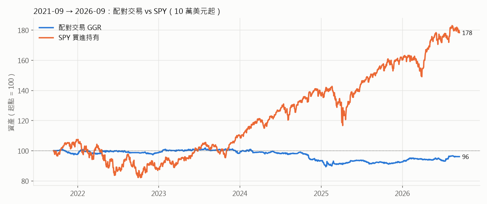
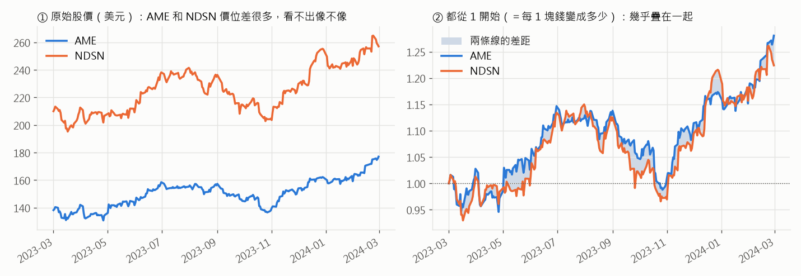
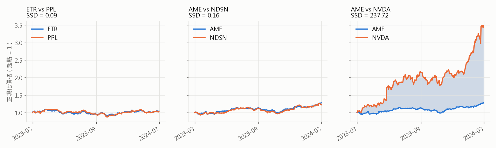
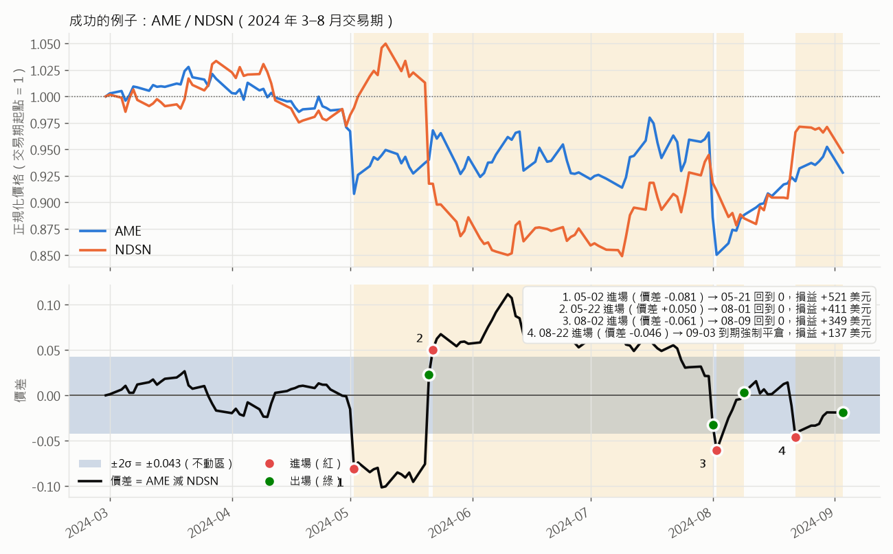
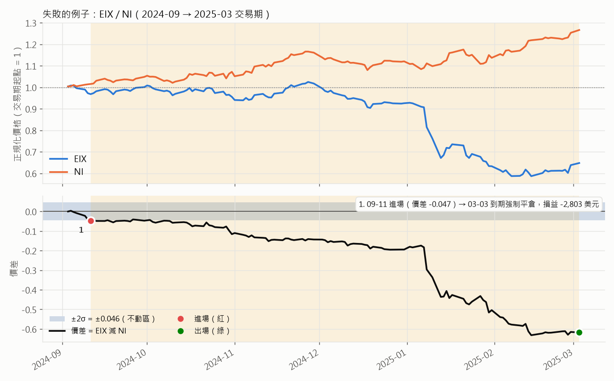
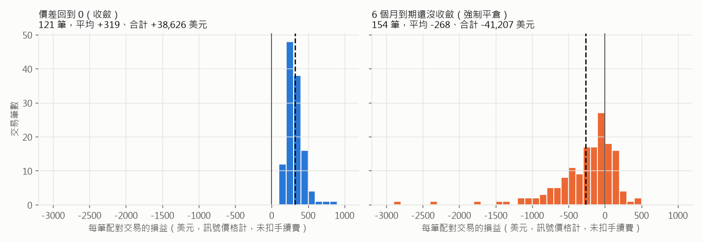
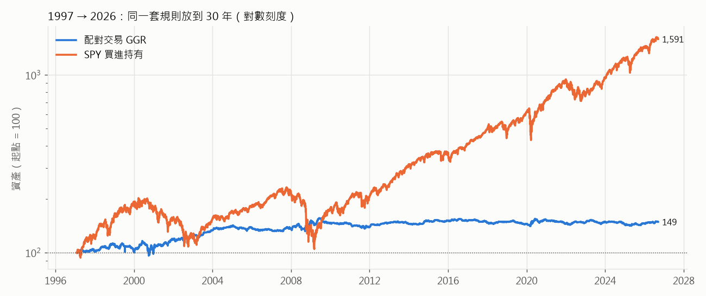
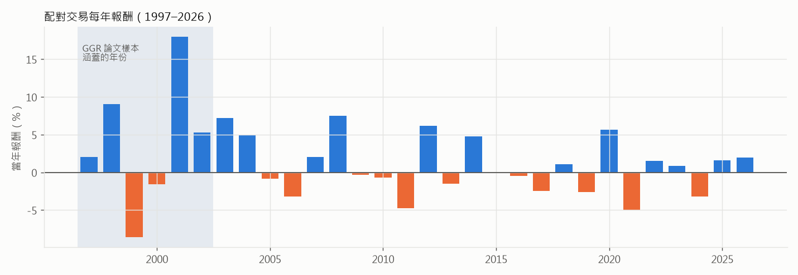

# 配對交易（Pairs Trading）：找兩檔「走勢像雙胞胎」的股票，分開時押它們會回來

這份文件解釋 `algorithms/pairs_trading.py` 在做什麼。策略來源是 Quantpedia 的
[Pairs Trading with Stocks](https://quantpedia.com/strategies/pairs-trading-with-stocks)，
也就是 Gatev、Goetzmann、Rouwenhorst（2006，以下簡稱 GGR）論文的「距離法」。

文中的圖和數字都是**真的跑出來的**。交易和資產曲線來自 LEAN 回測。`explain_figures.py`
用同一份 `data-sp500/` 資料，自己用 numpy 重算一次每期的配對，再和 LEAN log 逐期對照：
**11 次配對形成，220 組配對，0 組不符**（SSD 誤差 < 0.0001）。

```
uv run run_local.py "Pairs Trading GGR" --data-folder data-sp500
uv run run_local.py "SPY Buy & Hold 2021-2026" --data-folder data-sp500
uv run run_local.py "Pairs Trading GGR 1997-2026" --data-folder data-sp500-long
uv run python research/pairs_trading/explain_figures.py
```

主回測期間：**2021-09-16 → 2026-09-15**，起始資金 10 萬美元。股票池用 S&P 500 成分股（每天的歷史成分，不是今天的名單）。

---

## 一句話版本

> 每半年用過去 12 個月的股價，從 S&P 500 裡找出 20 對「走勢幾乎一模一樣」的股票。
> 接下來 6 個月裡，只要某一對突然分開（差距超過平常的 2 倍標準差），
> 就**買進跌比較多的那檔、放空漲比較多的那檔**，等兩條線再碰在一起時平倉賺差價。

這是一種**市場中性**策略：每一對都是一多一空、金額一樣，所以大盤漲跌對它影響很小。
它賺的不是「股票會漲」的錢，而是「兩檔很像的股票偶爾分開，然後又靠回來」的錢。

---

## 結果先講



| | 配對交易 GGR | SPY 買進持有 |
|---|---|---|
| 10 萬變成 | **9.6 萬** | 17.8 萬 |
| 年化報酬 | **−0.80%** | 12.25% |
| 最大回撤 | **12.2%** | 23.6% |
| 年化波動 | **3.5%** | 13.7% |
| Sharpe | −1.27 | 0.40 |
| 下單次數 / 手續費 | 1,049 筆 / 1,072 美元 | 1 筆 |

三個重點：

1. **策略本身確實是「中性」的**。2022 年 SPY 一度從高點跌了 20% 以上，配對交易幾乎沒有感覺（那條藍線很平），波動只有 SPY 的四分之一。
2. **但這 5 年它不賺錢**。扣掉手續費之後小虧 4%。
3. **Sharpe 是 −1.27，看起來很糟，一部分是會計造成的**。Sharpe 會扣掉無風險利率（這幾年大約 4–5%），而 LEAN 裡閒置的現金不會生利息。真實帳戶的現金和放空所得是有利息的，所以實際上會好一些，但年化報酬接近 0 這件事不會變。

拉長到 30 年（後面有一節專門講），結論是：**這個策略在 1997–2002 年還有效，之後一路變弱，2015 年以後幾乎等於 0**。

---

## 第 1 步：把股價「正規化」，才能比較長得像不像

AME（工業設備）一股 140 美元，NDSN（工業設備）一股 210 美元。直接畫在一起看不出像不像。
GGR 的做法是：**每檔股票都從 1 開始**，也就是「第一天投 1 塊錢，之後每天變成多少錢」（含股息）。



數字例子（2023-03-01 → 2024-02-29 的形成期）：

| | 第一天價格 | 最後一天價格 | 正規化後最後一天 |
|---|---|---|---|
| AME | 138.26 | 177.05 | 177.05 ÷ 138.26 = **1.281** |
| NDSN | 210.03 | 257.10 | 257.10 ÷ 210.03 = **1.224** |

正規化之後，兩條線一整年幾乎疊在一起（右圖），中間淺藍色的縫就是兩者的差距。

## 第 2 步：用「距離」(SSD) 挑出最像的 20 對

「像不像」用一個很直白的數字衡量：**每天兩條正規化線的差距，平方之後加總**（Sum of Squared Deviations，SSD）。
線越貼近，SSD 越小。

```
SSD = Σ (A 正規化價格 − B 正規化價格)²     （加總 252 個交易日）
```



| 配對 | SSD | 說明 |
|---|---|---|
| ETR / PPL（都是電力公司） | 0.09 | 該期最像的一對，兩條線幾乎看不出差別 |
| AME / NDSN（都是工業設備） | 0.16 | 該期第 12 名 |
| AME / NVDA | 237.72 | NVDA 一年漲了 3.5 倍，完全不像 |

2024-03-01 那次，有完整一年資料的成分股共 484 檔，可以組出 116,883 對；**所有配對 SSD 的中位數是 8.19**。
被選中的 20 對 SSD 都在 0.09–0.21 之間，是最前面的 0.02%。

挑選的規則（照 GGR）：

1. 每檔股票找出「跟它 SSD 最小的那一檔」當它的最佳搭檔。
2. 去掉重複，依 SSD 由小到大排，取前 20 對。
3. 同一家公司的不同股票類別（GOOG/GOOGL、FOX/FOXA、NWS/NWSA）排除，它們本來就是同一檔，不算配對。

這期選到的 20 對：

| # | 配對 | SSD | σ | 產業 |
|---|---|---|---|---|
| 1 | ETR / PPL | 0.089 | 0.0185 | 電力 |
| 2 | CNP / ED | 0.101 | 0.0200 | 電力 |
| 3 | CMS / DTE | 0.107 | 0.0205 | 電力 |
| 4 | CMS / NI | 0.109 | 0.0196 | 電力 |
| 5 | ETR / SRE | 0.120 | 0.0217 | 電力 |
| 6 | CPT / MAA | 0.124 | 0.0181 | 公寓 REIT |
| 7 | KO / YUM | 0.131 | 0.0215 | 民生消費 |
| 8 | GPC / LKQ | 0.132 | 0.0212 | 汽車零件 |
| 9 | CNP / LNT | 0.141 | 0.0142 | 電力 |
| 10 | CPT / UDR | 0.144 | 0.0185 | 公寓 REIT |
| 11 | CVX / XOM | 0.146 | 0.0238 | 石油 |
| 12 | AME / NDSN | 0.159 | 0.0213 | 工業設備 |
| 13 | KMB / PEP | 0.174 | 0.0260 | 民生消費 |
| 14 | AEE / EXC | 0.175 | 0.0254 | 電力 |
| 15 | BRKB / MA | 0.182 | 0.0251 | 金融 |
| 16 | AWK / EVRG | 0.185 | 0.0241 | 水電公用事業 |
| 17 | MA / V | 0.193 | 0.0226 | 支付 |
| 18 | FE / SRE | 0.202 | 0.0244 | 電力 |
| 19 | MCO / SPGI | 0.206 | 0.0179 | 信評 |
| 20 | BMY / PFE | 0.206 | 0.0285 | 製藥 |

**SSD 完全不看產業，但選出來的大多是同產業**，這是很好的直覺驗證：同產業的公司受同樣的消息影響，所以走勢像。
不過也看得出一個偏誤：**20 對裡有 9 對是電力公用事業**。這 5 年累計下來，出現最多次的 12 檔股票（CMS 24 次、AEE 15、DUK 15、WEC 13…）全部是電力股。
原因很簡單：波動越小的股票，SSD 天生就越小，所以 SSD 會偏好「本來就不太動」的股票。

σ（標準差）是**形成期裡價差（A − B）的標準差**，下一步會用到。

## 第 3 步：交易期，分開超過 2σ 就進場，碰回來就出場

形成期結束後，接下來 6 個月是交易期。每檔股票**再重新從 1 開始算**（以形成期最後一天的收盤價為基準），每天收盤後看：

```
價差 = A 的正規化價格 − B 的正規化價格

|價差| > 2σ        → 進場：買進便宜的（正規化價格低的），放空貴的，各投入總資產的 5%
價差穿過 0         → 出場：兩條線碰在一起了，平倉
6 個月到期          → 不管有沒有碰回來，全部平倉，重新選 20 對
```

同一對在 6 個月裡可以進出好幾次。訊號在收盤後產生，下一個交易日開盤成交（LEAN 的日線行為；GGR 也是等一天才交易，避免買賣價差的反彈）。

### 成功的例子：AME / NDSN



用第 1 筆交易逐步算（σ = 0.0213，所以 2σ = **0.0426**）：

| | AME | NDSN |
|---|---|---|
| 基準價（2024-02-29 收盤） | 177.05 | 257.10 |
| **2024-05-02 收盤** | 160.75 → 160.75 ÷ 177.05 = **0.908** | 254.34 → 254.34 ÷ 257.10 = **0.989** |

- 價差 = 0.908 − 0.989 = **−0.081**，絕對值超過 0.0426 → 進場。
- AME 比較低（相對便宜）→ **買進 AME 30 股**（約 4,822 美元）；NDSN 比較高 → **放空 NDSN 19 股**（約 4,832 美元）。兩邊各約總資產的 5%。
- **2024-05-21 收盤**：AME 166.45（0.940），NDSN 235.90（0.918），價差 = **+0.023**，穿過 0 → 出場。

| 部位 | 計算 | 損益 |
|---|---|---|
| 多 AME 30 股 | 30 × (166.45 − 160.75) | +171 |
| 空 NDSN 19 股 | −19 × (235.90 − 254.34) | +350 |
| **合計** | | **+521 美元** |

注意兩邊**都**賺：AME 漲了，NDSN 跌了。但就算兩檔一起漲或一起跌，只要「差距縮小」就會賺，這就是市場中性。

這組在這 6 個月裡共進出 4 次，3 次碰回 0，最後 1 次到期平倉也小賺，合計 **+1,418 美元**。

### 失敗的例子：EIX / NI



兩家都是電力公司，形成期走勢很像。2024-09-11 價差 −0.047（剛好超過 2σ = 0.0465），策略**買進 EIX 64 股、放空 NI 154 股**。

結果價差不但沒回來，還一路拉大。EIX 是南加州電力（Southern California Edison）的母公司，
2025 年 1 月洛杉磯大火之後，市場擔心它要承擔野火賠償責任，股價大跌；NI 則繼續上漲。

| 部位 | 進場 → 2025-03-03 到期 | 損益 |
|---|---|---|
| 多 EIX 64 股 | 75.88 → 50.02 | −1,655 |
| 空 NI 154 股 | 31.76 → 39.21 | −1,147 |
| **合計** | | **−2,803 美元** |

這一筆就虧掉了將近 3% 的總資產，等於 **5 筆以上的成功交易**才補得回來。

這就是配對交易最大的風險：**它假設「分開是暫時的」**。
如果分開是因為某一家公司發生了真正的變化（災害、併購、財報暴雷），兩條線就永遠不會回來了。

## 第 4 步：把所有交易放在一起看



5 年共 275 筆完整的配對交易（另有 1 筆在回測結束時還開著）：

| | 筆數 | 勝率 | 平均損益 | 合計 | 持有天數（中位數） |
|---|---|---|---|---|---|
| 價差回到 0（收斂） | 121 | **100%** | +319 | +38,626 | 43 天 |
| 到期還沒收斂 | 154 | 26% | −268 | −41,207 | 113 天 |
| **全部** | 275 | | | **−2,580** | |

（以訊號當天的收盤價計，未扣手續費。實際虧損 3,953 美元 = 2,580 + 手續費 1,072 + 隔天開盤成交的價差。）

這張圖是理解這個策略最重要的一張：

- **收斂的交易一定賺錢**，因為出場條件就是「差距回到 0」，而進場時差距至少 2σ。每筆大約賺 2σ × 5% 的資產 ≈ 300 美元，很穩定但很小。
- **沒收斂的交易大多虧錢，而且偶爾虧很大**（左尾拖到 −2,800）。
- 這 5 年裡，**沒收斂的比收斂的多**（154 對 121），兩邊一抵銷剛好打平，再扣掉手續費就變小虧。

平均每天大約有 11.7 對是開著的，也就是總曝險大約是資產的 117%（多 58%、空 58%）。

---

## 拉長到 30 年：為什麼 GGR 論文的數字跑不出來？

GGR 論文（1962–2002）報告的是年化約 11%、Sharpe 1.22。同一套規則放到 1997–2026：





| | 配對交易 GGR | SPY 買進持有 |
|---|---|---|
| 年化報酬 | 1.35% | 9.79% |
| 最大回撤 | 17.5% | 55.1% |
| 年化波動 | 4.7% | 16.1% |
| 手續費（30 年） | 13,049 美元 | 1 美元 |

分段的年化報酬：

| 期間 | 年化 |
|---|---|
| 1997–2002（和 GGR 樣本重疊） | **3.8%** |
| 2003–2008 | 2.9% |
| 2009–2014 | 0.4% |
| 2015–2020 | 0.1% |
| 2021–2026 | −0.5% |

（1997 從 2 月開始，2026 到 9 月中為止，兩年都不是完整一年。）

兩個觀察：

1. **獲利一路衰退**。GGR 論文發表後，學術界後續的研究（例如 Do & Faff 2010）也發現 2002 年之後距離法的獲利明顯下降，一般的解釋是：這個方法太有名、太容易複製，套利空間被大家吃掉了。
2. **它在崩盤時很好用**。2008 年 SPY 大跌，配對交易這一年是 **+7.5%**；2001、2002 年空頭也都是正報酬。這是市場中性策略真正的價值：和大盤低相關。

就算在 1997–2002，這裡也只有 3.8%，遠低於論文的 11%。主要原因：

- **股票池不同**。GGR 用的是 NYSE/AMEX/NASDAQ 全部（流動性過濾後），包括很多小型股；這裡只有 S&P 500 大型股，定價效率高得多，偏離也更小。
- **論文的收益有一部分來自買賣價差反彈**（bid-ask bounce），GGR 自己估算過，等一天再交易後報酬會降低；這裡一律在隔天開盤成交。
- **閒置現金沒有利息**。LEAN 的現金不計息，而平均只有一半左右的配對是開著的。
- **生存者偏差**：越早的年份，有越多下市的股票抓不到資料（見 `research/momentum_effect/long-history.md` 的說明），所以 1990 年代的股票池並不完整。

---

## 這個實作和原文的差異

| 項目 | GGR / Quantpedia | 這裡 |
|---|---|---|
| 股票池 | NYSE/AMEX/NASDAQ 全部，去除流動性差的 | 當時的 S&P 500 成分股，且形成期 252 天資料完整 |
| 價格 | 含息總報酬指數 | LEAN 的 Adjusted 價格（同樣含息還原） |
| 形成 / 交易期 | 12 個月 / 6 個月 | 252 個交易日 / 6 個月（每個月初換期） |
| 選配對 | 每檔找最小 SSD 的搭檔，取前 20 對 | 一樣；另外排除同公司不同類別股 |
| 進場 / 出場 | 2σ 分開進場、價格交叉出場、到期平倉 | 一樣 |
| 重疊的投資組合 | 論文每個月都開一個新的 6 個月組合（6 個重疊） | 只有一組，每 6 個月整組換掉 |
| 部位大小 | 每對 1 塊錢多、1 塊錢空（committed capital） | 每對兩邊各總資產的 5%，進場時決定股數，持有期間不再調整 |
| 成交 | 訊號後等一天 | 收盤訊號，隔天開盤成交；含 LEAN 預設手續費 |

### 實作上踩到的兩個坑

1. **同一檔股票可能同時在兩組配對裡**（例如 DTE/LNT 和 EVRG/LNT 一個要做多 LNT、一個要放空 LNT）。
   一開始每組各自下單，平倉時第一張單會讓 LNT 從淨空 3 股翻成空 109 股，因保證金不足被拒絕，留下了殘單。
   現在的寫法是**每天把所有配對的部位按股票加總成「目標股數」，只下差額**，而且先下減少曝險的單。
2. **日線資料每天會觸發兩次 `on_data`**（16:00 和 00:00），而 16:00 下的市價單要到隔天開盤才成交，
   第二次 `on_data` 會以為還沒下單而重複下。現在計算差額時會把還沒成交的掛單算進去。

改完之後 5 年回測 **0 張被拒單**。30 年回測裡還有 5 張單（1999-01、2015-01/02 兩次）在 20 對幾乎全部開著、總曝險接近 200%（保證金上限）時被拒，隔天會自動重試；對結果影響很小，但這代表 5% 一邊的部位大小在極端情況下會碰到槓桿上限。

---

## 參數

都可以在 `variants.py` 或 QuantConnect 的 Parameters 面板裡改：

| 參數 | 預設 | 意思 |
|---|---|---|
| `formation_days` | 252 | 形成期長度（交易日） |
| `trading_months` | 6 | 交易期長度（月），也是換配對的頻率 |
| `pair_count` | 20 | 交易幾對 |
| `entry_std` | 2.0 | 價差超過幾個 σ 進場 |
| `leg_weight` | 0.05 | 每一邊（多或空）佔總資產的比例 |

## 檔案

| 檔案 | 內容 |
|---|---|
| `algorithms/pairs_trading.py` | LEAN 演算法 |
| `research/pairs_trading/explain_figures.py` | 重算配對、對照 LEAN、畫圖、印出本文所有數字 |
| `research/pairs_trading/trades.csv` | 5 年回測每一筆配對交易（從 LEAN log 解析） |
| `results/pairs_trading_ggr/` | 5 年回測結果 |
| `results/pairs_trading_ggr_1997_2026/` | 30 年回測結果 |
