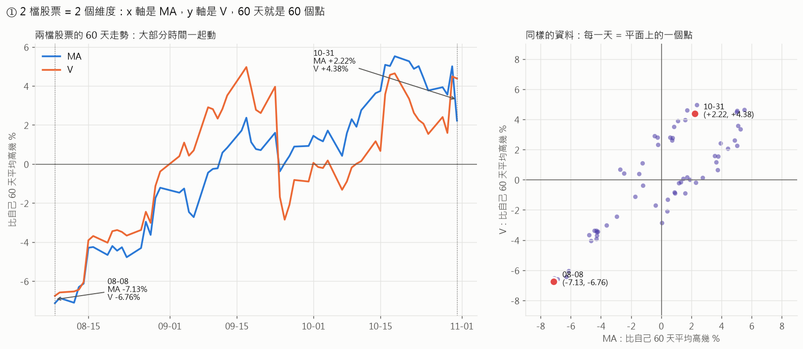
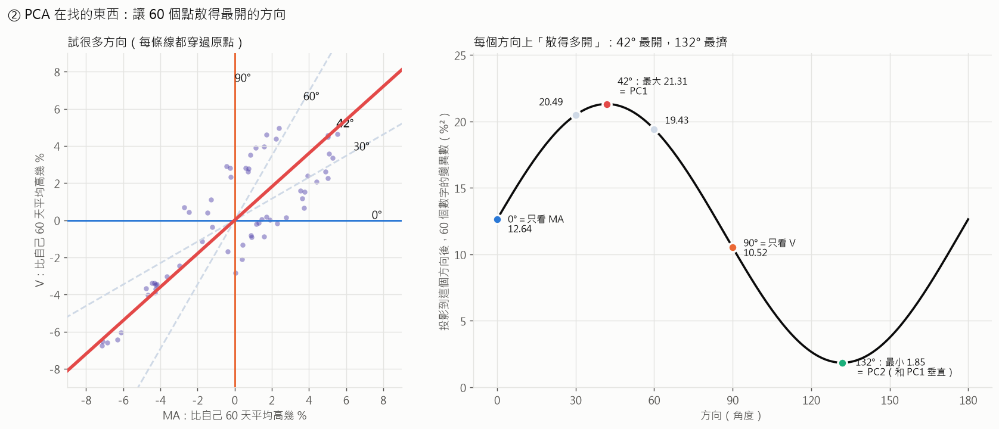
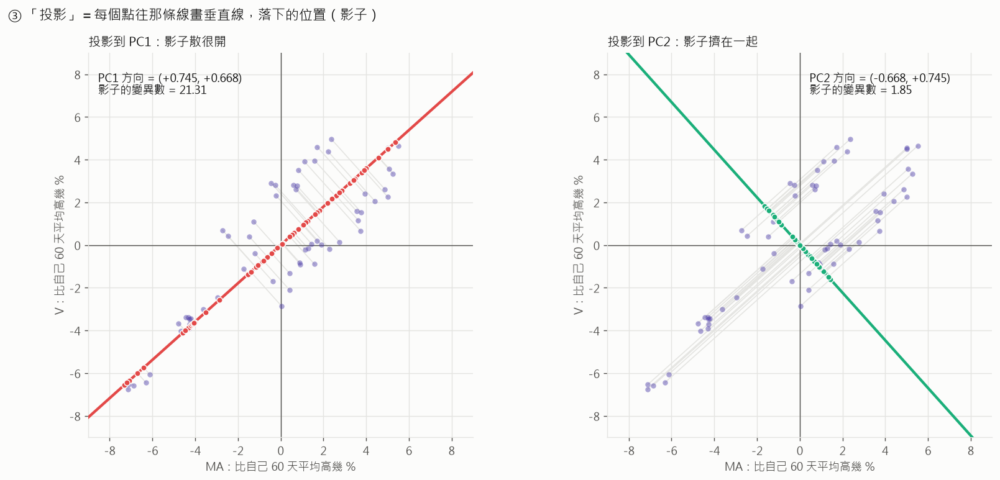
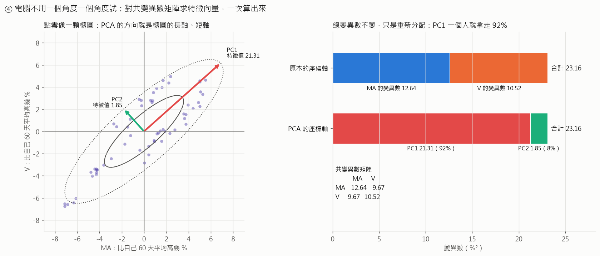
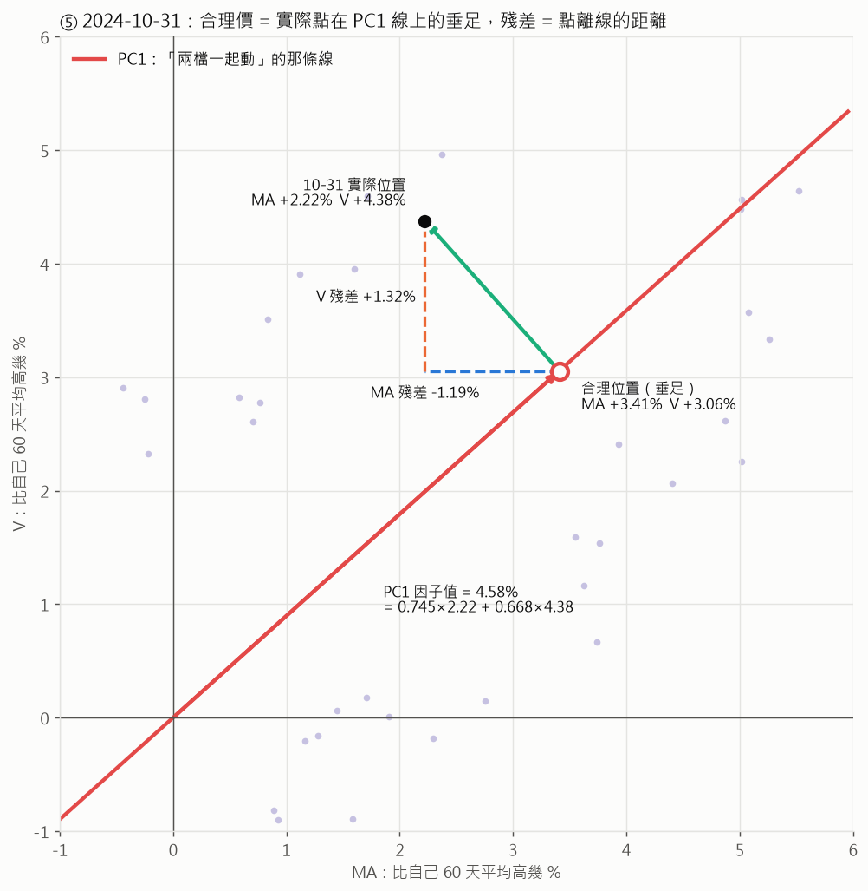
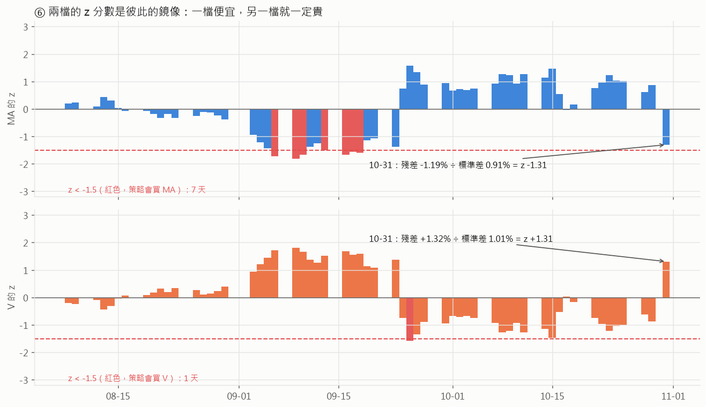

# 用 2 檔股票把 PCA 畫出來

[`strategy-explained.md`](strategy-explained.md) 裡的 PCA 是在 20 檔股票上做的，
也就是 20 個維度，沒辦法畫。這份文件把同一套計算**縮小成 2 檔股票、取 1 個主成分**，
讓每一步都能畫在平面上。

- 股票：**MA（Mastercard）** 和 **V（Visa）**，兩家都是刷卡公司，大多一起漲跌。
- 期間：和主文件的例子一樣，是 **2024-11-01 換股前的 60 個交易日**（2024-08-08 → 2024-10-31）。
- 計算：和策略程式**完全一樣**（取 log → 減平均 → PCA → OLS → z 分數），只是股票從 20 檔變 2 檔、主成分從 3 個變 1 個。

圖和數字都是用 `data-sp500/` 的真實資料算出來的：

```
uv run --group pca python research/pca_stat_arbitrage/pca_2d_figures.py
```

---

## ① 2 檔股票 = 2 個維度，每一天 = 平面上的一個點



先做和策略一樣的預處理：每檔股票取 log，再減掉自己 60 天的平均。
得到的數字可以讀成「**今天比自己 60 天平均高或低幾 %**」。

| 日期 | MA | V | 在右圖的位置 |
|---|---|---|---|
| 08-08 | −7.13% | −6.76% | 左下角那個紅點 |
| 10-31 | +2.22% | +4.38% | 右上方那個紅點 |

左圖是平常看股價的方式：兩條線、時間軸。右圖是同一份資料換個方式看：
**x 軸是 MA、y 軸是 V，每一天變成一個點，60 天就是 60 個點。**

因為兩檔大多一起漲跌，60 個點會排成一條從左下到右上的斜帶。

> 這就是「維度」的意思：有幾檔股票，就有幾個座標軸。
> 20 檔股票時，每一天是 20 維空間裡的一個點，只是畫不出來而已。

---

## ② PCA 在找什麼：讓點散得最開的方向



拿一根穿過原點的尺（一個方向），把 60 個點都**投影**到尺上。每個點會在尺上得到一個數字，
60 個點就是 60 個數字。再看這 60 個數字**散得多開**，也就是變異數有多大。

左圖試了幾個方向，右圖把 0° 到 180° 每個方向的變異數都畫出來：

| 方向 | 意思 | 變異數（%²） |
|---|---|---|
| 0° | 只看 MA | 12.64 |
| 30° | 偏 MA，混一點 V | 20.49 |
| **42°** | **MA 和 V 一起看** | **21.31 ← 最大，這就是 PC1** |
| 60° | 偏 V，混一點 MA | 19.43 |
| 90° | 只看 V | 10.52 |
| **132°** | 一檔漲、另一檔跌 | **1.85 ← 最小，這就是 PC2** |

PCA 做的事情就是：**找出變異數最大的方向，叫它 PC1；再找和 PC1 垂直、變異數次大的方向，叫它 PC2**，依此類推。

2 維的時候，和 PC1 垂直的方向只剩一個，所以 PC2 剛好就是變異數最小的方向（132° = 42° + 90°）。

為什麼要「散得最開」？因為散得越開，這個方向上的資訊就越多。
如果只能用一個數字描述每一天，選 42° 方向上的位置，能保留最多的變化。

**為什麼是 42°，不是 45°？** 因為 MA 的變異數（12.64）比 V（10.52）大，
程式只減了平均、沒有除以標準差，所以**波動大的股票會把 PC1 拉向自己那一邊**。
主文件提到，20 檔的時候 PC2 幾乎就是 SMCI 一檔，原因一樣，只是誇張很多。

---

## ③ 「投影」是什麼：每個點在那條線上的影子



投影就是**從每個點往那條線畫一條垂直線，落下的位置**，像光從正上方照下來形成的影子。

- **左圖，投影到 PC1：** 紅色的影子從 −7 一路分布到 +5，散得很開，變異數 21.31。
- **右圖，投影到 PC2：** 綠色的影子都擠在原點附近，變異數只有 1.85。

所以用 PC1 上的影子位置來描述每一天，幾乎沒有損失太多資訊。被丟掉的只有 PC2 那一點點，
也就是「MA 和 V 走得不一樣」的部分。

---

## ④ 電腦實際的算法：共變異數矩陣的特徵向量



上面「試每一個角度」只是為了好懂，電腦不會這樣做。實際的算法是：

**第 1 步：算共變異數矩陣**，也就是每兩檔股票「一起動」的程度。

|  | MA | V |
|---|---|---|
| MA | 12.64 | 9.67 |
| V | 9.67 | 10.52 |

對角線是各自的變異數。9.67 是兩檔的共變異數，數字越大，代表越常一起動。

**第 2 步：求這個矩陣的特徵向量和特徵值。** 數學上可以證明：

- **特徵向量就是散得最開的那些方向**：(0.745, 0.668) 和 (−0.668, 0.745)，和②試出來的 42°、132° 一模一樣。
- **特徵值就是每個方向上的變異數**：21.31 和 1.85。

從圖上看，60 個點像一顆傾斜的橢圓。**PC1 是橢圓的長軸，PC2 是短軸**，
特徵值決定長軸、短軸有多長。

**總變異數不會變，只是重新分配。** 右圖上下兩條長度一樣：

```
原本的座標軸：MA 12.64 + V 10.52  = 23.16
PCA 的座標軸：PC1 21.31 + PC2 1.85 = 23.16
```

所以 PC1 解釋了 21.31 ÷ 23.16 = **92%**。主文件說「前 3 個主成分解釋 88%」，就是同一個算法。

策略程式裡的 `PCA().fit(sample)` 做的就是這兩步。

---

## ⑤ 合理價 = 垂足，殘差 = 點離線的距離



這張圖把 10-31 那天放大來看，策略的「合理價」和「殘差」在這裡變成了很直觀的幾何：

**1. 因子值 = 影子離原點多遠（紅色箭頭）**

```
PC1 因子值 = 0.745 × MA + 0.668 × V
           = 0.745 × 2.22% + 0.668 × 4.38%
           = 4.58%
```

意思是「這天兩檔**一起**往上的程度是 4.58%」。程式裡的 `np.dot(sample, pca_model.components_.T)` 算的就是這個。

**2. 合理位置 = 實際點在 PC1 線上的垂足（白色圓圈）**

```
MA 的合理位置 = 0.745 × 4.58% = +3.41%
V  的合理位置 = 0.668 × 4.58% = +3.06%
```

如果兩檔**完全只**跟著共同走勢動，10-31 那天應該在這個位置。

策略是用 OLS 迴歸算合理價的，它算出來的斜率剛好就是 0.745 和 0.668，截距是 0。
所以**迴歸的合理價就是這個垂足**，兩種說法是同一件事。

**3. 殘差 = 實際位置 − 合理位置（綠色箭頭）**

| | 實際 | 合理 | 殘差 |
|---|---|---|---|
| MA | +2.22% | +3.41% | **−1.19%**（落後共同走勢，便宜） |
| V | +4.38% | +3.06% | **+1.32%**（超前共同走勢，貴） |

綠色箭頭和 PC1 線**垂直**，所以殘差就是「點離線有多遠」。
被 PC1 解釋掉的部分沿著線走，解釋不了的部分垂直於線。

---

## ⑥ z 分數：今天離線的距離，是平常的幾倍



每一天都可以算出殘差，60 天就有 60 個殘差。看它們平常大概多大：

| | 殘差標準差（平常的距離） | 10-31 的殘差 | z |
|---|---|---|---|
| MA | 0.91% | −1.19% | −1.19 ÷ 0.91 = **−1.31** |
| V | 1.01% | +1.32% | +1.32 ÷ 1.01 = **+1.31** |

圖上可以看到三件事：

1. **兩檔的 z 是彼此的鏡像**，每一天都是。因為 2 維扣掉 PC1 之後只剩 PC2 一個方向，
   點一離開斜線，一定是一檔在線的一邊、另一檔在另一邊，不可能兩檔同時便宜。
   這其實就是**配對交易（pairs trading）**的原理。
2. **10-31 這天什麼都不會買。** MA 的 z 是 −1.31，沒有低於 −1.5。
3. 60 天裡，MA 有 7 天跌破 −1.5（紅色，主要在 9 月），V 只有 1 天。
   如果換股日剛好落在那幾天，策略就會買進 MA，但**不會同時放空 V**。

---

## 從 2 檔回到 20 檔

概念一模一樣，只是空間變大、畫不出來：

| | 這份文件（2 檔） | 實際策略（20 檔） |
|---|---|---|
| 維度 | 2（MA、V） | 20 |
| 每一天 | 平面上一個點 | 20 維空間裡一個點 |
| 共變異數矩陣 | 2 × 2 | 20 × 20 |
| 特徵向量 | 2 個方向 | 20 個方向 |
| 保留幾個主成分 | 1 個 | 3 個 |
| 「共同走勢」的形狀 | 一條**線** | 一個 3 維的「**平面**」 |
| 解釋了多少變化 | 92% | 88%（2024-11-01） |
| 合理位置 | 點在線上的垂足 | 點在 3 維平面上的垂足 |
| 殘差 | 點離線多遠 | 點離 3 維平面多遠 |
| z 分數 | 殘差 ÷ 殘差標準差 | 一樣 |
| 一檔便宜時 | 另一檔**一定**貴（鏡像） | 不一定，可能好幾檔同時便宜 |

[主文件](strategy-explained.md)第 ② 節的 `fig2-factors.png` 是 20 檔版本的「解釋了多少」，
第 ③ 節的 `fig3-residual.png` 是 MA 在 20 檔版本裡的實際價和合理價。
20 檔的時候 MA 的 z 是 −3.37，比這裡的 −1.31 極端很多，
因為那次的共同走勢是用 20 檔股票（含 SMCI、TSLA 這種大波動股）定義的，不只是 V。

> **同一檔股票、同一天，z 分數取決於你拿誰當它的「同伴」。** 這也是這個策略的結果
> 會隨股票池變動的原因之一：每個月成交金額前 20 名換了幾檔，所有股票的合理價都會跟著變。
