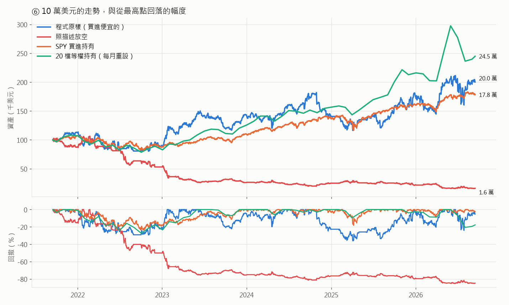
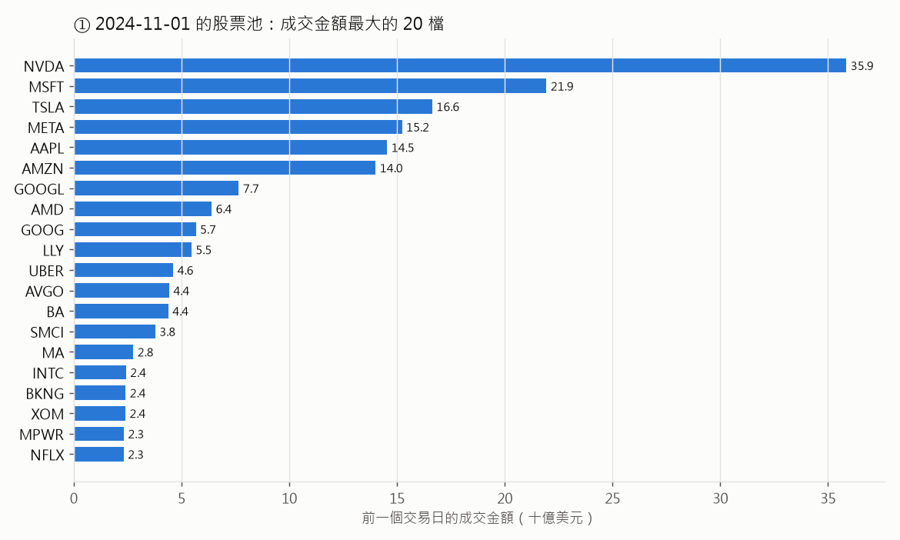
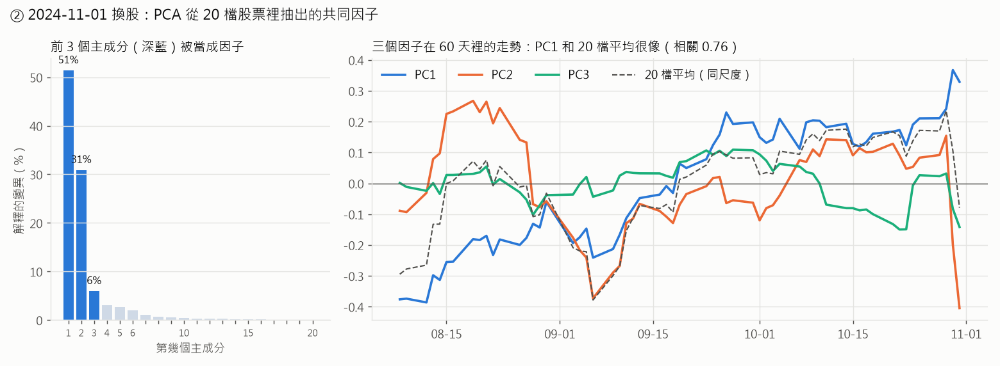
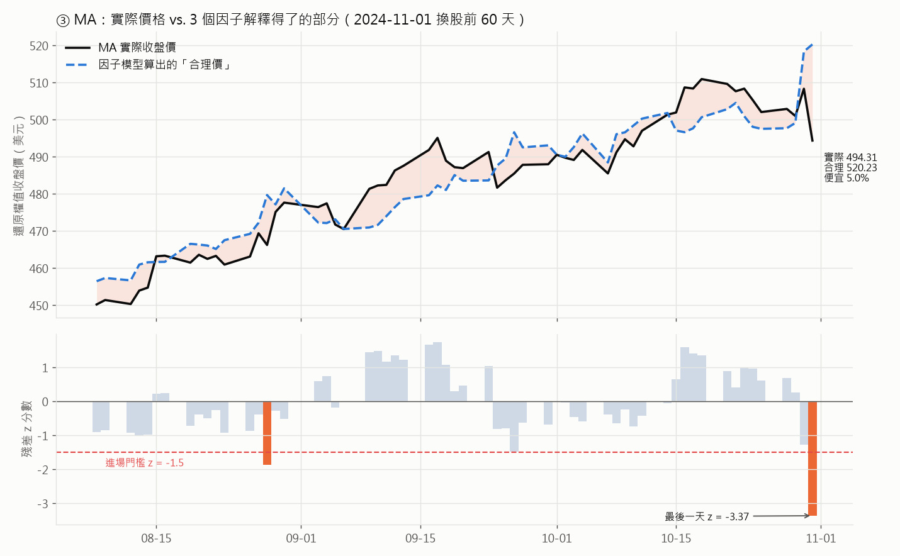
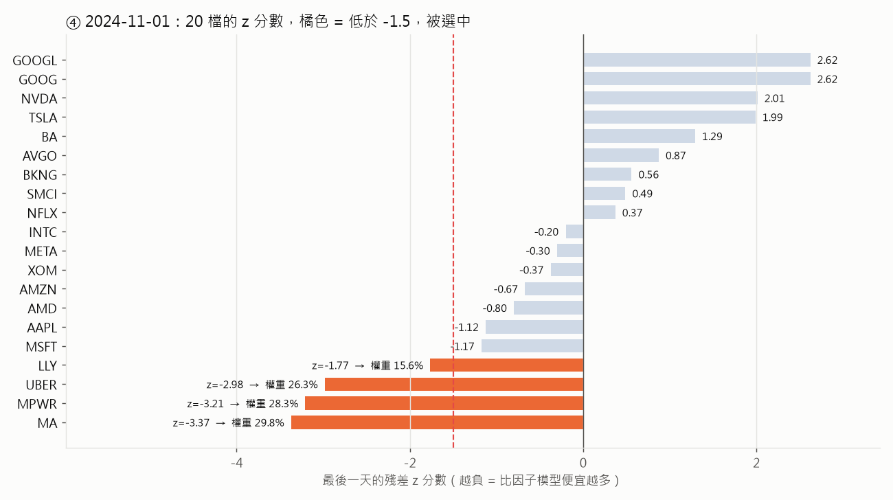
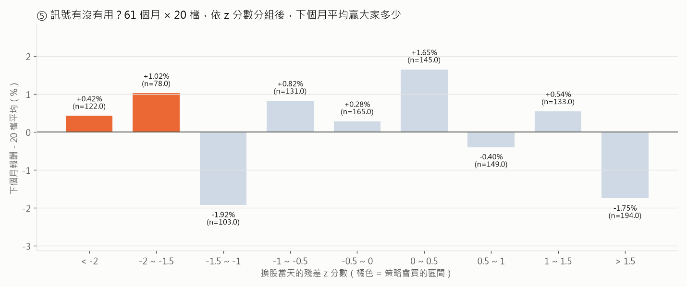
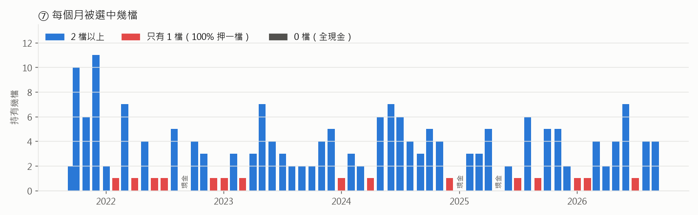

# PCA 殘差均值回歸：找出「比共同因子該有的價格還便宜」的股票

這份文件解釋 `algorithms/pca_stat_arbitrage.py`（QuantConnect 的
`PcaStatArbitrageAlgorithm`，策略名稱「PCA Residual Mean Reversion Shorts」）
實際上在做什麼。

文中的圖和數字都是**真的跑出來的**。LEAN 回測產生交易紀錄和資產曲線；
`explain_figures.py` 用同一份 `data-sp500/` 資料，自己用 pandas + scikit-learn + statsmodels
重算一次每個月的股票池、PCA、迴歸、z 分數和權重，再逐月對照 LEAN 實際的決策：
**61 次換股，0 次不符，權重誤差 0.0000**。所以下面每個「某個月為什麼買某檔」的解釋，
都已經對照過引擎的實際行為。

```
uv sync --group pca
uv run --group pca run_local.py "PCA Stat Arbitrage" --data-folder data-sp500
uv run --group pca run_local.py "PCA Stat Arbitrage (short)" --data-folder data-sp500
uv run run_local.py "SPY Buy & Hold 2021-2026" --data-folder data-sp500
uv run --group pca python research/pca_stat_arbitrage/explain_figures.py
```

回測期間：**2021-09-16 → 2026-09-15**（原版是 `end_date - 5 年`），起始資金 10 萬美元。

---

## 一句話版本

> 每個月第一個交易日，拿成交金額最大的 20 檔美股過去 60 天的股價，
> 用 PCA 找出「大家一起動」的共同走勢，再看每檔股票**比共同走勢該有的價格便宜多少**。
> 便宜得特別離譜（z 分數 < −1.5）的那幾檔，依便宜程度分配資金，抱一個月。

背後的想法是**統計套利（stat arb）**：一檔股票的漲跌，大部分可以用「整個市場、整個產業」的共同走勢解釋；
解釋不了的那一小塊（殘差）應該是暫時的雜訊，遲早會回到零。所以殘差很負的股票是「暫時被錯殺」，應該會漲回來。

---

## ⚠️ 先講最重要的發現：程式碼是「買進」，不是描述說的「放空」

策略描述和標題都說「short positions」，但程式碼實際上是**做多**。原因是一個雙重負號：

```python
selected_scores = z_scores[z_scores < -1.5]          # 選出來的 z 全部是負數，例如 −3.37
return selected_scores * (1 / denominator)           # 負數 × 正數 = 負數，例如 −0.298
...
PortfolioTarget(symbol, -weight)                     # −(−0.298) = +0.298  → 買進 29.8%
```

LEAN 的 order 紀錄也證實了這一點：2024-11-01 這天是**買進** MA 92 股、MPWR 58 股、UBER 563 股（數量是正的）。

這其實才是合理的方向：殘差很負代表「比模型便宜」，均值回歸的邏輯應該是**買**便宜的，等它漲回來。
描述說要放空便宜的股票，等於在賭「便宜的會更便宜」，那是動能（momentum），不是均值回歸。

為了兩邊都看清楚，這裡跑了兩個版本：

| 版本 | 參數 | 做什麼 |
|---|---|---|
| **程式原樣**（主角） | `side = 1` | 買進 z < −1.5 的股票，就是原始程式碼的行為 |
| **照描述放空** | `side = −1` | 放空同一批股票，權重一樣 |

除了 `side` 這個正負號之外，兩者的選股和權重完全一樣。

## 結果先講



| | 程式原樣（買進） | 照描述放空 | SPY 買進持有 | 20 檔等權持有* |
|---|---|---|---|---|
| 10 萬變成 | **20.1 萬** | 1.6 萬 | 17.8 萬 | 24.5 萬 |
| 年化報酬 | **14.9%** | −30.6% | 12.2% | 19.6% |
| 最大回撤 | 36.0% | 85.1% | 23.6% | — |
| Sharpe | 0.38 | −0.94 | 0.40 | — |
| 年化波動 | 26.8% | 25.3% | 13.7% | — |
| 下單次數 | 378 | 369 | 1 | — |

\* 最右邊是對照組：**同樣那 20 檔股票，不看 z 分數，每月等權全部持有**。
它是用 pandas 算的（開盤價到開盤價、不含手續費、沒有 5% 現金），所以只能當參考，不能和 LEAN 的數字逐位比較。

三個重點：

1. **買進版贏了 SPY 一點點，但風險是兩倍。** 年化多 2.7 個百分點，但波動 26.8% 對 13.7%，
   回撤 36% 對 24%。風險調整後的 Sharpe 幾乎一樣（0.38 對 0.40）。
2. **「20 檔等權全部持有」還比較好。** 用同一套無摩擦的算法比，等權 20 檔一年 19.6%，
   照 PCA 訊號挑出來的 21.1%，**挑選只多了 1.5 個百分點**，而且下面會看到，這 1.5 點在統計上跟雜訊分不開。
   這段期間賺錢的主要原因是「抱著最熱門的大型科技股」，不是 PCA。
   （LEAN 版只有 14.9%，比 21.1% 少很多，主要是 2022 年 7 月一筆被拒絕的單，見下面 ⑦。）
3. **照描述放空是災難**：5 年剩 16%。2021–2026 是大型科技股的大多頭，放空成交金額最大的 20 檔股票，
   幾乎就是在放空大盤。

---

## 全景

```
  每月第一個交易日 00:00  ① 重建股票池（用「前一個交易日」的資料）
      │   S&P 500 成分股 ~500 檔
      │     └─ 股價 > 5 美元
      │         └─ 成交金額（股價 × 成交量）最大的 20 檔   ← 股票池
      ▼
  同一天 08:00（開盤前）  ② 拿這 20 檔過去 60 個交易日的收盤價
      │   取 log → 每檔減掉自己的平均 → PCA → 取前 3 個主成分當「共同因子」
      │
      │                   ③ 每檔股票對 3 個因子做 OLS 迴歸
      │   迴歸算出來的 = 「因子解釋得了的合理價」
      │   實際 − 合理 = 殘差；把殘差標準化 → z 分數
      │
      │                   ④ 只看最後一天的 z 分數
      │   z < −1.5 的入選，權重 ∝ |z|，加總 = 100%（實際上 95%，留 5% 現金）
      │   其他股票（含上個月的持股）全部賣掉
      ▼
  開盤                    08:00 還沒開盤，單子變成開盤市價單，用當天開盤價成交
      │
      ▼
  接下來一整個月什麼都不做，沒有停損，直到下個月第一個交易日
```

以下用 **2024-11-01** 這次換股，把每一步的實際數字走一遍。

---

## ① 股票池：成交金額最大的 20 檔



成交金額 = 前一個交易日的收盤價 × 成交量。NVDA 一天成交 359 億美元，
第 20 名 NFLX 也有 23 億。這 20 檔幾乎都是超大型科技股，
加上幾檔當時很熱門的股票（SMCI、MPWR、BA、UBER）。

注意 **GOOG 和 GOOGL 同時入選**：同一家公司的兩種股份，走勢幾乎一模一樣。下面會看到這件事的影響。

---

## ② PCA：從 20 檔股票裡找出「大家一起動」的部分

**先做兩件預處理：**

```python
sample = np.log(history)                 # 取 log
sample = sample - sample.mean()          # 每檔減掉自己 60 天的平均
```

取 log 之後，每一檔股票的數值就變成「**比自己 60 天平均高或低幾 %**」。
例如 MA 最後一天是 +0.0222，代表比它 60 天的平均價高約 2.2%。
這樣 NVDA（股價 130）和 MA（股價 500）才能放在同一個尺度上比較。

> 想看 PCA 每一步長什麼樣子，見 [`pca-in-2d.md`](pca-in-2d.md)：
> 把同一套計算縮小到 2 檔股票（MA、V），每一步都畫在平面上。

**PCA（主成分分析）在做什麼？** 可以把它想成：

> 20 檔股票每天各自上上下下，PCA 去找「最能概括這 20 條線的少數幾條線」。
> 第 1 條（PC1）是 20 檔「最常一起動」的方向；第 2 條是扣掉第 1 條之後，剩下最常一起動的方向；依此類推。



2024-11-01 這次：

| 主成分 | 解釋了多少變化 | 主要由誰組成（loading 絕對值最大的） |
|---|---|---|
| PC1 | 51% | SMCI +0.41、BKNG −0.36、TSLA −0.32、NVDA −0.30、AVGO −0.29 |
| PC2 | 31% | **SMCI +0.80**、NVDA +0.35、AVGO +0.22 |
| PC3 | 6% | **TSLA +0.66**、NVDA −0.47、AMD +0.31 |
| 合計 | **88%** | 剩下的 17 個主成分只解釋 12% |

前 3 個主成分一共解釋 88% 的變化，這就是策略說的「共同風險因子」。

但這裡有一個教科書不常講的細節：**PC2 幾乎就是 SMCI 一檔股票，PC3 主要是 TSLA 對 NVDA。**
原因是程式只做了「減平均」，沒有「除以標準差」，所以**波動越大的股票，在 PCA 裡的聲音越大**。
這 60 天裡 SMCI 的 log 價格標準差是 0.149，是第二名 NVDA（0.091）的 1.6 倍，
所以 PCA 找出來的「共同因子」有很大一部分其實是「SMCI 自己的走勢」。

也就是說，這裡說的「因子」並不是乾淨的「大盤、產業、風格」，而是「這 20 檔裡最會動的幾檔」。PC1 和 20 檔平均的相關係數是 0.76，算是像大盤，但並不等於大盤。

---

## ③ 迴歸：每檔股票的「合理價」和「殘差」

對每一檔股票做一次迴歸：

```
這檔股票的 log 價格偏離 = a + b1 × PC1 + b2 × PC2 + b3 × PC3 + 殘差
```

意思是：**如果這檔股票只跟著 3 個共同因子走，它今天應該在哪裡？** 迴歸算出來的就是「合理價」，
實際價格和合理價的差就是**殘差**，也就是這檔股票自己獨有、因子解釋不了的部分。

以當天 z 分數最低的 **MA（Mastercard）** 為例：



上圖黑線是實際價格，藍色虛線是 3 個因子算出來的合理價。兩條線大部分時間貼得很近
（R² = 0.82，因子解釋了 MA 82% 的價格變化），但最後兩天拉開了：

| | log 偏離 | 換成價格 |
|---|---|---|
| 模型說應該在 | +0.0733 | 520.23 美元 |
| 實際在 | +0.0222 | 494.31 美元 |
| **殘差** | **−0.0511** | 比合理價便宜約 **5.0%** |

光看 −5% 還不知道算不算多，所以要和 MA 自己平常的殘差比，也就是**標準化**：

```
z = (今天的殘差 − 殘差平均) ÷ 殘差標準差
  = (−0.0511 − 0) ÷ 0.0152
  = −3.37
```

MA 的殘差平常只會晃 ±1.5% 左右，今天偏了 −5.1%，是**平常的 3.37 倍**，
在下圖就是最右邊那根橘色長條。60 天裡它只有另一天（8 月底）碰到 −1.5 的門檻。

兩個值得注意的地方：

- **殘差平均一定是 0。** 迴歸有截距，OLS 的殘差平均本來就是 0，所以 z 分數其實就是「殘差 ÷ 殘差標準差」。
- **這是「在樣本內」的殘差。** 拿來估計合理價的 60 天，和拿來判斷便不便宜的那一天，是同一批資料。
  最後一天本身也參與了 PCA 和迴歸，所以它的殘差其實已經被模型「拉」得比較小了。

---

## ④ 選股與權重：z < −1.5，權重 ∝ |z|

20 檔各自算出最後一天的 z 分數：



有 4 檔低於 −1.5。權重的算法很簡單，**依 |z| 的比例分配**：

| 股票 | z | \|z\| | 權重 = \|z\| ÷ 11.32 |
|---|---|---|---|
| MA | −3.37 | 3.37 | **29.8%** |
| MPWR | −3.21 | 3.21 | **28.3%** |
| UBER | −2.98 | 2.98 | **26.3%** |
| LLY | −1.77 | 1.77 | **15.6%** |
| 合計 | | 11.32 | 100% |

`free_portfolio_value_percentage = 0.05` 會先留 5% 現金，所以實際上是用 95% 的資產照這個比例分配。
當時總資產約 16.2 萬，MA 分到 16.2 萬 × 95% × 29.8% ≈ 4.6 萬，LEAN 實際買了 92 股 × 495.15 ≈ 4.56 萬（以開盤價成交）。

`set_holdings(targets, True)` 的 `True` 代表**不在名單裡的全部清掉**。
所以同一天也把上個月的持股 AMZN、COST、MSFT、SMCI 賣光，LLY 則是從上個月的部位減碼到 15.6%。

另外注意圖上方：GOOG 和 GOOGL 的 z 分數都是 2.62，**完全一樣**。兩條幾乎相同的線放進 PCA，
它們一定一起被因子解釋、一起產生殘差。如果哪天它們一起變便宜，策略會**把同一家公司買兩次**，
回測裡這種事發生了 11 次（例如 2023-04、2024-02、2025-10）。

### 那後來呢？

| 股票 | 權重 | 下個月（11/1 → 12/2 開盤）報酬 |
|---|---|---|
| MA | 29.8% | +6.5% |
| MPWR | 28.3% | **−26.0%** |
| UBER | 26.3% | −2.7% |
| LLY | 15.6% | −3.5% |
| 加權 | | 約 −6% |
| 20 檔平均 | | +5.1% |
| SPY | | +5.5% |

這個例子剛好是**失敗**的一次：MA 確實「回歸」了，但 MPWR 繼續大跌 26%，
帳上這個月 −5.4%，同時大盤 +5.5%。這說明了均值回歸策略最大的風險：
**殘差很負，可能是暫時的雜訊，也可能是市場剛開始反映一個真正的壞消息。** 模型分不出這兩者。

---

## ⑤ 訊號到底有沒有用？

一次的例子說明不了什麼，所以把整段回測的 **61 個月 × 20 檔 = 1,220 筆**全部拿出來，
依換股當天的 z 分數分組，看每組**下個月比 20 檔平均多賺多少**：



如果均值回歸的邏輯成立，應該看到**左邊高、右邊低**的階梯：z 越負，下個月越會補漲。

實際上：

- 策略會買的兩組（橘色，z < −1.5）平均多賺 +0.42% 和 +1.02%，勝率 53%。
- 但緊鄰的 −1.5 ~ −1 那一組是 **−1.92%**，0 ~ 0.5 那一組反而是 +1.65%。
- 只有最右邊 z > 1.5（比模型貴很多）那組是比較一致地落後（−1.75%，勝率 37%）。
- z 分數和下個月超額報酬的相關係數：**−0.035**，幾乎是 0。

**沒有看到階梯。** 被選中的股票平均每月多賺 0.66%，看起來不錯，但旁邊的組別隨便就差到 ±2%，
這個差距在這個樣本大小下和雜訊分不出來。也就是說，在這 5 年、這 20 檔大型股上，
「60 天 PCA 殘差」**沒有可靠的預測力**。

---

## ⑥ 逐年看

| 年份 | 程式原樣（買進） | 照描述放空 | SPY |
|---|---|---|---|
| 2021（9/16 起） | +12.1% | −11.8% | +6.8% |
| 2022 | −20.3% | −39.8% | −17.5% |
| 2023 | **+60.3%** | −50.6% | +25.0% |
| 2024 | −1.8% | −4.5% | +24.0% |
| 2025 | +24.4% | −10.9% | +17.2% |
| 2026（至 9/15） | +14.4% | −27.4% | +11.4% |

注意**放空版每一年都虧**，連 2022 年大盤跌 17% 的空頭年都虧 40%。
最大的一筆是 2022-07 放空 AMD（95%），AMD 那個月漲 27%，帳上一個月 −24%。
放空的部位還會隨股價上漲而越變越大。放空版沒有計算借券費用，實際只會更差。

放空版也有 **10 筆單因為保證金不足被拒絕**（例如 2022-04 的 AMD、2024-01 的 AAPL），
原因和下面 ⑦ 講的一樣：整筆換到另一檔時，新單在舊部位還沒平倉前就檢查保證金。
這些月份它其實是空手，所以放空版的數字也不完全是「照描述放空」的真實結果，只是方向非常明確。

買進版的成績幾乎全部來自 **2023 年**（+60%），而 2023 年又主要來自單一個月，
就是下面要講的「100% 押一檔」。

---

## ⑦ 集中度：常常 100% 押一檔



z < −1.5 本來就是少見的事件，20 檔裡每次只會有幾檔符合：

| 每月入選幾檔 | 0 | 1 | 2 | 3 | 4 | 5 | 6 | 7 | 10 | 11 |
|---|---|---|---|---|---|---|---|---|---|---|
| 月數 | 3 | **15** | 9 | 8 | 10 | 6 | 4 | 4 | 1 | 1 |

**61 個月裡有 15 個月，95% 的資產全押在一檔股票上。** 而權重加總永遠是 100%，
所以不管訊號強不強（一檔 z = −1.6 也一樣），只要有一檔入選，它就拿到全部資金。
這是整個策略波動度是大盤兩倍的主要原因，報酬最好和最差的月份幾乎都是這種月：

| 最好的月份 | 持股 | 當月 | | 最差的月份 | 持股 | 當月 |
|---|---|---|---|---|---|---|
| 2023-01 | NVDA | **+32.4%** | | 2022-04 | AMD | **−21.6%** |
| 2026-04 | MU、PLTR | +29.1% | | 2023-09 | DG、LLY | −14.6% |
| 2025-09 | DELL | +16.3% | | 2022-01 | AMZN、NVDA | −13.4% |
| 2023-03 | MSFT | +14.4% | | 2025-02 | DECK、MSFT、NOW | −12.4% |

另外有 3 個月（2022-09、2025-01、2025-05）沒有任何一檔低於 −1.5，
`set_holdings([], True)` 就把所有持股賣光，**整個月空手**。

### 一筆被拒絕的單：2022-07-01

LEAN 的 log 裡有一筆錯誤：

```
Order Error: Insufficient buying power ... Initial Margin: 40457.92, Free Margin: 40419.20
```

那天策略要把 CRM（95%）整個換成 AMD（95%）。兩張單都是開盤市價單，
LEAN 在 08:00 檢查 AMD 這張買單的保證金時，CRM 還沒賣掉，結果**差了 38 美元**，AMD 的買單被拒絕。
CRM 照樣賣掉了，所以 2022 年 7 月整個月都是現金，**而 AMD 那個月漲了 27%**。

這一筆就是 LEAN 結果（年化 14.9%）和上面無摩擦試算（21.1%）落差的最大來源。
這在 QuantConnect 雲端也一樣會發生，屬於原始程式的行為（100% 換到另一檔、又留很少的現金緩衝），不是移植造成的。

---

## 為什麼這個策略不太成立？

把上面看到的整理起來：

1. **在「價格水準」上做 PCA。** 經典的 PCA 統計套利（Avellaneda & Lee, 2010）是對**每日報酬**做 PCA，
   再把殘差累加成一個會回歸的過程。這裡是直接對 60 天的 log 價格做，
   PCA 抓到的主要是「這 60 天誰在漲、誰在跌」的趨勢，而不是每天的共同波動。
2. **因子被高波動股主導。** 沒有標準化，SMCI、TSLA 這種股票本身就變成了因子。
3. **只有 20 檔、60 個資料點、3 個因子＋截距。** 每次迴歸只有 56 個自由度，殘差很容易被雜訊左右。
   GOOG／GOOGL 這種幾乎一樣的兩條線還會佔掉一部分解釋力。
4. **樣本內殘差。** 判斷便宜的那一天也參與了估計。
5. **權重永遠加總 100%。** 一檔勉強過門檻的股票也會拿到全部資金，風險完全沒有隨訊號強弱調整。

結果就是：訊號本身和雜訊分不開（⑤），策略的報酬主要來自「持有大型科技股」這件事本身，
而那個部分，直接等權買進 20 檔就拿得到，風險還更低。

---

## 移植到本機時改了什麼（以及對結果的影響）

原版用的是 QuantConnect 雲端的 Morningstar 基本面資料（`Fundamental`），免費的 LEAN 沒有附，
原程式在本機跑**選不到任何股票**。改法和 `momentum_effect.py` 一樣：

| 原版 | 本機版 | 影響 |
|---|---|---|
| 全美國上市股票 | **S&P 500 成分股**（point-in-time 名單，`data-sp500/`） | 見下方 |
| `f.price`、`f.dollar_volume` | 前一個交易日的原始（未還原）日 K：收盤價、收盤價 × 成交量 | 同一個定義 |
| `universe_settings.asynchronous = True` | 拿掉 | 只影響速度；本機版的選股會呼叫 `self.history` |
| `set_start_date(end_date − 5 年)` | 固定 2021-09-16 → 2026-09-15 | 落在本機資料範圍內 |
| `PortfolioTarget(symbol, -weight)` | `-weight * side`，`side` 預設 1 | **預設和原版完全一樣**；`side = −1` 才是放空版 |
| PCA、迴歸、z 分數、權重 | **完全不變** | |

**候選股票不一樣。** 原版是在全美股裡找成交金額前 20 名，可能選到 S&P 500 以外的股票，
例如 TSM 這類美國掛牌的外國公司、PLTR（2024-09 才納入 S&P 500）、MSTR、COIN（2025-05 才納入）。
成交金額前 20 名大多本來就是 S&P 500 的大型股，所以差異應該不大，但不會完全一樣。

其他和本機其他策略共通的限制（詳見 `README.md` 的 Constituents universes）：

- **被收購下市的公司沒有資料**，它們永遠不會被選到（倖存者偏差）。
- **LEAN 報表的 Alpha、Beta、Treynor 是 0**，因為本機的 daily-only 資料沒有 LEAN 內部 benchmark 要的小時線。
  和 SPY 的比較請看上面的表，那是在同一份資料上另外跑的。
- **放空版沒有借券費用**，LEAN 的預設模型不收。

需要額外安裝的套件：`statsmodels` 和 `scikit-learn`，放在 `pyproject.toml` 的 `pca` 群組裡，
所以要用 `uv run --group pca ...` 執行。

---

## 總結

| 問題 | 答案 |
|---|---|
| 它在賭什麼？ | 某檔股票比「20 檔股票的共同走勢」該有的價格便宜很多，下個月會漲回來 |
| 程式真的在放空嗎？ | **沒有。** 雙重負號讓它變成買進；照描述放空的話 5 年虧掉 84% |
| 賺錢的來源 | 大多是持有大型科技股本身（2023 年 +60%，其中一個月 100% 押 NVDA 賺 32%） |
| 虧錢的來源 | 單押一檔時剛好碰到下跌（2022-04 AMD −22%），或便宜的股票繼續便宜（2024-11 MPWR −26%） |
| 訊號有沒有用？ | 1,220 筆樣本裡，z 分數和下個月超額報酬的相關係數 −0.035，看不出預測力 |
| 風險控制 | 只有 5% 現金緩衝；**沒有停損、沒有分散下限，常常 100% 押一檔** |
| 最重要的一句話 | **年化 14.9%、贏 SPY 2.7 個百分點，但波動是兩倍，Sharpe 一樣；直接等權持有那 20 檔反而更好。** |
