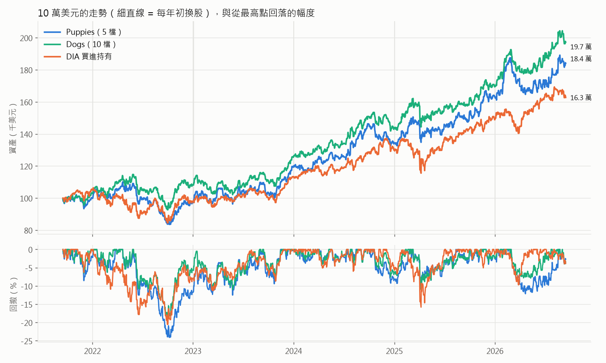
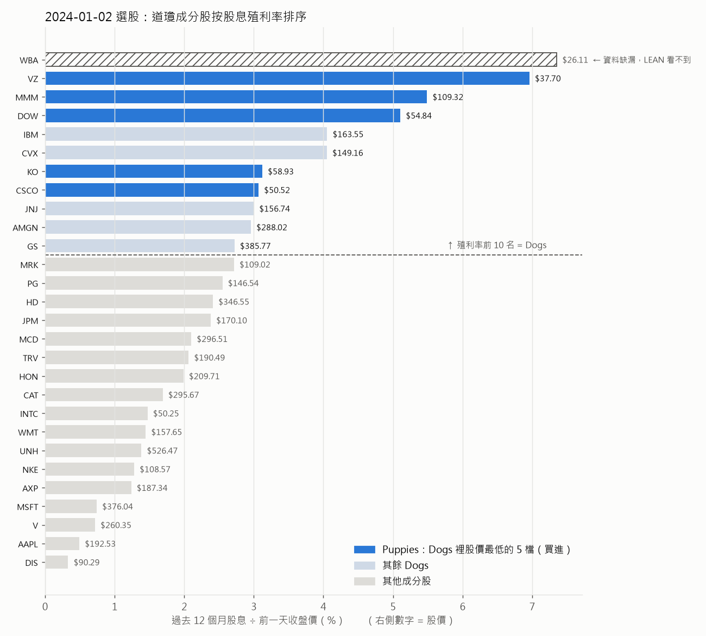
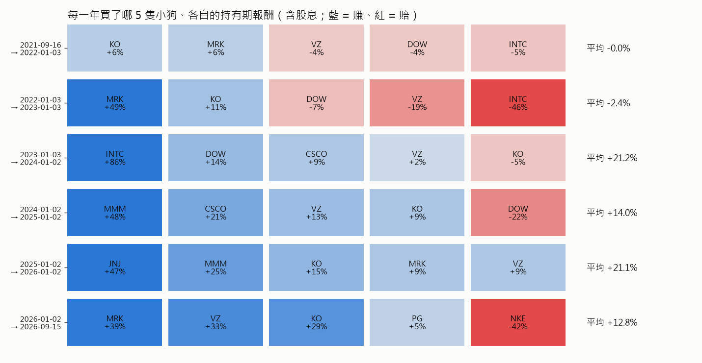
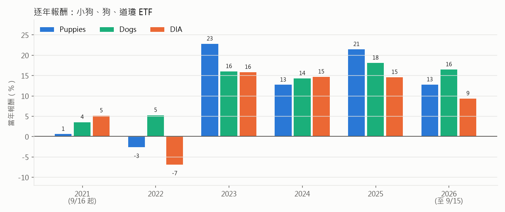
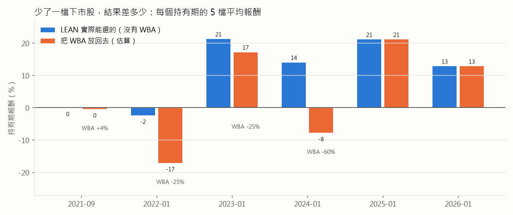

# 道瓊小狗（Puppies of the Dow）：每年初買 5 檔「高殖利率裡最便宜」的道瓊股

這份文件解釋 `algorithms/puppies_of_the_dow.py`（QuantConnect 的 `PuppiesOfTheDow`）
實際上在做什麼。

文中的圖和數字都是**真的跑出來的**。LEAN 回測產生交易紀錄和資產曲線；
`explain_figures.py` 用同一份 `data-dow/` 資料，自己用 pandas 重算一次每年的
股價、殖利率、Dogs 和 Puppies，再逐年對照 LEAN 實際的選股：
**6 次選股，0 次不符**。用 pandas 照同樣的持股重算報酬，得到 184,069 美元，
LEAN 是 184,116 美元，差 0.03%。所以下面每一個「某一年為什麼買某檔」的解釋，
都已經對照過引擎的實際行為。

```
uv run run_local.py "Puppies of the Dow" --data-folder data-dow
uv run run_local.py "Dogs of the Dow" --data-folder data-dow
uv run run_local.py "DIA Buy & Hold 2021-2026" --data-folder data-dow
uv run python research/puppies_of_the_dow/explain_figures.py
```

回測期間：**2021-09-16 → 2026-09-15**（原版是 `end_date - 5 年`），起始資金 10 萬美元。

---

## 一句話版本

> 每年第一個交易日，把道瓊 30 檔成分股按**股息殖利率**排序，取最高的 10 檔（**Dogs of the Dow**），
> 再從這 10 檔裡挑**股價最低的 5 檔**（**Puppies**），每檔放 20%，抱一整年，明年初再重選。

背後的想法：道瓊成分股都是大型績優股，不太會倒。如果其中某檔的殖利率特別高，
通常不是因為它突然多發股息，而是**股價跌了**（殖利率 = 股息 ÷ 股價）。
策略賭的是「大家對這些落難藍籌股太悲觀，悲觀退去後股價會回來」，等待期間還能領股息。

## 結果先講



| | Puppies（本策略，5 檔） | Dogs（10 檔） | DIA 買進持有 |
|---|---|---|---|
| 10 萬變成 | 18.4 萬 | **19.7 萬** | 16.3 萬 |
| 年化報酬 | 13.0% | **14.6%** | 10.2% |
| 最大回撤 | 24.1% | **19.1%** | 20.5% |
| Sharpe | 0.46 | **0.59** | 0.32 |
| 年化波動 | 12.8% | 11.4% | 12.2% |
| 下單次數 | 35 | 65 | 1 |
| 手續費合計 | $51 | $68 | $1 |

從表面看，兩個版本都贏過 DIA。但「再挑最便宜的 5 檔」這一步在這段期間是**減分**的：
Puppies 的報酬比 Dogs 少、回撤比 Dogs 大。

**但這張表有一個大問題，在第 ⑤ 節詳細說明：**
Walgreens（WBA）在 2021–2024 年是道瓊成分股，而且**每一年都會被選進 Puppies**，
但它在 2025 年下市私有化，免費資料源已經查不到它，所以 LEAN 從來沒看到它。
把 WBA 放回去估算，**Puppies 的 10 萬只會變成約 12.2 萬（年化約 4%），輸給 DIA**；
Dogs 約 17.0 萬（年化約 11%），仍小贏 DIA。

---

## 全景

```
  每年第一個交易日 00:00   ① 重建股票池（用「前一個交易日」的資料）
      │   DIA 的成分股 = 道瓊 30 檔
      │     └─ 股價 > 5 美元，且過去 12 個月有發股息
      │         └─ 按股息殖利率排序，取前 10 名      ← Dogs of the Dow
      │             └─ 其中股價最低的 5 檔          ← Puppies（這就是要買的）
      ▼
  同一天 08:00            ② 每檔目標權重 20%
      │   不在 Puppies 裡的舊持股 → 全部賣掉
      │   Puppies → 買到 / 調整到 20%
      ▼
  開盤                    ③ 08:00 還沒開盤，單子變成開盤市價單，用當天開盤價成交
      │
      ▼
  接下來一整年什麼都不做（不停損、不再平衡），直到明年第一個交易日
```

一年只動一次，5 年總共只下了 35 張單。

---

## ① 股息殖利率：一個數字，就是「過去一年的股息 ÷ 現在的股價」

```
股息殖利率 = 過去 12 個月每股配發的現金股息合計 ÷ 前一個交易日的收盤價
```

以 2024-01-02 那次選股的 Verizon（VZ）為例：

| 除息日 | 每股股息 |
|---|---|
| 2023-01-09 | 0.653 |
| 2023-04-06 | 0.653 |
| 2023-07-07 | 0.653 |
| 2023-10-06 | 0.665 |
| **過去 12 個月合計** | **2.624** |
| 2023-12-29 收盤價 | 37.70 |
| **殖利率** | 2.624 ÷ 37.70 = **6.96%** |

同一天 IBM 的股息其實更多（一年 6.63 美元），但股價 163.55，殖利率只有 4.05%。
**殖利率高，不代表發得多，常常代表股價低。** VZ 當時的股價比 2020 年底的 58.75 跌了三成多，
這正是策略想找的「落難藍籌」。

幾個值得注意的細節：

- **用的是「當時」的股價和股息，不是還原權值的。** 如果中間有拆股，拆股前的股息會換算成
  拆股後的股數。例如 Walmart 2024 年 2 月 1 拆 3，2025 年初算出的過去一年股息是 0.832
  （拆股後每季 0.208），配上拆股後的股價 90.35，殖利率 0.92%，數字是對的。
- **除息日剛好是選股當天的股息不算。** 那天開盤才買的人領不到這筆股息。
  這個細節不是小事，見第 ⑥ 節。
- **12 個月的邊界會切到季配息。** 2021-01-04 那次，Cisco 的配息日是 2020-01-02 和 2021-01-04，
  兩個都剛好落在窗口外，所以只算到 3 次配息、殖利率 2.41%，以 0.12 個百分點之差排第 11 名，
  沒進 Dogs。如果算 4 次，它是 3.22%，而且股價 44.75 是 Dogs 裡最低的，會直接變成 Puppy。

---

## ② 選股：兩道篩子，從 30 檔到 5 檔

以 **2024-01-02** 為例：



| 步驟 | 條件 | 剩下 |
|---|---|---|
| 起點 | 當天的道瓊成分股 | 30 |
|  | 有價格資料（WBA 查不到，見第 ⑤ 節） | 29 |
| 有發股息 | 過去 12 個月股息 > 0（Boeing、Salesforce 沒發，出局） | 27 |
| 股價 | > 5 美元（道瓊成分股全部通過，這條形同虛設） | 27 |
| **Dogs** | 殖利率前 10 名 | 10 |
| **Puppies** | 其中股價最低的 5 檔 | **5** |

第一道篩子（殖利率前 10）切在 **GS 2.722%** 和 **MRK 2.715%** 之間，只差 0.007 個百分點。
Merck 差一點點就進了 Dogs，而且它股價 109.02，會擠掉 3M 變成 Puppy。
**排名式的規則在門檻附近是很敏感的。**

第二道篩子在 10 隻 Dogs 裡挑股價最低的 5 檔：

| Dogs | 殖利率 | 股價 | 結果 |
|---|---|---|---|
| VZ | 6.96% | 37.70 | **Puppy** |
| CSCO | 3.07% | 50.52 | **Puppy** |
| DOW | 5.11% | 54.84 | **Puppy** |
| KO | 3.12% | 58.93 | **Puppy** |
| MMM | 5.49% | 109.32 | **Puppy** |
| CVX | 4.05% | 149.16 | 淘汰 |
| JNJ | 3.00% | 156.74 | 淘汰 |
| IBM | 4.05% | 163.55 | 淘汰 |
| AMGN | 2.96% | 288.02 | 淘汰 |
| GS | 2.72% | 385.77 | 淘汰 |

---

## ③ 「股價低」到底代表什麼？

這是整個策略最值得懷疑的一步。**一股多少錢，跟公司便不便宜沒有關係**：
股價 37 美元的 VZ 不會因此比 385 美元的 GS「便宜」，要看的是本益比、殖利率這類「相對」指標。

最直接的證據是拆股。Walmart：

| 選股日 | 股價 | 過去一年股息 | 殖利率 |
|---|---|---|---|
| 2024-01-02 | 157.65 | 2.280 | 1.45% |
| 2025-01-02 | **90.35** | 0.832 | 0.92% |

公司還是同一家，只因為 2024 年 2 月 1 拆 3，股價就從 157 變成 90。
如果 Walmart 剛好是 Dog，拆股會讓它「變成 Puppy」，但公司本身什麼都沒變。

那這一步為什麼存在？兩個說法：

1. **在道瓊裡，股價低 = 權重低。** 道瓊是**價格加權**指數（股價越高的成分股佔比越大），
   所以 Puppies 其實是「Dogs 裡在指數中份量最小的 5 檔」，有點像在道瓊裡做小型股傾斜。
2. **股價低常常是跌出來的。** 一檔股票跌了很多，殖利率會變高（進 Dogs），股價也會變低（進 Puppies），
   兩道篩子都在找同一種股票：最近被市場拋棄的。這讓 Puppies 比 Dogs 更「逆勢」、更集中。

第 2 點是雙面刃：被拋棄的股票有的會反彈（2023 年的 Intel +86%），有的會繼續爛下去（2024 年的 WBA −60%）。

---

## ④ 每年買了什麼、賺賠多少



（報酬是從買進日開盤到下次換股日開盤，含股息再投入；最後一期算到 2026-09-15 收盤。）

- **第一期從 2021-09-16 開始**，用的是 2021-01-04 那次選出來的 5 檔。原版程式碼用一年的
  warm-up 來「重播」年初的選股，好讓回測一開始就有持股，不用等到明年 1 月。
- **換手很低。** 5 次換股分別換掉 0、1、1、2、2 檔。可口可樂（KO）和 Verizon（VZ）
  6 期全部都在，它們是「永遠的高殖利率低價股」。
- **每一期的平均報酬**：0.0%、−2.4%、+21.2%、+14.0%、+21.1%、+12.8%。

**集中持股的代價看得很清楚**：每檔 20%，一檔漲跌 40% 就是整個組合 ±8%。
2022 年 Intel −46%，一檔就把組合拉低 9 個百分點，抵消了 Merck +49% 的貢獻。
2026 年到 9 月為止 Nike −42%，也是一樣的故事。



- **2022（熊市）**：DIA −7%，Dogs +5%，Puppies −3%。高殖利率股在升息年確實比較抗跌，
  但 Puppies 只有 5 檔，被 Intel 拖累。
- **2023、2025**：Puppies 是三者最好的（+23%、+21%），分別靠 Intel 反彈和 J&J、3M。
- **最大回撤 24.1%** 發生在 2022-04-21 → 2022-10-07，比 DIA 的 20.5% 深。
  策略沒有任何停損或風險控制，一年中間跌多少都只能抱著。

---

## ⑤ 最大的但書：少了一檔下市股

Walgreens Boots Alliance（WBA）2020–2024 年是道瓊成分股（2024-02-26 被 Amazon 取代），
2025-08-28 被私募基金收購下市。Yahoo Finance 現在查詢 WBA 只會回「symbol may be delisted」，
所以 `data-dow/` 裡沒有它，LEAN 選股時看不到它。

問題是：**WBA 正是這個策略最想買的那種股票。** 用 WBA 當時的月底收盤價和配息紀錄
（`wba_monthly.csv`、`wba_dividends.csv`，來源見檔頭）重算，它在 4 次選股都會進 Puppies：

| 選股日 | WBA 股價 | 過去一年股息 | 殖利率 | 殖利率排名 | 會擠掉 |
|---|---|---|---|---|---|
| 2021-01-04 | 39.88 | 1.86 | 4.66% | 第 4 | MRK |
| 2022-01-03 | 52.16 | 1.90 | 3.64% | 第 5 | MRK |
| 2023-01-03 | 37.36 | 1.92 | 5.14% | 第 4 | KO |
| 2024-01-02 | 26.11 | 1.92 | **7.35%** | **第 1** | MMM |

而它被持有的那幾年表現是：



| 持有期 | WBA 報酬（估算） | 被它擠掉的股票 | 5 檔平均：LEAN → 放回 WBA |
|---|---|---|---|
| 2021-09 → 2022-01 | +3.7% | MRK +5.9% | 0.0% → −0.5% |
| 2022-01 → 2023-01 | −24.7% | MRK +48.8% | −2.4% → −17.1% |
| 2023-01 → 2024-01 | −25.0% | KO −4.6% | +21.2% → +17.1% |
| 2024-01 → 2025-01 | **−60.4%** | MMM +48.4% | +14.0% → −7.8% |

2024 年最戲劇化：WBA 殖利率全道瓊最高（7.35%），股價最低（26 美元），兩道篩子都把它排第一。
它 2 月就被踢出道瓊，但策略一年只看一次，照樣抱到年底。這一年它從 26.11 跌到 9.33，
同時它擠掉的 3M 漲了 48%。

| 估算（pandas，同一套方法） | 期末資產 | 年化 |
|---|---|---|
| Puppies，沒有 WBA（= LEAN 的情況） | 184,069 | 13.0% |
| **Puppies，放回 WBA** | **121,693** | **4.0%** |
| Dogs，沒有 WBA | 198,019 | 14.6% |
| **Dogs，放回 WBA** | **170,022** | **11.2%** |
| DIA 買進持有（LEAN） | 162,741 | 10.2% |

這就是**倖存者偏差**（survivorship bias）：免費資料源只保留還活著的公司，
而「高殖利率 + 低股價」這組篩選，挑出來的正好是最可能出事、最可能消失的公司。
一檔股票的缺漏，就讓 Puppies 從「贏 DIA 3 個百分點」變成「輸 DIA 6 個百分點」。
Dogs 有 10 檔分散，WBA 只佔 10%，傷害小很多。

估算的可信度：沒有 WBA 的那一行，pandas 算出 184,069，LEAN 是 184,116，方法本身只差 0.03%。
放回 WBA 時，WBA 用的是**月底收盤價**（沒有日線），買賣價跟真正的開盤價會有幾天的落差，
配息四捨五入到分。所以 12.2 萬是估計值，不是精確回測，但 −60% 這種量級不會因為差幾天而改變。

---

## ⑥ 與原版的差異，以及一個會讓結果差 1.4 萬的細節

原版從 QuantConnect 的 Morningstar 基本面資料選股，免費的 LEAN 沒有這份資料，
所以本機版做了這些替換（交易邏輯不變）：

| | 原版 | 本機版 |
|---|---|---|
| 成分股 | QuantConnect 的 DIA 成分股資料集 | `leandata/reference/dow-30-membership.csv`，依 S&P Dow Jones 公告的歷次異動手動整理，再用 `convert_data.py universe` 建成每日成分股檔 |
| 股價 | `Fundamental.price` | 前一交易日的未還原收盤價（就是 `Fundamental.price` 的定義） |
| 殖利率 | `valuation_ratios.total_yield` | 過去 365 天的現金股息 ÷ 股價，股息來自 LEAN 自己的 factor file |
| 日期規則 | `year_start("SPY")` | `year_start(DIA)`，資料夾是圍繞 DIA 建的 |
| 期間 | 結束日 = 今天，開始 = 5 年前 | 固定 2021-09-16 → 2026-09-15，確保在資料範圍內 |

**`total_yield` 不只是股息殖利率。** Morningstar 的定義是「股息殖利率 + 庫藏股殖利率」
（公司買回自家股票也算回饋股東）。策略描述寫的是 dividend yield，本機版照描述用純股息。
大量買回股票的公司（例如 Apple）在原版裡排名會高一些，所以本機版和雲端版的選股可能不完全相同。

**一個會讓結果差 1.4 萬的細節。** 第一版移植時，選股當天剛好除息的股息也被算進去了
（LEAN 把股息標在除息日，而 history 的時間窗包含「今天」）。這讓 Cisco 在 2026 年初
算到 5 次季配息（2025-01-03 和 2026-01-02 兩次都落在 365 天窗口裡），擠進 Dogs 和 Puppies；
2021 年也多算了一次，讓它進了 Dogs。結果：

| | 期末資產 | 年化 |
|---|---|---|
| 包含選股當天除息的股息（第一版） | 198,244 | 14.7% |
| 不包含（現在的版本，標準的過去 12 個月定義） | 184,116 | 13.0% |

**只改一個「哪一天的股息算不算」的定義，結果就差了 1.4 萬美元。**
這跟第 ② 節 GS / MRK 只差 0.007 個百分點是同一件事：一年只選一次、只買 5 檔，
每個邊界上的決定都會被放大成整整一年 20% 的部位。

其他小差異：LEAN 從 factor file 還原股息時會四捨五入到分，所以殖利率和 pandas 重算的值
最多差 0.006 個百分點，不影響任何一年的選股。報表裡的 Alpha、Beta 是 0，原因和
`README.md` 的 Constituents universes 一節相同（LEAN 的 benchmark 在回測中固定讀小時線，
這份資料只有日線），不是策略沒有市場曝險。

---

## 總結

- 這是一個**極簡、極低換手**的策略：一年看一次，買 5 檔道瓊高殖利率低價股，抱一年。
- 在免費資料上，它看起來年化 13%、贏 DIA 3 個百分點。
- 但「再挑最便宜的 5 檔」這一步沒有道理（股價高低不代表貴賤），在這段期間也確實讓結果比 Dogs 差。
- 更重要的是，它天生最容易踩到倖存者偏差：把 2024 年下市前的 WBA 放回去，
  Puppies 年化剩約 4%，輸給直接買 DIA。
- 如果要繼續研究這個方向，Dogs（10 檔）比 Puppies 穩健；而且需要一份包含下市股的資料，
  否則回測結果會系統性地偏樂觀。
