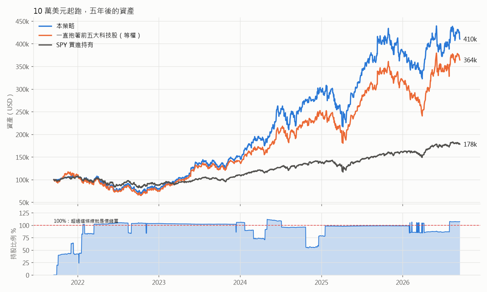
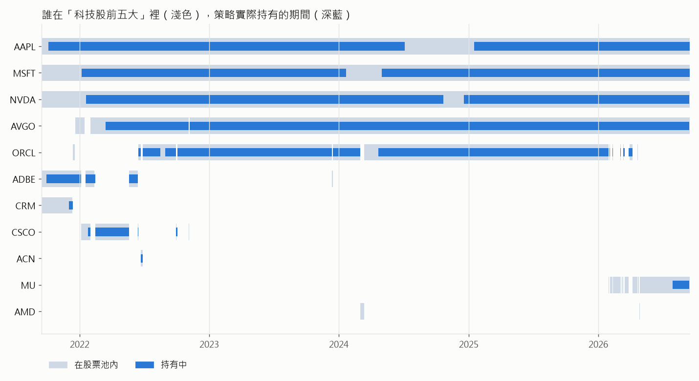
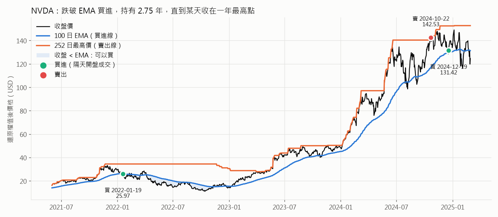
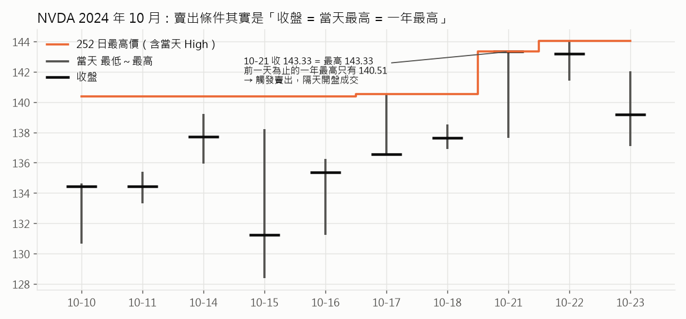
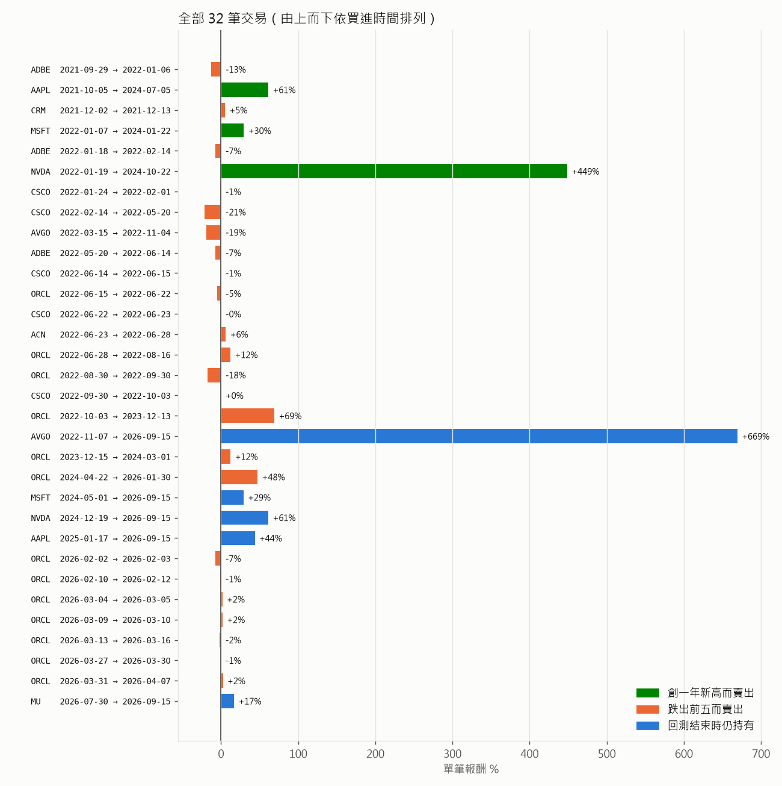
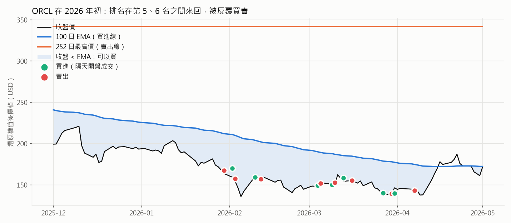

# 科技股前五大：跌破均線就買、創新高就賣

這份文件解釋 `algorithms/tech_ema_reversion.py`，也就是題目裡的
`DynamicNadionCircuit`，實際上在做什麼。

文中的圖和數字都是**真的跑出來的**。LEAN 回測產生交易紀錄和資產曲線；
`explain_figures.py` 會用同一份 `data-sp500/` 資料，自己重算一次
股票池、100 日 EMA 和 252 日最高價，再逐筆對照 LEAN 下的 **59 張單**，
結果 **0 筆不符**。所以文中每一個「某天為什麼買／賣」的解釋，都已經對照過引擎的實際行為。

```
uv run run_local.py "Tech Top5 EMA Reversion" --data-folder data-sp500
uv run run_local.py "SPY Buy & Hold 2021-2026" --data-folder data-sp500
uv run python research/tech_ema_reversion/explain_figures.py
```

回測期間：**2021-09-16 → 2026-09-15**（原版是 `end_date - 5 年`），
起始資金 10 萬美元。

---

## 一句話版本

> 每天找出美國市值最大的 5 檔科技股。哪一檔**收盤跌到 100 日均線以下**，
> 就用總資產的 20% 買進；之後一直抱著，直到它**收在一年來的最高點**才賣。
> 被擠出前五名的股票立刻賣掉。

## 結果先講



| | 本策略 | 一直抱著前五大（等權，每天再平衡） | SPY 買進持有 |
|---|---|---|---|
| 10 萬變成 | **41.0 萬** | 36.4 萬 | 17.8 萬 |
| 年化報酬 | **32.6%** | 29.5% | 12.2% |
| 最大回撤 | 36.4% | 44.6% | 23.6% |
| Sharpe | 0.85 | — | 0.40 |
| 下單次數 | 59 | — | 1 |

中間那一欄是用來對照的：**完全不管均線、一直等權持有當天的前五大科技股**
（在 pandas 裡算的，不含手續費）。拿本策略跟它比，才看得出「跌破 EMA 才買、
創新高才賣」這套時機規則到底有沒有幫上忙。答案是：**多賺約 3 個百分點年化，回撤少了 8 個點。**
不過下面會看到，差距主要不是因為「低買高賣」，而是另外兩個副作用造成的。

先把最重要的觀察放在前面：**這個策略大部分時間都是滿倉的**（平均持股 92%，
見上圖下半部）。它看起來像擇時策略，實際上更接近
「買進持有大型科技股，偶爾休息一下」。

---

## 全景

```
  每天 00:00  ① 選股票池：科技股依市值排序，取前 5
                  │  跌出前 5 的 → 立刻全部賣掉（隔天開盤成交）
                  ▼
  每天 08:00  ② 對股票池裡每一檔看「昨天收盤」：
                  ├─ 沒持有，且 收盤 < 100 日 EMA        → 買進 20%
                  └─ 有持有，且 收盤 ≥ 252 日最高價       → 全部賣掉
                  │
                  ▼
  開盤        ③ 08:00 還沒開盤，所以單子變成「開盤市價單」，用當天開盤價成交
```

---

## ① 股票池：科技股前五大

```python
filtered = [f for f in fundamental
            if f.asset_classification.morningstar_sector_code == MorningstarSectorCode.TECHNOLOGY]
return [f.symbol for f in sorted(filtered, key=lambda f: f.market_cap)[-5:]]
```

`sorted` 由小排到大，`[-5:]` 取最後 5 個，也就是**最大的 5 個**。

**「科技股」是 Morningstar 的定義，跟一般認知不一樣。** GOOGL、META 屬於
「通訊服務」，AMZN、TSLA 屬於「非必需消費」，所以都**不算**科技股。剩下的
常客是 AAPL、MSFT、NVDA、AVGO，第五名則由 ORCL、ADBE、CRM、CSCO 等輪流坐。



- 回測第一天（2021-09-16）的前五大：**AAPL、MSFT、NVDA、ADBE、CRM**
- 最後一天（2026-09-15）的前五大：**AAPL、MSFT、NVDA、AVGO、MU**

淺色是「在股票池內」，深藍是「真的有持股」。前四名五年來幾乎沒變過，所有
換來換去的動作都發生在**第五名**。

> **本地版怎麼做到的：** 免費的 LEAN 沒有 Morningstar 基本面資料，所以本地版
> 改用 `data-sp500/` 的 S&P 500 成分股清單：市值用「股價 × 流通股數」代替
> （排序結果相同），產業分類則用 Yahoo Finance 的 sector 欄位，而這個欄位的
> 資料本來就來自 Morningstar，清單見 `sectors.csv`。交易邏輯一行都沒改。
> 差異見文末〈本地版與原版的差異〉。

---

## ② 買進：收盤跌破 100 日 EMA

```python
if not security.invested and security.price < security.ema.current.value:
    self.set_holdings(security, 1 / len(self._universe.selected))
```

**EMA（指數移動平均）** 可以想成「最近 100 天的平均價格，但越近的日子權重越大」。
每天更新一次：

```
今天的 EMA = 今天收盤 × 2/101  +  昨天的 EMA × 99/101
           = 今天收盤 × 1.98%  +  昨天的 EMA × 98.02%
```

價格跌到這條線下面，意思是「比最近的平均水準便宜」。策略假設這種好公司的
下跌只是暫時的，所以進場。

### 數字例子：NVDA，2022-01-19 買進

| 2022-01-18（前一天）| 數值 |
|---|---|
| 收盤 | 25.79 |
| 100 日 EMA | 26.27 |
| 收盤 < EMA？ | **是**，低了 1.8% |

隔天早上 08:00 策略看到這個條件成立，下了買單。這時還沒開盤，所以單子變成
開盤市價單，2022-01-19 以開盤價 **25.97** 成交，共 790 股，約 20,500 美元，
也就是當時總資產約 10.3 萬的 20%。

（價格都是**還原權值後**的價格。NVDA 之後分割過 10:1，所以這裡的 25.97
在當時的報價其實是 259.7 左右。LEAN 預設就用還原價算指標。）



藍色陰影是「收盤 < EMA」的區間，也就是**允許買進**的時候。可以看到 2022 年
有一大段都是陰影，但策略只在第一天買，之後就不會再加碼，因為條件裡有
`not security.invested`。

### 這個買進條件其實很寬鬆

以股票池裡的股票來算，大約 **31% 的日子**收盤會在 EMA 下方。只要有一檔
股票出場，通常幾週內就會再跌破均線、重新被買回來。這就是平均持股高達 92% 的原因。

---

## ③ 賣出：「創一年新高」比字面上難得多

```python
elif security.invested and security.price >= security.max.current.value:
    self.liquidate(security)
```

字面上的意思是「價格 ≥ 過去一年最高價就賣」。但 `self.max(security, 252)`
有兩個容易忽略的細節：

1. **它追蹤的是每天的「最高價 High」，不是收盤價。** LEAN 的 `MAX` 指標
   在日K資料上預設取 `High`（`Lean/Algorithm/QCAlgorithm.Indicators.cs:1526`）。
2. **這 252 天包含今天。** 指標在 08:00 已經把昨天那根K棒算進去了。

兩個細節加在一起，賣出條件實際上是：

> **昨天的收盤價 = 昨天的最高價，而且這個最高價是過去 252 天裡最高的。**

也就是說，只有「收在當天最高點、剛好又創一年新高」的那一天才會賣。

### 數字例子：NVDA，2024-10-22 賣出



| 2024-10-21 | 數值 |
|---|---|
| 收盤 | 143.33 |
| 當天最高 | 143.33（收在最高點）|
| 到 10-18 為止的一年最高 | 140.51 |
| 含 10-21 的一年最高 | 143.33 |
| 143.33 ≥ 143.33？ | **是** → 隔天開盤 142.53 賣出 |

這筆交易從 25.97 抱到 142.53，**賺 449%**，持有 1,007 天。

但這一天前面還發生了很多事：從 2023 年初到這天為止，NVDA **有 38 天收盤
超過前一年的最高價**，也就是一般人理解的「創一年新高」。只是那 38 天都沒有收在
當天最高點，所以一次都沒觸發。2024 年那段大漲裡，策略**一直沒賣**。

這其實是整個策略報酬的來源：**它想「在新高時獲利了結」，但實作出來的條件
非常嚴格，結果變成長期抱住贏家。** 如果照字面改成「收盤 ≥ 前一年最高收盤」，
NVDA 在 **2023-03-31** 收盤 27.69 時就會觸發賣出，只賺約 **7%**，
而不是 449%。

五年內，這條規則**總共只觸發了 3 次**：

| 股票 | 買進 | 賣出 | 報酬 | 持有天數 |
|---|---|---|---|---|
| AAPL | 2021-10-05 @ 136.05 | 2024-07-05 @ 219.56 | +61% | 1,004 |
| MSFT | 2022-01-07 @ 302.05 | 2024-01-22 @ 391.66 | +30% | 745 |
| NVDA | 2022-01-19 @ 25.97 | 2024-10-22 @ 142.53 | +449% | 1,007 |

賣掉之後，它們都在幾個月內跌破 EMA 被買回來（MSFT 2024-05、NVDA 2024-12、
AAPL 2025-01），這是上面那張股票池圖裡深藍條中間的小缺口。

---

## ④ 跌出前五：真正最常見的賣出原因

```python
for security in changes.removed_securities:
    self.liquidate(security)
```



32 筆交易依出場原因分三類：

| 出場原因 | 筆數 | 平均報酬 | 中位數報酬 | 中位數持有 |
|---|---|---|---|---|
| 創一年新高（規則 ③）| 3 | +180% | +61% | 1,004 天 |
| **跌出前五（規則 ④）** | **24** | +2.3% | **−0.6%** | **7.5 天** |
| 回測結束時仍持有 | 5 | +164% | +44% | 635 天 |

**四分之三的交易是被「跌出前五」踢出場的**，而且大多是虧損的短線來回。原因很簡單：
第五名和第六名的市值常常只差幾個百分點，一點股價波動就會讓它們交換名次。
股價下跌的那一檔同時也可能跌破 EMA，所以會發生這樣的循環：

```
跌到第 5 名 + 跌破 EMA → 買進
隔幾天又被擠到第 6 名    → 賣掉
又回到第 5 名            → 又買進 ……
```



2026 年 2 月到 4 月，ORCL 就這樣被**買賣了 7 輪**，每輪持有 1 到 7 天，
報酬在 −7% 到 +2% 之間。2022 年 6 月的 CSCO、ORCL、ACN 也是一樣的情形。

好在這些交易的金額小、虧損也小，對總報酬的傷害不大（總手續費只有 100 美元）。
但要注意：真實交易還有滑價，這種短線來回在真實環境會比回測更貴。

---

## ⑤ 部位大小：不會再平衡，而且會借錢

```python
self.set_holdings(security, 1 / len(self._universe.selected))   # = 0.2
```

`set_holdings(x, 0.2)` 的意思是「用**當下總資產**的 20% 買這檔」。但買進之後，
這個部位就**再也不會被調回 20%**：

- 漲最多的部位會越長越大。回測結束時 AVGO 的市值是 11.5 萬，佔總資產 **28%**。
- 有新的一檔要買時，還是拿「總資產的 20%」去買，**不會先減碼其他部位**。

所以當四檔已經長到超過 80% 時，第五檔的 20% 就需要借錢。LEAN 預設是保證金帳戶
（最高 2 倍），所以不會報錯，直接借錢買：

- 持股比例最高到 **112%**
- 有 **44% 的交易日**超過 100%
- 最後一天：股票市值 44.0 萬，淨值 41.0 萬，等於**借了約 3 萬**

上面資產曲線圖的下半部就是持股比例，紅色虛線以上都是借錢買的部分。這解釋了
本策略比「等權一直持有」多賺的一部分：它讓贏家一直長大，不會每天把它減回 20%，
再加上一點槓桿。原策略的描述說「每檔 20%」，但實際跑出來並不是這樣。

---

## 五個重點

1. **它其實是「大型科技股買進持有」的變形。** 買進條件很寬鬆（31% 的日子都
   符合），平均持股 92%，報酬幾乎全部來自 AVGO（+669%）、NVDA（+449%）這幾筆長抱。
2. **「創新高就賣」的條件比字面嚴格得多。** 要收在當天最高點，而且這個最高點
   是一年來的最高，五年只觸發 3 次。這個「bug」反而是它賺錢的原因。
3. **最常見的出場原因是跌出前五。** 24 筆中位數只持有 7.5 天、報酬 −0.6%，
   基本上是第五名那格的雜訊。
4. **部位不會回到 20%，而且會用到槓桿。** 贏家越長越大，最高槓桿 1.12 倍。
5. **這五年剛好是科技股大多頭。** 年化 32.6% 大部分要歸功於這個背景。SPY 只有
   12.2%，而「什麼都不做、一直抱著前五大」也有 29.5%。策略規則本身只多貢獻了
   約 3 個百分點。

## 本地版與原版的差異

| | QuantConnect 原版 | 本地版 |
|---|---|---|
| 候選股票 | 全美股 | S&P 500 成分股（前五大科技股一定在裡面）|
| 市值 | Morningstar 基本面 | 股價 × 流通股數（由 Yahoo 的股數推算）|
| 產業 | Morningstar，隨時間變動 | Yahoo sector（來源也是 Morningstar），但一律用**今天的**分類 |
| 期間 | `end_date − 5 年` | 固定 2021-09-16 → 2026-09-15 |
| 下市公司 | 有 | 被併購的公司抓不到（對前五大科技股影響很小）|

最可能影響結果的是**第五名是誰**，因為第五名附近的名次本來就很接近，股數資料的
更新時間差一點，排名就可能不同。前四名則不受影響。

## 想動手玩的話

`variants.py` 的 `"Tech Top5 EMA Reversion"` 可以調三個參數：

```python
"universe_size": 5,     # 前幾大
"ema_period": 100,      # 買進用的 EMA 天數
"max_period": 252,      # 賣出用的最高價天數
```

改完重跑回測，再重跑 `explain_figures.py`，就會更新所有圖和數字。
值得試的方向：

- **`universe_size` 改成 4**：避開第五名的反覆買賣，看報酬會不會變好
- **把賣出條件改成 `self.max(security, 252, selector=Field.CLOSE)`**，並比較
  「前一天為止」的最高價：這才是字面上的「創一年新高就賣」，可以看看它少賺多少
