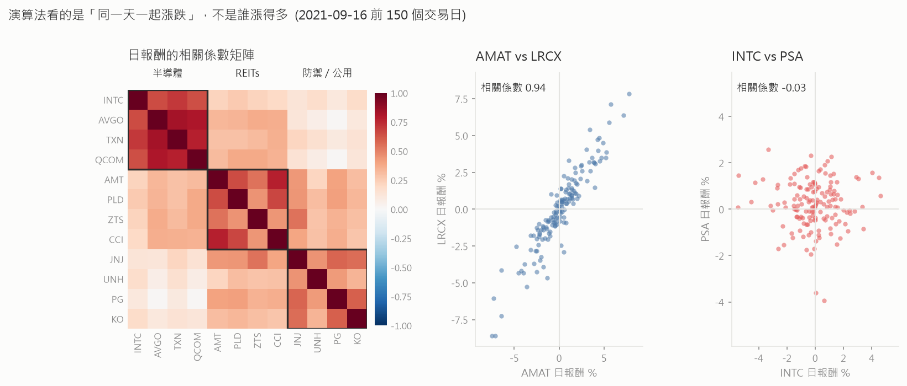
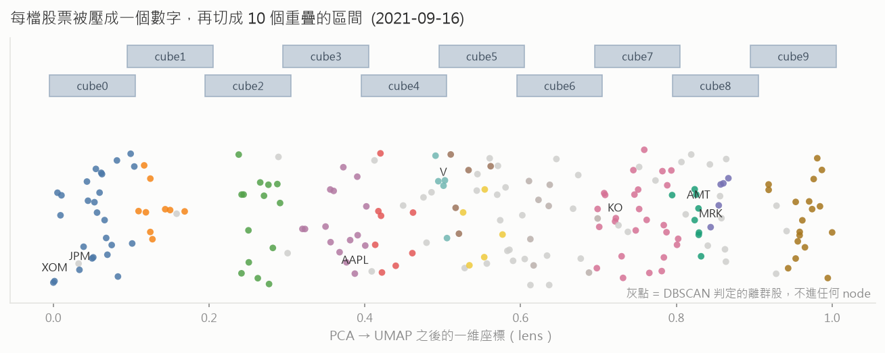
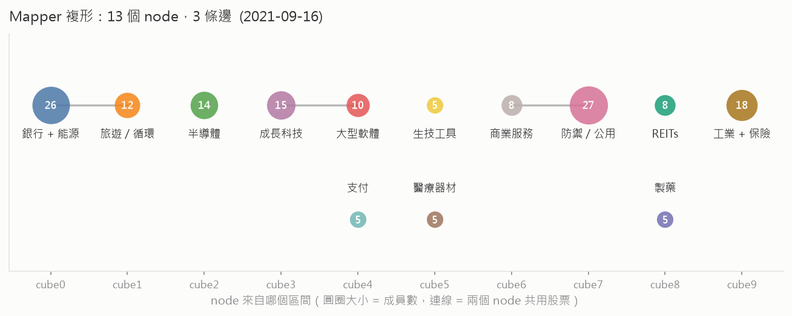
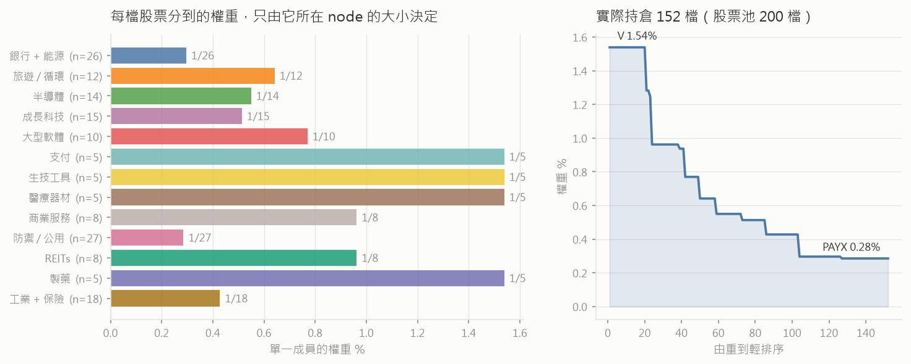
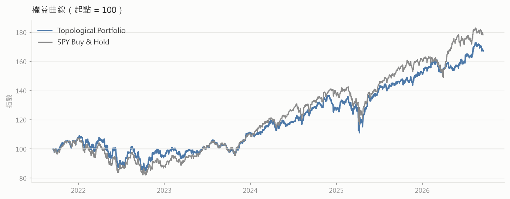

# Topological Portfolio 逐步拆解

這份文件解釋 `algorithms/topological_portfolio.py` 到底在做什麼。

所有圖和數字都是**真的跑出來的**，不是示意圖：`explain_figures.py` 會用
`data-sp500/` 裡的資料，在指定日期上重跑一次策略裡一模一樣的程式碼
（`clustering_symbols` 和 `_weight_distribution` 是逐字複製過去的）。走查用的
日期是 **2021-09-16**，也就是回測的第一天，用的是到當天收盤為止的 150 根日線。

```
uv run --group topological python research/topological_portfolio/explain_figures.py
```

---

## 一句話版本

> 把 SPY 裡最大的 200 檔股票，依照「**有沒有在同一天一起漲跌**」分成幾群，
> 每一群拿到一樣多的錢，群裡再平均分給成員。被判定為「跟誰都不像」的股票不買。

聽起來像普通的分群，但中間那個「分群」用的是 **Mapper**——拓樸資料分析
（TDA）的一個演算法。它跟 K-means 有兩個關鍵差別，而這兩個差別決定了整個
策略的性格：

1. **一檔股票可以同時屬於兩群。** Mapper 的分群區間是重疊的。
2. **可以什麼群都不屬於。** 用 DBSCAN 分群，跟誰都不夠像的就是離群值。

第 2 點是這個策略最大的實際效果：2021-09-16 這天，200 檔裡只有 **152 檔**
真的被買進，另外 48 檔被判為離群值，完全不持有。

---

## 全景

```
   ① 選股票池        SPY 成分股 → 依權重取前 200 檔
          │
   ② 變成「點」       每檔股票 = 一個 149 維的向量（150 天的日報酬）
          │
   ③ 壓成一個數字     PCA → UMAP，149 維 → 1 維
          │
   ④ Mapper          切成 10 個重疊區間 → 每區間內 DBSCAN → 得到 13 個 node
          │
   ⑤ 連通元件         共用股票的 node 連起來 → 10 個「群」
          │
   ⑥ 算權重           每個 node 分到一樣多的錢，群內平均分
          │
   ⑦ 每天再平衡       9:31 用這組權重下單
          │
   ⑧ 每 125 天        回到 ②，整個重算一次
```

②～⑥ 只在 ⑧ 觸發時跑，中間的每一天都只做 ⑦。

---

## ① 選股票池

```python
lambda u: [x.symbol for x in sorted(
    [x for x in u if x.weight], key=lambda x: x.weight, reverse=True)[:200]]
```

從 SPY 的成分股清單裡，挑出**權重最大的 200 檔**。權重從哪來、為什麼本地跑
需要自己生，見主 README 的
[Constituents universes](../../README.md#constituents-universes)。

2021-09-16 這天前十名是 AAPL、MSFT、GOOGL、GOOG、AMZN、TSLA、BRKB、NVDA、
V、JPM。

## ② 把每檔股票變成一個「點」

```python
prices = history.unstack(0).close            # 150 天 × 200 檔
log_returns = np.log(prices / prices.shift(1)).dropna().T   # 200 檔 × 149 天
```

最後那個 `.T`（轉置）是整件事的轉捩點。轉置之前，每一**列**是一天；轉置之
後，每一**列是一檔股票**。

用三檔股票、三天來看就很清楚。這是這次走查用的資料裡，最前面三天的真實
日報酬：

| 日報酬 % | 2021-02-16 | 2021-02-17 | 2021-02-18 |
|---|---|---|---|
| AMAT | +1.40 | −2.26 | −1.99 |
| LRCX | +0.96 | −1.00 | −1.40 |
| PSA  | −0.83 | +1.78 | +0.40 |

轉置之後，AMAT 就是空間中的一個點，座標是 `(+1.40, −2.26, −1.99, …)`。實際
上不是 3 天而是 149 天，所以是 **149 維空間裡的 200 個點**。接下來所有動作
都是在問：這 200 個點排成什麼形狀？

一眼就看得出來 AMAT 和 LRCX 三天都同方向，PSA 三天都相反。這就是演算法唯一
在乎的訊號。

**「像不像」怎麼定義？** 用相關係數距離（`DBSCAN(metric='correlation')`）。
這點很容易誤會，值得先看清楚：



左邊是 12 檔股票的日報酬相關係數矩陣，順序照 Mapper 分出來的群排列——對角線
上的紅色方塊就是「同一群」。右邊兩張散點圖是同一件事的近拍：

- **AMAT vs LRCX**：相關係數 0.94。點幾乎落在一條線上——AMAT 漲的那天
  LRCX 也漲。
- **INTC vs PSA**：相關係數 −0.03。完全一團雲，兩者今天怎麼走互不相干。

這天所有配對的平均相關係數：**同一個 node 內 0.553，跨 node 只有 0.220**。

要注意的是，相關係數**不看漲多少，只看方不方向一致**。同一個半導體 node
裡，AMAT 在這 150 天漲了 23.5%，INTC 卻跌了 11.3%——相差將近 35 個百分點，
但它們仍然在同一群，因為它們是「在同一天」一起上下的。

## ③ 把 149 維壓成 1 維

```python
projection = [PCA(n_components=0.8, random_state=1),
              UMAP(n_components=1, random_state=1, n_jobs=-1)]
```

兩段接力：

- **PCA(0.8)**：先線性降維，保留 80% 的變異數。目的是去雜訊、加速。
- **UMAP(1)**：再非線性壓到**一個數字**。UMAP 的好處是它會盡量讓原本相近
  的點壓完還是相近。

在 Mapper 的術語裡，這個「把高維點壓成一個數字」的函式叫 **lens**（透鏡）。
它不是最終答案，只是一個用來「排隊」的座標——真正分群還是在原始 149 維資料
上做的。

## ④ Mapper：覆蓋 → 分群 → 連邊

這是核心，分三步。

**第一步：把 lens 的值域切成 10 個「重疊」的區間。**



上面兩排藍色長條就是 10 個區間（KeplerMapper 的預設是 10 個、重疊 10%）。
畫成上下交錯是為了看得出來**相鄰區間是有重疊的**——cube0 的右端超過了
cube1 的左端。這個重疊之後會變成連結兩個 node 的橋樑。

下面每個圓點是一檔股票，橫座標就是它的 lens 值。可以看到左邊那一團
（XOM、JPM 附近）自己聚成一塊，右邊又是另一塊。

**第二步：在每個區間**內部**，用 DBSCAN 分群。**

注意是在**原始的 149 維報酬資料**上分群，不是在 lens 值上。lens 只負責決定
「誰跟誰一起被拿去分群」。每個分出來的群叫一個 **node**。

DBSCAN 的特性是**允許有離群值**：密度不夠的點不會被硬塞進任何群。上圖裡的
灰點就是這些股票——2021-09-16 這天有 48 檔，它們最後一毛錢都不會拿到。

**第三步：兩個 node 只要共用股票，就連一條邊。**



這 13 個 node 是這樣分的（完全是演算法自己跑出來的，中文標籤是我看成員後加
上去的）：

| node | 檔數 | 成員 |
|---|---|---|
| cube0_cluster0 | 26 | JPM, BAC, XOM, WFC, CVX, MS, C, GS, SCHW, AXP, RTX, CAT, DE, USB, PNC, COP, TFC, COF, MET, AIG, SPG, DOW, EOG, SLB, APTV, PRU |
| cube1_cluster0 | 12 | RTX, BA, BKNG, TJX, GM, F, FCX, MAR, SPG, ROST, APTV, SYY |
| cube2_cluster0 | 14 | INTC, AVGO, TXN, QCOM, BLK, AMAT, AMD, ADI, LRCX, MU, KLAC, NXPI, TEL, MCHP |
| cube3_cluster0 | 15 | AAPL, GOOGL, GOOG, TSLA, PYPL, ADBE, INTU, NOW, ISRG, ADSK, ALGN, DXCM, CMG, SNPS, CDNS |
| cube4_cluster0 | 10 | MSFT, GOOG, AMZN, ADBE, NFLX, CRM, ILMN, IDXX, A, FTNT |
| cube4_cluster1 | 5 | V, MA, FIS, FISV, GPN |
| cube5_cluster0 | 5 | DHR, ABT, TMO, MSCI, IQV |
| cube5_cluster1 | 5 | MCD, MDT, SYK, EW, BSX |
| cube6_cluster0 | 8 | CSCO, ACN, LIN, SPGI, MRSH, MCO, CTAS, MSI |
| cube7_cluster0 | 27 | JNJ, UNH, PG, KO, VZ, PEP, IBM, CVS, SPGI, MMM, LMT, ELV, ADP, DUK, CI, SO, WM, CL, D, NOC, HUM, ROP, KMB, KHC, AEP, RSG, PAYX |
| cube8_cluster0 | 8 | AMT, PLD, ZTS, CCI, EQIX, PSA, DLR, SBAC |
| cube8_cluster1 | 5 | MRK, BMY, AMGN, GILD, REGN |
| cube9_cluster0 | 18 | BRKB, HON, UNP, MO, HCA, CB, ITW, ETN, NSC, EMR, GD, JCI, TROW, CARR, LHX, TT, TRV, ALL |

這是整份文件最值得停下來看的地方。沒有人告訴演算法什麼是「半導體」或
「REIT」，它只看了 149 天的漲跌，就把
`V, MA, FIS, FISV, GPN`（支付）、
`MRK, BMY, AMGN, GILD, REGN`（大型製藥）、
`AMT, PLD, CCI, EQIX, PSA, DLR, SBAC`（REITs）
分了出來。

三條邊分別是：

- `cube0 ─ cube1`：共用 RTX、SPG、APTV（金融/能源 ↔ 重啟循環股）
- `cube3 ─ cube4`：共用 GOOG、ADBE（成長科技 ↔ 大型軟體）
- `cube6 ─ cube7`：共用 SPGI（商業服務 ↔ 防禦股）

那些共用的股票就是「橋」。它們同時屬於兩個 node——這是 K-means 做不到的事，
也是 Mapper 之所以叫「拓樸」方法的原因：它保留的是**結構的形狀**，而不只是
把每個點塞進一個桶子。

## ⑤ 把相連的 node 併成一「群」

`clustering_symbols()` 把有邊相連的 node 併在一起。結果是 10 個群：

```
[cube0, cube1]  [cube3, cube4]  [cube6, cube7]
[cube2] [cube4_cluster1] [cube5_cluster0] [cube5_cluster1]
[cube8_cluster0] [cube8_cluster1] [cube9]
```

**但這一步對權重其實沒有影響**——下一節會看到為什麼。

## ⑥ 算權重



程式碼的註解寫著「在大群和小群之間、以及群內部分配權重」，但實際跑出來的
規則是這樣（我用程式對照過，誤差 0）：

> **每個 node 分到一樣多的錢，node 內的成員再平均分。**
> 一檔股票的權重 ∝ 它所在 node 的 `1 / 成員數`；如果它同時在兩個 node，就把
> 兩份加起來。

也就是 `weight(s) ∝ Σ 1/|node|`，對每個包含 s 的 node 加總。這天有 13 個
node，所以一檔只屬於單一 node 的股票拿到 `1 / (13 × node 大小)`：

| node 大小 | 每檔權重 |
|---|---|
| 5 檔（支付、製藥、醫材、生技工具）| **1.538%** |
| 8 檔（REITs、商業服務）| 0.962% |
| 10 檔（大型軟體）| 0.769% |
| 12 檔（旅遊/循環）| 0.641% |
| 14 檔（半導體）| 0.549% |
| 15 檔（成長科技）| 0.513% |
| 18 檔（工業+保險）| 0.427% |
| 26 檔（銀行+能源）| 0.296% |
| 27 檔（防禦/公用）| **0.285%** |

所以最重的是 V、MA、FIS、FISV、GPN 這五檔支付股，各 1.54%；最輕的是防禦股
那一大群，各 0.285%。差距 5.4 倍，而**唯一的決定因素是所屬 node 的大小**。

六檔「橋」股票因為被算兩次，拿到加總：

| 股票 | 所屬 node | 權重 |
|---|---|---|
| ADBE, GOOG | cube3(15) + cube4(10) | 0.513% + 0.769% = **1.282%** |
| SPGI | cube6(8) + cube7(27) | 0.962% + 0.285% = **1.247%** |
| RTX, APTV, SPG | cube0(26) + cube1(12) | 0.296% + 0.641% = **0.937%** |

### 一個值得知道的落差

`_weight_distribution` 是一個三層遞迴（群 → node → 股票），每一層都算了
`weight_per_element = 1 / 元素數`，但**只有最後一層（股票）那個值真的被寫進
`weights`**，上面兩層算完就丟掉了。而 `/(2 ** (level - 1))` 對每一檔股票都是
固定的 4，正規化時會約掉。

結果就是：**群的數量、群的大小，對權重完全沒有作用**。第 ⑤ 步那整套連通元件
的計算，唯一的實際效果是——`clustering_symbols` 的合併迴圈寫成
`if x in linked_clusters[i] or y in linked_clusters[i]`，其中 `y` 是一個
list，所以 `y in ...` 永遠是 False，合併是不完整的；一個 node 有機會被塞進
多個群，它的成員就會被多算一次。

換句話說，程式現在的行為是「**每個 Mapper node 等權**」，而不是註解描述的
「群之間等權、群內再分」。這兩種做法都是合理的設計，只是要知道跑的是哪一
種。想要註解描述的那個版本，得改 `_weight_distribution`。

## ⑦ 每天再平衡

```python
self.schedule.on(self.date_rules.every_day(spy.symbol),
                 self.time_rules.at(9, 31), self._rebalance)
...
self.set_holdings([PortfolioTarget(symbol, weight) for ...],
                  liquidate_existing_holdings=True)
```

每個交易日早上 9:31，用上面那組權重把整個投資組合對齊一次。
`liquidate_existing_holdings=True` 會把**不在名單裡的持股全部賣掉**——所以
每次重建拓樸結構之後，掉出名單的股票會被出清。

權重在兩次重建之間是固定的，但股價一直在動，所以理論上每天每檔都要微調。
實務上沒有：LEAN 預設會擋掉小於投組 0.1% 的委託
（`minimum_order_margin_portfolio_percentage`），所以 5 年下來只有 **2,565 筆
委託**，平均一天 2 筆，而不是一天 200 筆。日均週轉率 0.85%。

另外，因為用的是日線，LEAN 會把 9:31 送出的市價單自動轉成 **MarketOnClose**，
在當天收盤成交——所以沒有用未來資訊。

## ⑧ 每 125 天重建

```python
next_recalibration = algorithm.time + timedelta(self.recalibration_period)
```

每 125 個日曆日（約 4 個月）整個流程重跑一次。回測期間共重建 **15 次**：第一
次就在 2021-09-16 早上 9:31（所以回測第一天開盤前才有持股），之後是
2022-01-19、2022-05-24、2022-09-26、2023-01-29 …… 一路到 2026-07-02。

為什麼要重建？因為市場的相關結構本來就會變。把同一套程式跑在
**2022-09-26**（一年後，熊市中）上，分群長得完全不一樣：

| 2021-09-16 | 2022-09-26 |
|---|---|
| 13 個 node，能源和銀行混在同一群 | 9 個 node，**能源自己獨立成一群**（XOM, CVX, COP, EOG, OXY, SLB, ADM, VLO, DVN, PSX, WMB，11 檔）|
| 最大群 27 檔 | 最大群 37 檔（防禦股大集結：UNH, JNJ, LLY, KO, ABBV, PFE, MRK, VZ…）|
| 半導體自成一群 | 半導體被併進一個 30 檔的「成長股被殺」大群（META, NVDA, CRM, QCOM, ADBE, AMD, NFLX, PYPL…）|

2022 年的能源獨走和成長股齊跌，在拓樸結構上看得一清二楚。這就是為什麼不能
只算一次。

（`recalibrate_period = 125` 和 `history_lookback = 150` 這兩個數字的來源，
在目前手上的研究片段裡沒有交代——原始 notebook 還 import 了 `ripser` 和
`persim` 卻沒用到，那段 persistent homology / Wasserstein 距離的分析很可能
就是決定這兩個數字的地方。）

## ⑨ 這個結構有多穩？

值得先知道一件事，因為它會改變你怎麼看上面那張分群表。

把走查日期往前挪**一天**（用到 2021-09-15 為止的 150 根日線），重跑一次：

| | 到 09-16 | 到 09-15 |
|---|---|---|
| node 數 | 13 | 13 |
| node 大小 | 5, 5, 5, 5, 8, 8, 10, 12, 14, 15, 18, 26, 27 | 5, 6, 6, 6, 7, 7, 10, 11, 11, 18, 20, 23, 28 |
| 持股數 | 152 | 146 |

拿兩次結果比對：

- **「誰會被買」很穩**：兩天都持有的有 144 檔，Jaccard 相似度 **0.94**。往前
  挪一整週也還有 0.87。
- **「誰跟誰一群」不太穩**：把「這兩檔在同一個 node」當成一個配對來算，
  09-16 有 1228 對、09-15 有 1209 對，但只有 812 對是共同的——Jaccard 只有
  **0.50**。挪一週同樣是 0.49。

也就是說，**半導體大致還是跟半導體在一起、REITs 還是跟 REITs 在一起**（上面
那張相關係數矩陣的方塊結構本來就很紮實），但 node 的邊界會移動、大小會變、
落在哪個 cube 也會變。

這件事之所以重要，是因為**權重只由 node 大小決定**（第 ⑥ 步）。所以持股清單
幾乎不動，權重卻會跳。以 09-16 那次為例，半導體被分成一個 14 檔的 node，每
檔 0.549%；09-15 那次它被拆成「7 檔純半導體」加上「和工業股混在一起的一
群」，同一批股票的權重就完全不同了。

這是 UMAP + DBSCAN 這條管線的固有性質，不是實作錯誤——UMAP 對輸入的微小變
化本來就敏感（所以原程式才會固定 `random_state`）。要判斷這個策略好不好，這
個不穩定性應該算進去：它意味著回測結果對「哪一天重建」這件事有相當的依賴。

---

## 跑出來的結果



2021-09-16 → 2026-09-15，起始資金 100 萬美元：

| 統計 | Topological Portfolio | SPY 買進持有 |
|---|---|---|
| 年化報酬 | 10.827% | 12.249% |
| 最大回撤 | 22.000% | 23.600% |
| Sharpe | 0.33 | 0.396 |
| Sortino | 0.378 | 0.457 |
| 委託筆數 | 2,565 | 1 |
| 日均週轉 | 0.85% | 0.05% |

從曲線看得出來它在做什麼：**2022 年的熊市裡跌得比 SPY 少一點，2024 年之後
的大型科技股行情裡漲得比 SPY 少一點。** 這很合理——它把權重從市值加權拉平
成「每個相關性群組等權」，結果就是減碼那幾檔帶動指數的超大型股。

這是一個區間、一組參數的結果，而且用的權重是重建出來的近似值，被併購的公司
也不在資料裡（主 README 有說明）。不要把它當成策略好壞的定論。

---

## 六個重點

1. **它不看基本面、不看產業分類、不看動能。** 只看 150 天的日報酬有沒有同步。
2. **被判為離群值的股票完全不買。** 這天 200 檔裡有 48 檔出局，是最大的單一
   效果。
3. **小群的個股權重高。** 5 檔的群每檔 1.54%，27 檔的群每檔 0.285%。這其實
   是一個隱含的押注：押「小而獨特的相關性群組」。
4. **「橋」股票拿雙份。** 同時屬於兩個 node 的股票權重加倍——這是 Mapper 相
   對於一般分群法真正不同的地方。
5. **分群結構對「哪一天重建」很敏感。** 持股清單穩（Jaccard 0.94），但誰跟
   誰一群只有一半重疊（0.50），而權重完全由 node 大小決定。
6. **實作與註解有落差。** 程式跑的是「每個 node 等權」，不是註解寫的「群間 +
   群內分層」。要改哪一邊是設計決定，不是 bug 修正。

## 想動手玩的話

`explain_figures.py` 最上面有四個常數：

```python
MAIN_DATE = "2021-09-16"        # 走查的日期
CONTRAST_DATE = "2022-09-26"    # 只用來對照
LOOKBACK = 150                  # history_lookback
UNIVERSE_SIZE = 200             # 股票池大小
```

改完重跑就會印出那天的分群、權重、穩定度，並重畫全部五張圖。想看參數怎麼
影響回測結果，
`variants.py` 裡的 `"Topological Portfolio"` 可以調
`history_lookback`、`recalibrate_period`、`universe_size`，然後：

```
uv run --group topological run_local.py "Topological Portfolio" --data-folder data-sp500
```

## 檔案對照

| 你想看的東西 | 在哪裡 |
|---|---|
| 策略本體 | `algorithms/topological_portfolio.py` |
| 選股票池的權重從哪來 | `README.md` 的 Constituents universes |
| 重現這份文件的圖和數字 | `research/topological_portfolio/explain_figures.py` |
| 回測完整統計 | `results/topological_portfolio/TopologicalPortfolio-summary.json` |
| 每一筆成交 | `results/topological_portfolio/TopologicalPortfolio-order-events.json` |

`results/` 是 `run_local.py` 每次跑都會重寫的輸出，所以不在版控裡。這份文件
的五張圖已經是畫好的檔案，但要**重跑** `explain_figures.py` 需要先有
`data-sp500/`（見主 README），第五張權益曲線還需要先跑過這兩個回測：

```
uv run --group topological run_local.py "Topological Portfolio" --data-folder data-sp500
uv run --group topological run_local.py "SPY Buy & Hold 2021-2026" --data-folder data-sp500
```
