# TradingAgents 分析師團隊：跟著「ABC 科技」走一遍

> 這份文件解說 TradingAgents 的四位分析師（技術面、基本面、新聞、社群情緒）：他們**拿了什麼數據、怎麼分析、為什麼這樣分析、最後想得到什麼**。
> 全程用一家虛構公司「**ABC 科技**」當例子，從頭走到尾。
>
> 依據：TradingAgents v0.7.1 原始碼。ABC 的所有數字、圖表都是**虛構的示意資料**（產生圖的程式：`images/make_figures.py`）。

---

## 怎麼讀這份文件

| 標記 | 意思 | 簡報時 |
|---|---|---|
| 一般正文、圖 | **主線**：照順序講就能理解全貌 | 照著講 |
| 🎯 這段要回答 | 每一段開頭的問題 | 先拋問題 |
| 📌 本段重點 | 每一段結尾的 2–3 句總結 | 停下來確認大家懂了 |
| ▶ 點開來的灰色區塊 | **補充細節**：完整指標清單、程式碼位置、例外狀況 | 預設不展開，有人問再點開 |

不需要任何金融背景。遇到專有名詞，正文會當場解釋；也可以查最後的〈附錄 A：名詞小辭典〉。

## 目錄

| 段落 | 主題 | 一句話 |
|---|---|---|
| Part 0 | 全貌 | 分析師團隊在系統中的位置、怎麼工作 |
| Part 1 | 今天的題目 | ABC 科技是誰、要分析什麼 |
| Part 2 | 技術面分析師 | 市場現在怎麼對待 ABC？ |
| Part 3 | 基本面分析師 | ABC 體質好嗎？股價貴不貴？ |
| Part 4 | 新聞分析師 | 外面的世界發生了什麼？ |
| Part 5 | 社群情緒分析師 | 大家現在對 ABC 的感覺如何？ |
| Part 6 | 報告交出去之後 | 四份報告怎麼被用來做決策 |
| Part 7 | 總整理 | 一張表比較四位分析師 |
| Part 8 | 延伸討論 | 對自己做策略研究的啟示、系統限制 |
| 附錄 | 名詞小辭典、程式碼對照 | |

---

## Part 0：三分鐘看懂全貌

🎯 **這段要回答：** 分析師團隊在 TradingAgents 裡扮演什麼角色？

### 0.1 整個系統長這樣

TradingAgents 模仿一間投資公司的分工，用多個 AI 角色接力做出投資決策。**分析師團隊是第一站**，負責蒐集證據、寫報告。

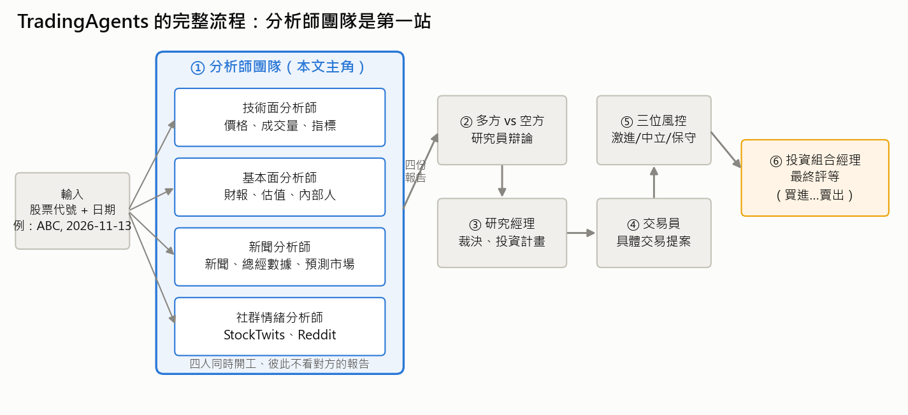

### 0.2 為什麼要四位分析師？用「頂讓一家餐廳」來想

假設你考慮花錢頂下一家餐廳（＝買一家公司的股票），你會想知道：

| 你會想知道 | 怎麼查 | 對應分析師 |
|---|---|---|
| 這家店賺不賺錢、有沒有欠債？ | 翻帳本 | **基本面** |
| 最近客人越來越多還是越來越少？ | 看每天來客數的走勢 | **技術面** |
| 這條街要拆遷嗎？景氣好嗎？ | 看新聞、政策、大環境 | **新聞** |
| 網路上的食客最近怎麼評價？ | 看 Google 評論、PTT | **社群情緒** |

任何單一角度都可能騙人：帳本很漂亮，但這條街明年要拆；網路一片好評，但其實只是暫時爆紅。**四個角度互補，才能看到完整的圖。**

### 0.3 一位分析師怎麼工作？

分析師其實就是「一個 AI ＋ 一份任務說明 ＋ 幾個查資料的工具」。有兩種工作模式：

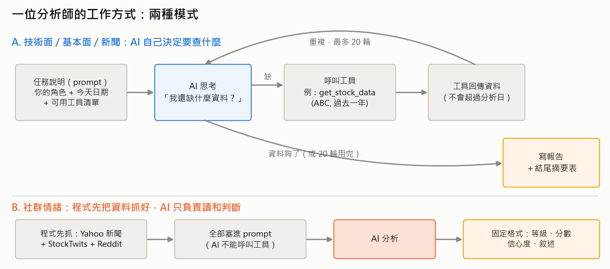

- **技術面、基本面、新聞**：AI 自己決定要查什麼、查幾次，查夠了就寫報告。
- **社群情緒**：程式先把資料抓好塞給 AI，AI 只負責讀和判斷（原因在 Part 5 說明）。

### 0.4 四條所有分析師都遵守的規則

1. **只報告、不決策。** 任務說明裡寫著：「Report what your tools support; another agent decides the trade.」分析師像偵查員，只負責蒐證，要不要買是後面的人決定。
2. **四人同時開工、互不參考。** 避免一個人的看法帶歪另一個人。
3. **不能偷看未來。** 如果分析日期是 2026-11-13，工具絕不會給 11/13 之後的資料（回測時才不會作弊）。
4. **報告結尾要附一張摘要表**，方便後面的人快速抓重點。

📌 **本段重點**
- 分析師團隊是系統的第一站，四人同時從四個角度蒐證，交出四份報告。
- 他們只報告不決策；決策由後面的辯論與經理負責。

<details>
<summary>▶ 深入看：這些規則在程式的哪裡？</summary>

| 規則 | 程式位置 | 說明 |
|---|---|---|
| 只報告不決策 | 四個 `tradingagents/agents/analysts/*_analyst.py` 的 system prompt | 每位分析師的任務說明都有這句 |
| 同時開工 | `tradingagents/graph/setup.py`：「The analysts work at the same time; the research debate starts once every one of them has filed its report.」 | 四個節點都從 START 出發，全部完成才進入多空辯論 |
| 不偷看未來 | `tradingagents/agents/tools.py`、`tradingagents/dataflows/date_window.py` | 每個工具都由程式注入 `trade_date`，AI 要求的日期若超過它會被截斷 |
| 工具次數上限 | `default_config.py` 的 `max_tool_rounds: 20`；`analysts/turn.py` | 20 輪用完後，AI 會被要求「立刻用已有資料寫報告，並說明哪些資料沒拿到」 |
| 用哪種 AI | `graph/setup.py`：分析師都用 `quick_thinking_llm` | 分析師用較快較便宜的模型；需要深度判斷的經理才用 `deep_thinking_llm` |
| 可以只選部分分析師 | `setup.py` 的 `selected_analysts`，預設 `("market", "social", "news", "fundamentals")` | 社群情緒分析師在設定裡叫 `social` |

</details>

---

## Part 1：今天的題目 —— ABC 科技

🎯 **這段要回答：** 我們要跟著走的例子是什麼？

假設你在 **2026 年 11 月 13 日（星期五）收盤後**，對 TradingAgents 下了這個指令：

```python
ta = TradingAgentsGraph()
state, decision = ta.propagate("ABC", "2026-11-13")
```

**ABC 科技（虛構）的基本資料：**

| 項目 | 內容 |
|---|---|
| 產業 | 半導體／AI 晶片 |
| 今天收盤價 | 106.48 美元 |
| 最近一個月 | 從約 93 美元漲到 106 美元（＋15%） |
| 最近大事 | 10/28 宣布和雲端大廠簽下大合約；11/05 傳出歐盟反壟斷調查 |

四位分析師同時拿到「ABC」和「2026-11-13」這兩個資訊，開始工作。他們往回看的時間長度不一樣：

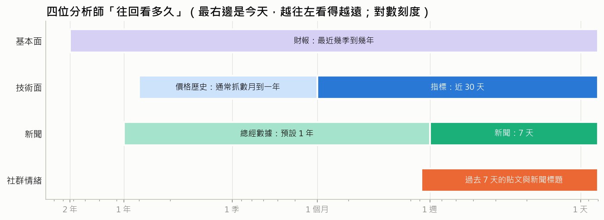

這個差異很重要：**情緒只看最近一週，基本面看好幾季**。所以四份報告講的其實是不同時間尺度的事，後面的決策者要自己權衡。

📌 **本段重點**
- 輸入只有兩樣：股票代號和分析日期。
- 四位分析師看的時間長度從「一週」到「好幾年」都有。

---

## Part 2：技術面分析師 —— 市場現在怎麼對待 ABC？

🎯 **這段要回答：** 只看價格和成交量，能看出什麼？

> **技術分析的核心想法：** 所有人知道的資訊（財報、新聞、情緒）最後都會反映在「買賣行為」上，所以價格本身就是所有資訊的總結。它不問「ABC 好不好」，只問「市場現在怎麼對待 ABC」。

### 2.1 第一步：拿到每天的價格資料（OHLCV）

技術面分析師第一個呼叫的工具是 `get_stock_data`，拿到 ABC 每天的五個數字，合稱 **OHLCV**：開盤價（Open）、最高價（High）、最低價（Low）、收盤價（Close）、成交量（Volume）。

畫出來就是大家常看到的「K 線圖」：

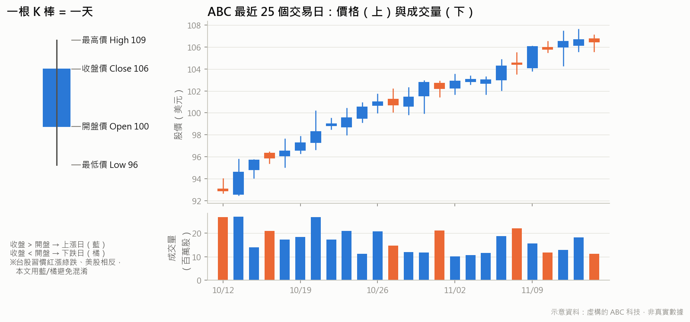

接著它會從十幾個「技術指標」中，**挑最多 8 個彼此互補的**來算。技術指標就是把價格資料用公式加工，讓某個特性更容易看出來。下面依照「趨勢 → 動能 → 波動」三個問題，看 ABC 的狀況。

### 2.2 問題一：趨勢往哪走？—— 移動平均線

**移動平均線**＝把過去 N 天的收盤價平均，畫成一條線。目的是把每天上下亂跳的價格「抹平」，看出大方向。

- **50 日均線**：大約一季的平均，代表中期趨勢。
- **200 日均線**：大約一年的平均，代表長期趨勢，是市場上最常被引用的「多空分界線」。

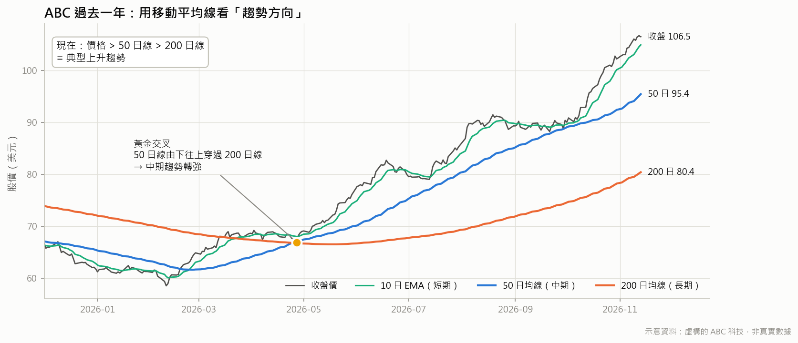

**ABC 的狀況：**
- 今年 4 月底出現「**黃金交叉**」：50 日線由下往上穿過 200 日線，代表中期趨勢轉強。
- 現在的排列是「價格 106.5 ＞ 50 日線 95.4 ＞ 200 日線 80.4」，是**教科書式的上升趨勢**。

> 均線的缺點：它是「落後指標」，等它確認趨勢時，價格往往已經走了一大段。所以還要搭配反應更快的指標。

### 2.3 問題二：力道在加強還是減弱？—— RSI 與 MACD

趨勢向上，不代表會一直漲。接下來要看「漲的力道」。

- **RSI（相對強弱指標）**：0–100 分，衡量最近 14 天「漲的力道」佔多少。**超過 70 叫「超買」**（短期漲太快，可能要休息）；**低於 30 叫「超賣」**（短期跌太深，可能反彈）。
- **MACD 柱狀圖**：衡量「短期均線和長期均線的差距」有沒有在擴大。柱子越長＝上漲越來越快；柱子變短＝雖然還在漲，但越漲越沒力。

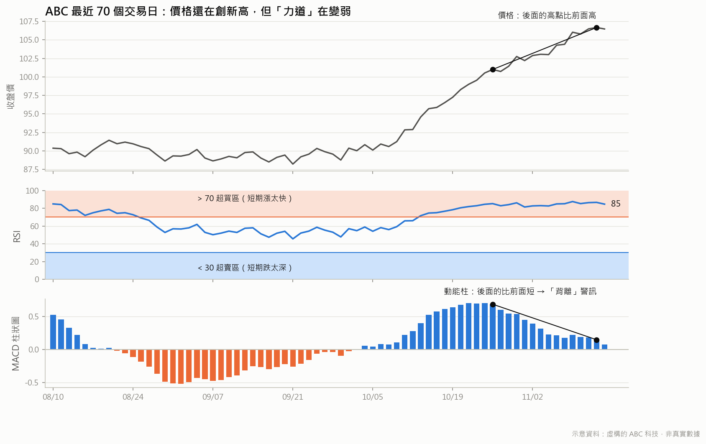

**ABC 的狀況：**
- RSI 到了 **85**，明顯在超買區。
- 價格還在創新高（101 → 106.7），但 MACD 柱子卻從 0.69 縮到 0.15。這叫「**背離**」：就像一台車還在往前開，但油門已經慢慢放開了，常是趨勢可能轉弱的早期警訊。

> 但要小心：**強勢股的 RSI 可以在 70 以上待很久**。任務說明特別提醒：「In strong trends, RSI may remain extreme; always cross-check with trend analysis.」所以不能看到超買就喊賣。

### 2.4 問題三：價格晃動有多大？—— 布林通道與 ATR

- **布林通道**：以 20 日均線為中心，上下各畫一條「正常波動範圍」的邊界。價格大約 95% 的時間會落在通道內，碰到上緣代表相對偏貴、碰到下緣代表相對偏便宜。
- **ATR（平均真實波幅）**：平均每天價格上下晃幾塊錢。

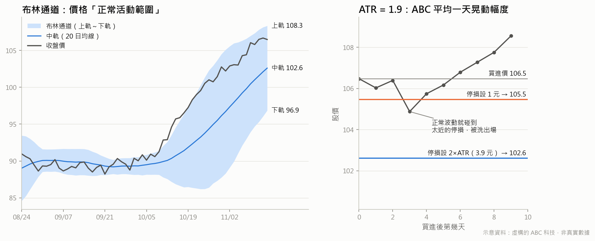

**ABC 的狀況：**
- 價格 106.5 貼近布林上軌 108.3：位置偏高。
- ATR = **1.9 元**：ABC 平均一天晃 1.9 元。

**ATR 最實際的用途：決定停損放哪、要買多少。**
- 停損＝事先決定「跌到哪裡就認賠出場」。如果停損只設在買價下方 1 元，正常波動就會把你「洗出場」（右圖橘線）。
- 比較合理的是 2 倍 ATR ≈ 3.9 元，停損放在 102.6（右圖藍線）。
- 如果你一筆交易最多只願意虧 3,900 美元，停損距離 3.9 元 → **最多買 1,000 股**。

這就是為什麼技術面報告對後面的「交易員」很重要。

### 2.5 防止 AI 編數字：核實快照

AI 有時會「幻覺」，編出不存在的數字（例如亂講一個布林通道數值，或說「歷史上在這裡反彈過三次」）。所以程式規定：寫報告前**必須**呼叫 `get_verified_market_snapshot`，這個工具**不經過 AI**，直接用程式算出最新價格與 11 個常用指標。報告裡任何精確數字都要以它為準。

AI 從這個工具看到的內容大概長這樣（節錄）：

```text
## Verified market data snapshot for ABC
- Requested analysis date: 2026-11-13
- Latest trading row used: 2026-11-13

| Field  | Value  |        | Indicator     | Value  |
|--------|--------|        |---------------|--------|
| Open   | 106.73 |        | close_10_ema  | 104.91 |
| High   | 107.10 |        | close_50_sma  | 95.43  |
| Low    | 105.60 |        | close_200_sma | 80.40  |
| Close  | 106.48 |        | rsi           | 84.67  |
| Volume | 11.1M  |        | macdh         | 0.08   |
                            | boll_ub       | 108.34 |
                            | atr           | 1.93   |
```

### 2.6 技術面分析師交出的報告（ABC 摘要）

| 面向 | 觀察 | 意義 |
|---|---|---|
| 趨勢 | 價格 ＞ 50 日線 ＞ 200 日線；4 月黃金交叉 | 中長期上升趨勢明確 |
| 動能 | RSI 85；MACD 柱狀圖縮短（背離） | 短期過熱，上漲力道減弱 |
| 波動 | 貼近布林上軌；ATR 1.9 | 位置偏高；停損合理距離約 3.9 元 |
| 成交量 | 最近創新高時成交量沒有放大（VWMA 略低於 20 日均線） | 上漲的「資金背書」變弱 |

📌 **本段重點**
- 技術面回答四件事：**趨勢方向、力道強弱、是否過熱、波動多大**。
- ABC：大趨勢向上，但短期過熱且力道在減弱。
- ATR 會直接影響後面交易員設定停損與買多少股。

<details>
<summary>▶ 深入看：完整的指標菜單（12 個，AI 每次挑最多 8 個）</summary>

任務說明要求：「選最多 8 個、提供互補資訊、避免重複」（例如不要同時選 RSI 和 StochRSI，因為兩者衡量的是同一件事），並簡短說明為什麼適合當下的市場。

| 類別 | 指標代號 | 中文 | 白話用途 | 任務說明中的提醒 |
|---|---|---|---|---|
| 移動平均 | `close_50_sma` | 50 日簡單均線 | 中期趨勢、動態支撐壓力 | 落後價格，要搭配快速指標 |
| 移動平均 | `close_200_sma` | 200 日簡單均線 | 長期趨勢、黃金/死亡交叉 | 反應慢，適合確認大方向，不適合頻繁進出 |
| 移動平均 | `close_10_ema` | 10 日指數均線 | 短期動能變化、進場點 | 盤整時雜訊多，要搭配長均線過濾 |
| MACD | `macd` | MACD 線 | 短期 EMA(12) − 長期 EMA(26)，看動能 | 低波動或盤整時要用其他指標確認 |
| MACD | `macds` | 訊號線 | MACD 的 9 日平均，和 MACD 線交叉當訊號 | 要放在更大的策略中，避免假訊號 |
| MACD | `macdh` | 柱狀圖 | MACD − 訊號線，看動能強弱、提早發現背離 | 波動大，快速市場要加過濾 |
| 動能 | `rsi` | 相對強弱指標 | 70/30 判斷超買超賣、看背離 | 強勢趨勢中 RSI 可以一直處在極端值 |
| 波動 | `boll` | 布林中軌 | 20 日均線，價格的動態基準 | 要搭配上下軌一起看 |
| 波動 | `boll_ub` | 布林上軌 | 中軌 + 2 個標準差，潛在超買／突破區 | 強勢時價格可以沿著上軌走 |
| 波動 | `boll_lb` | 布林下軌 | 中軌 − 2 個標準差，潛在超賣區 | 要用其他分析避免假反轉 |
| 波動 | `atr` | 平均真實波幅 | 設停損、依波動調整部位大小 | 是事後反應的指標 |
| 成交量 | `vwma` | 成交量加權均線 | 成交量大的日子權重高，確認趨勢有沒有資金支撐 | 成交量暴增時可能失真 |

**名詞補充：**
- **SMA vs EMA**：SMA 每天權重一樣；EMA 給「最近幾天」比較大的權重，所以反應比較快。
- **死亡交叉**：50 日線由上往下穿過 200 日線，和黃金交叉相反，代表轉弱。
- **標準差**：衡量「價格平常會偏離平均多遠」。布林通道變窄代表市場在盤整、累積能量；突然變寬常代表大行情開始。
- **支撐／壓力**：價格跌到某處常會止跌（支撐）、漲到某處常遇到賣壓（壓力）。均線、布林上下軌常被當成參考。

</details>

<details>
<summary>▶ 深入看：三個工具與防幻覺的規則</summary>

| 工具 | 內容 | 來源（預設） |
|---|---|---|
| `get_stock_data(start_date, end_date)` | 指定期間每日 OHLCV（期間由 AI 決定） | Yahoo Finance |
| `get_indicators(indicator, curr_date, look_back_days=30)` | 單一指標近 N 天數值；AI 若一次傳多個（用逗號分隔），程式會拆開逐一計算 | 由 OHLCV 用 `stockstats` 套件計算 |
| `get_verified_market_snapshot(curr_date)` | 最新一天 OHLCV、11 個固定指標、最近最多 30 天收盤價 | 程式直接計算（`dataflows/vendors/yahoo/snapshot.py`） |

快照的 11 個固定指標：`close_10_ema`、`close_50_sma`、`close_200_sma`、`rsi`、`boll`、`boll_ub`、`boll_lb`、`macd`、`macds`、`macdh`、`atr`。

任務說明中的防幻覺規則（`market_analyst.py`）：
- 寫報告前必須呼叫快照，並以它作為精確價格與指標數值的依據。
- 其他工具的數字和快照衝突時，要**指出差異**，不能自己編一個折衷值。
- 除非工具輸出有具體日期與價格佐證，否則**不得聲稱**歷史驗證、支撐壓力反彈或精確漲跌幅。

這個設計源自 GitHub issue #830：AI 曾編造出資料不支持的布林通道數值和「歷史驗證過的反彈」。

</details>

---

## Part 3：基本面分析師 —— ABC 體質好嗎？股價貴不貴？

🎯 **這段要回答：** ABC 是不是一家好公司？就算是，現在的股價合理嗎？

> **基本面分析的核心想法：** 股價長期會回到公司的「真實價值」。短期市場可能瘋狂或恐慌，但長期來說，會賺錢的公司股價會跟上。

### 3.1 先認識三大財務報表

上市公司每季都要公布財務報表。基本面分析師會用三個工具分別拿到這三張表：

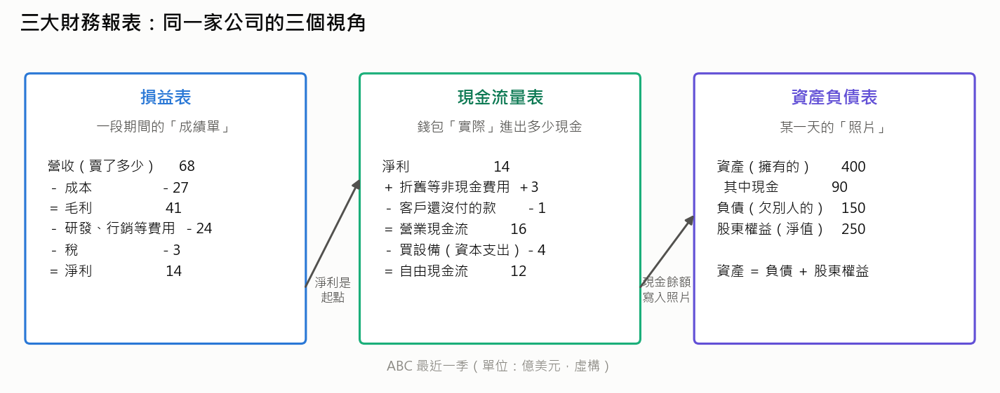

用個人理財來比喻：

- **損益表**＝一季的「成績單」：賺了多少、花了多少，最後**淨利**是多少。
- **現金流量表**＝錢包「實際」進出多少現金。從淨利出發，調整成真正收到的現金，最後算出**自由現金流**（可以自由拿來配息、還債、投資的錢）。
- **資產負債表**＝某一天的「照片」：擁有什麼、欠多少、**淨值**多少。

**為什麼損益表賺錢還不夠，要看現金流？** 因為「帳面賺錢」不等於「收到錢」。例如賣了 100 億的貨，但客戶半年後才付款，損益表上已經算營收，現金卻還沒進來。如果一家公司淨利長期好看、現金流卻很差，就要小心。

### 3.2 ABC 的成績單

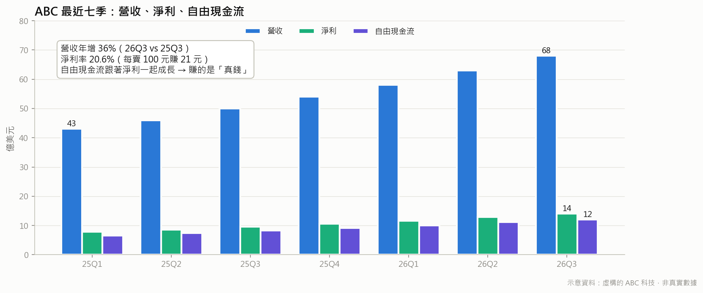

**ABC 的狀況：**
- **營收年增 36%**（成長很快）
- **淨利率 20.6%**（每賣 100 元賺約 21 元）
- **自由現金流跟著淨利一起成長**：賺的是真錢，不是紙上富貴
- 資產負債表：負債 150 億、淨值 250 億，負債不算重

### 3.3 但是……股價貴不貴？—— 估值

好公司不等於好投資：**買太貴也會虧**。這就是「估值」要回答的問題。最常用的是**本益比（PE）**：

> **本益比 ＝ 股價 ÷ 每股盈餘（EPS）**
> 意思是：「以目前的獲利速度，要幾年才能把買股票的錢賺回來？」

**用 ABC 算一次：**

| 步驟 | 計算 | 結果 |
|---|---|---|
| 過去 12 個月淨利 | 10.6 + 11.6 + 12.9 + 14.0 | 49.1 億美元 |
| 每股盈餘 EPS | 49.1 億 ÷ 20 億股 | 2.46 美元 |
| 本益比 PE | 106.48 ÷ 2.46 | **約 43 倍** |
| PEG（考慮成長的本益比） | PE 43 ÷ 預期年成長率 30 | **約 1.4** |

怎麼解讀：
- **PE 43** ＝ 以目前獲利要 43 年回本，代表市場對 ABC 的成長期待很高。
- 但高成長公司的 PE 本來就會比較高，所以要看 **PEG**：一般認為 < 1 相對便宜、> 2 偏貴。**ABC 的 1.4 是「不便宜，但還不算離譜」。**
- 風險在於：市場已經把很多年的成長算進股價，只要成長稍微不如預期，股價就可能大跌。

### 3.4 公司高層在買還是賣？—— 內部人交易

「內部人」＝董事、高階主管、大股東。他們買賣自家股票必須申報。**沒有人比 CEO 更了解自己的公司**，所以他們的行為是很有參考價值的訊號。

**ABC 的狀況（虛構）：**
- CFO 在 10/20 以約 97 美元自掏腰包買進 500 萬美元股票 → **正面訊號**（願意拿自己的錢押注）
- CEO 每月固定賣 1 萬股（事先排定的計畫）→ **中性**

> 解讀要小心：內部人賣股的原因很多（買房、繳稅、分散資產），單一賣出不一定是壞消息；但**多位高層同時大量賣出**就值得注意。

### 3.5 基本面分析師交出的報告（ABC 摘要）

| 面向 | 觀察 | 意義 |
|---|---|---|
| 成長 | 營收年增 36%、淨利年增 46% | 高速成長 |
| 獲利能力 | 淨利率 20.6%、股東權益報酬率約 20% | 賺錢效率好 |
| 現金品質 | 自由現金流跟著淨利成長 | 獲利是真的 |
| 財務安全 | 負債不重、流動比率約 2 | 撐得過景氣差的時候 |
| 估值 | PE 約 43、PEG 約 1.4 | 不便宜，已反映不少成長期待 |
| 內部人 | CFO 買進；CEO 例行性賣出 | 偏正面 |

📌 **本段重點**
- 基本面回答兩個問題：**公司好不好**（成長、獲利、現金、負債），以及**股價貴不貴**（估值）。
- ABC：體質很好，但股價已經不便宜。
- 「好公司」和「好價格」是兩回事。

<details>
<summary>▶ 深入看：get_fundamentals 回傳的全部指標（約 28 項）</summary>

AI 從 `get_fundamentals` 看到的是一份清單，格式大概像：

```text
# Company Fundamentals for ABC

Name: ABC Technology Inc.
Sector: Technology
Market Cap: 213000000000 USD
PE Ratio (TTM): 43.4
...
```

| 指標 | 白話解釋 | 怎麼看 |
|---|---|---|
| Name / Sector / Industry | 公司名、產業 | 決定要拿誰來比較 |
| Market Cap 市值 | 股價 × 總股數 ＝ 買下整家公司要多少錢 | ABC：106.48 × 20 億股 ≈ 2,130 億美元 |
| PE Ratio (TTM) 本益比 | 股價 ÷ 過去 12 個月 EPS | 越高代表期待越高（或越貴） |
| Forward PE 預估本益比 | 股價 ÷ 分析師預估的未來 12 個月 EPS | 比 TTM PE 低 → 市場預期獲利會成長 |
| PEG Ratio | PE ÷ 盈餘成長率 | < 1 相對便宜、> 2 偏貴 |
| Price to Book 股價淨值比 | 股價 ÷ 每股淨值 | 銀行、傳產常看 |
| EPS (TTM) / Forward EPS | 每股盈餘（過去／預估） | 每一股分到多少獲利 |
| Dividend Yield 殖利率 | 每年配息 ÷ 股價 | 成長股通常很低 |
| Beta | 和大盤的連動程度 | 1.5 ＝ 大盤漲 10% 它平均漲 15%，跌也放大 |
| 52 Week High / Low | 過去一年最高／最低價 | 目前價格在區間哪裡 |
| 50 / 200 Day Average | 50 / 200 日均價 | 和技術面重疊 |
| Revenue (TTM) 營收 | 過去 12 個月總收入 | 賣了多少東西 |
| Gross Profit 毛利 | 營收 − 直接成本 | |
| EBITDA | 稅息折舊攤銷前利潤 | 排除負債、稅制、設備折舊的差異，方便比較本業 |
| Net Income 淨利 | 扣完所有成本費用稅金 | 真正賺的 |
| Profit Margin 淨利率 | 淨利 ÷ 營收 | 0.25 ＝ 每賣 100 元賺 25 元 |
| Operating Margin 營業利益率 | 本業利潤 ÷ 營收 | 不含業外收入 |
| Return on Equity (ROE) | 淨利 ÷ 股東權益 | 0.20 ＝ 股東每投入 100 元，一年賺 20 元 |
| Return on Assets (ROA) | 淨利 ÷ 總資產 | 用全部資產賺錢的效率 |
| Debt to Equity 負債權益比 | 負債 ÷ 股東權益 | 太高代表槓桿大，景氣差時風險高 |
| Current Ratio 流動比率 | 一年內可變現資產 ÷ 一年內要還的債 | > 1.5 一般算安全；< 1 周轉可能吃緊 |
| Book Value 每股淨值 | 每股分到的帳面淨資產 | |
| Free Cash Flow 自由現金流 | 營業現金流 − 資本支出 | 長期為正且成長是好公司的特徵 |

**單位陷阱（程式有特別處理）：** Yahoo 給的殖利率 `0.41` 代表 0.41%、負債權益比 `78.4` 代表 78.4%（0.78 倍），但利潤率是小數（0.25 = 25%）。程式會把單位標清楚，避免 AI 搞錯。也處理了貨幣問題，例如台積電 ADR 用美元報價、財報用新台幣（`dataflows/vendors/yahoo/fundamentals.py`）。

</details>

<details>
<summary>▶ 深入看：五個工具、資料來源、為什麼優先用 SEC EDGAR</summary>

| 工具 | 內容 | 來源（預設） |
|---|---|---|
| `get_fundamentals` | 公司概況 + 約 28 項指標 | Yahoo Finance |
| `get_balance_sheet(freq)` | 資產負債表，預設季報（可選年報） | SEC EDGAR → 失敗才用 Yahoo |
| `get_income_statement(freq)` | 損益表 | SEC EDGAR → Yahoo |
| `get_cashflow(freq)` | 現金流量表 | SEC EDGAR → Yahoo |
| `get_insider_transactions` | 內部人交易 | Yahoo Finance |

設定在 `default_config.py`：`"fundamental_data": "sec_edgar,yfinance"`。

**為什麼優先用 SEC EDGAR（美國證管會的官方申報資料庫）？** 原始碼註解舉了一個例子：蘋果 2008 年的總資產原本公告 396 億，2010 年修正（restate）成 362 億。其他資料商只給「修正後的現在版本」，但 SEC EDGAR 會記錄**每個數字的申報日期**，所以回測時能拿到「當時投資人真正看到的版本」。而且財報是在季度結束後幾週才公布，EDGAR 能正確反映「那天以前到底公布了沒」。只限美國公司；不在 EDGAR 的會自動改用下一個資料來源。

</details>

<details>
<summary>▶ 深入看：回測時基本面資料會被「扣留」</summary>

如果分析日期是過去（回測），以下資料會被程式**扣留**，改回傳一段說明（`dataflows/date_window.py`）：

| 被扣留的資料 | 原因 |
|---|---|
| `get_fundamentals` 公司概況 | Yahoo 只有「今天」的市值、本益比等數值，沒有歷史版本，給過去的分析等於偷看未來。連公司名稱和產業別都可能改過 |
| 內部人交易 | Yahoo 只記交易日，不記申報日（申報可能晚兩個工作天），無法確認當時是否已公開 |
| Yahoo 的三大報表 | 只記財報涵蓋的期間，不記公布日 |

只有 **SEC EDGAR 的報表**能依當時申報的版本提供。所以**回測時基本面分析師拿到的資料會比即時分析少很多**，非美國公司更是幾乎什麼都拿不到。

另一個小細節：任務說明寫「analyzing fundamental information over the past week」，但財報一季才更新一次，「過去一週」對基本面意義不大，看起來是沿用其他分析師的模板字句。

</details>

---

## Part 4：新聞分析師 —— 外面的世界發生了什麼？

🎯 **這段要回答：** 除了公司本身，還有哪些外在因素會影響 ABC 的股價？

> 再好的公司也逃不過大環境。2022 年美國升息時，幾乎所有科技股不論體質都大跌，這就是新聞分析存在的理由。

新聞分析師有四個工具，可以分成兩組：**「已經發生什麼」**（新聞）和**「用數據與機率佐證」**（經濟數據、預測市場）。

### 4.1 已經發生什麼：公司新聞 + 全球新聞

- `get_news`：ABC 本身的新聞（最多 20 篇）
- `get_global_news`：總體經濟新聞（過去 7 天、最多 10 篇），預設搜尋：聯準會與利率通膨、財報與 GDP、地緣政治與貿易戰、各國央行、石油與供應鏈

**ABC 這週 AI 看到的新聞（虛構）：**

| 日期 | 類型 | 標題 | 影響 |
|---|---|---|---|
| 10/28 | 公司 | ABC 與大型雲端業者簽下 5 年供貨合約 | 正面：營收能見度提高 |
| 10/30 | 公司 | ABC 第三季財報優於預期 | 正面 |
| 11/05 | 公司 | 傳歐盟對 ABC 展開反壟斷初步調查 | 負面：潛在罰款或限制 |
| 11/07 | 全球 | 美國非農就業人數低於預期 | 經濟轉弱 → 降息機率上升 |
| 11/10 | 全球 | 聯準會官員：通膨仍高於目標，降息需謹慎 | 降息不確定 |

### 4.2 為什麼利率對股價這麼重要？

新聞分析師特別關心利率，因為它幾乎影響所有股票。用**定存**來想：

- 如果定存利率是 **1%**，一支每年能幫你賺 5% 的股票很吸引人 → 大家搶著買 → 股價上漲。
- 如果定存利率升到 **5%**，同一支股票就沒那麼吸引人了（定存零風險也有 5%）→ 資金流出股市 → 股價下跌。

而且對**高成長股**影響特別大，因為它們的獲利多半在很遠的未來：

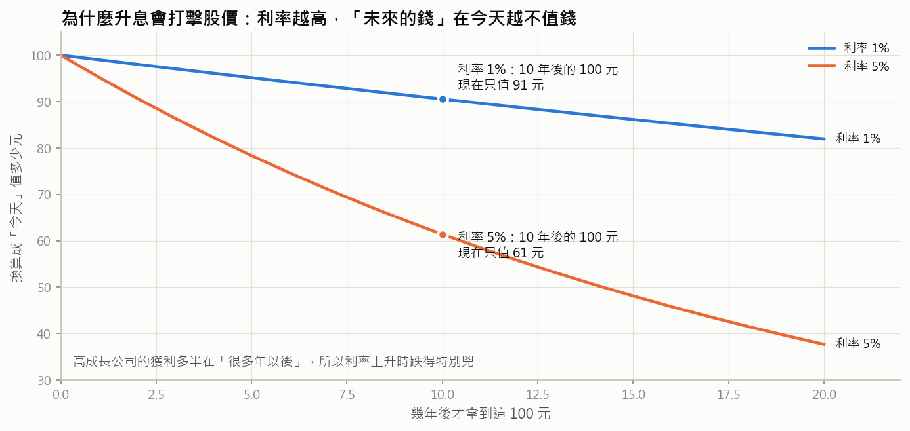

利率 5% 時，10 年後的 100 元在今天只值 61 元。ABC 是高成長股，所以**降息對它特別有利、升息特別傷**。

### 4.3 用數據佐證：FRED 經濟數據

AI 憑印象說「通膨好像還很高」是不可靠的。所以新聞分析師可以用 `get_macro_indicators`，從 **FRED**（美國聖路易聯邦準備銀行的免費經濟資料庫）拿到真實的經濟數據：

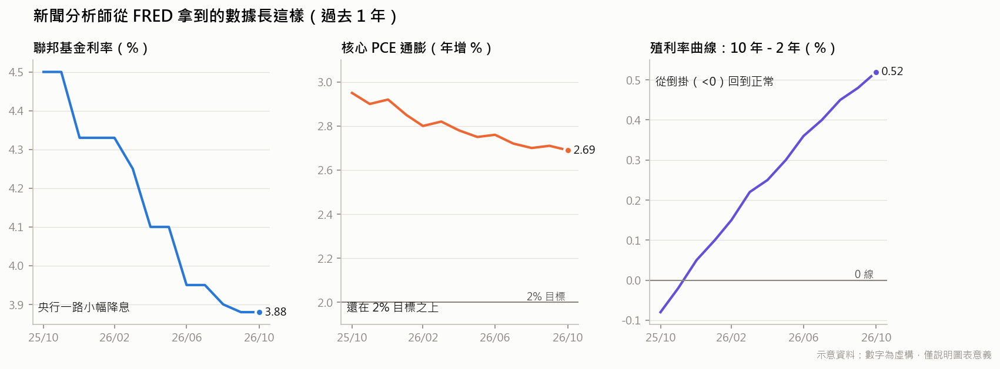

這三個是最常用的指標：

| 指標 | 白話意思 | 示意圖的讀法 |
|---|---|---|
| **聯邦基金利率** | 美國央行（聯準會，Fed）設定的基準利率，影響所有借貸成本 | 一路小幅降息 → 對股市是順風 |
| **核心 PCE 通膨** | 聯準會最看重的物價指標（排除波動大的食物和能源），目標是 2% | 2.69% 還在目標之上 → 聯準會可能不敢降太快 |
| **殖利率曲線（10 年 − 2 年）** | 長期和短期公債利率的差距 | 從負數回到正數 |

**殖利率曲線倒掛是什麼？** 正常情況下，借錢 10 年的利率應該比借 2 年高（借越久風險越大）。如果反過來變成負數（叫「倒掛」），代表市場預期「經濟會變差、未來利率會被迫降下來」。歷史上美國多次經濟衰退前都出現過倒掛。

### 4.4 市場怎麼看未來：預測市場

新聞告訴你「已經發生什麼」，**預測市場**告訴你大家認為「接下來會發生什麼」的機率。

**預測市場**是一種讓人用真錢押注「某件事會不會發生」的市場（TradingAgents 用的是 Polymarket）。例如「聯準會 12 月會降息嗎？」，如果「會」的合約價格是 0.72 美元，代表市場整體認為機率約 **72%**。和民調不同，這是用真金白銀押出來的，通常被認為比較誠實。

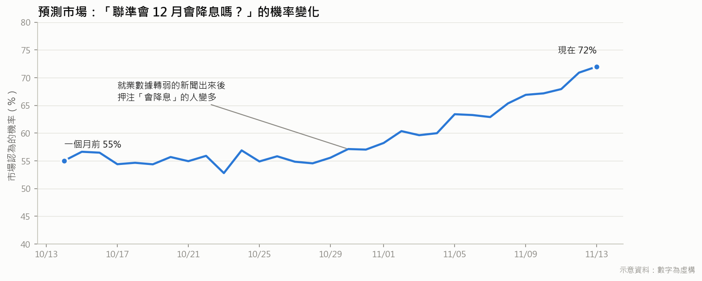

**ABC 的狀況：** 降息機率從一個月前的 55% 升到 72%，市場越來越相信會降息，對 ABC 這種成長股是順風。

### 4.5 新聞分析師交出的報告（ABC 摘要）

| 面向 | 觀察 | 對 ABC 的意義 |
|---|---|---|
| 公司事件 | 新合約、財報優於預期 | 正面催化劑 |
| 公司風險 | 歐盟反壟斷調查 | 潛在利空，需追蹤 |
| 利率 | 央行在降息，12 月降息機率升至 72% | 成長股順風 |
| 通膨 | 核心 PCE 2.69%，仍高於 2% 目標 | 降息可能不如預期快 |
| 景氣 | 殖利率曲線恢復正常、就業轉弱 | 衰退風險存在但不明確 |

📌 **本段重點**
- 新聞分析師看三層：**公司事件**、**總體經濟**、**市場對未來的預期**。
- 利率是影響股價最重要的總經因素，對成長股影響更大。
- 它用 FRED 數據和預測市場機率，讓總經評論「有數字佐證」。

<details>
<summary>▶ 深入看：四個工具與預設參數</summary>

| 工具 | 內容 | 來源 | 預設參數 |
|---|---|---|---|
| `get_news(start_date, end_date)` | 公司新聞：標題、摘要、出處 | Yahoo Finance | 最多 20 篇（`news_article_limit`） |
| `get_global_news(curr_date, look_back_days, limit)` | 全球／總經新聞 | Yahoo Finance | 7 天、10 篇（`global_news_lookback_days`、`global_news_article_limit`） |
| `get_macro_indicators(indicator, curr_date, look_back_days)` | 經濟數據：名稱、單位、頻率、最新值、期間變化、近期數據表 | FRED（需要 `FRED_API_KEY`） | 預設回看 1 年 |
| `get_prediction_markets(topic, limit)` | 符合主題、交易量最大的開放市場：機率、交易量、結算日、近期變化 | Polymarket（免金鑰） | 最多 6 個 |

`get_global_news` 預設的五組搜尋字（`default_config.py` 的 `global_news_queries`，可自行修改）：
1. Federal Reserve interest rates inflation
2. S&P 500 earnings GDP economic outlook
3. geopolitical risk trade war sanctions
4. ECB Bank of England BOJ central bank policy
5. oil commodities supply chain energy

**「選配」設計：** 經濟數據和預測市場被列為選配（`dataflows/router.py` 的 `OPTIONAL_CATEGORIES`）。沒設 FRED 金鑰或網路出錯時，只會回傳提示，不會讓整個分析中斷；但股價、財報、新聞這些「核心」資料失敗就會報錯。

</details>

<details>
<summary>▶ 深入看：FRED 可用的全部經濟指標</summary>

AI 可以用簡稱，也可以直接用 FRED 的原始代號（例如 `CPIAUCSL`）。完整對照在 `dataflows/vendors/fred.py`。

| 簡稱 | FRED 代號 | 中文 | 為什麼影響股市 |
|---|---|---|---|
| `fed_funds_rate` | FEDFUNDS | 聯邦基金利率 | 所有借貸成本的基準 |
| `2y_treasury` / `10y_treasury` / `30y_treasury` | DGS2 / DGS10 / DGS30 | 2/10/30 年期公債殖利率 | 無風險報酬的基準；10 年期影響股票估值最深 |
| `yield_curve`（`10y_2y_spread`） | T10Y2Y | 殖利率曲線 | 倒掛常是衰退前兆 |
| `cpi` / `core_cpi` | CPIAUCSL / CPILFESL | 消費者物價指數／核心 CPI | 通膨高 → 央行可能升息 |
| `pce` / `core_pce` | PCEPI / PCEPILFE | 個人消費支出物價 | 聯準會最看重的通膨指標 |
| `inflation_expectations` | T10YIE | 通膨預期 | 市場預期未來通膨 |
| `real_gdp` / `gdp` | GDPC1 / GDP | 實質／名目 GDP | 經濟有沒有在成長 |
| `industrial_production` | INDPRO | 工業生產 | 製造業景氣 |
| `unemployment` | UNRATE | 失業率 | 太高 → 衰退；太低 → 推升通膨 |
| `nonfarm_payrolls` | PAYEMS | 非農就業人數 | 經濟熱度溫度計 |
| `initial_claims` | ICSA | 初領失業救濟金人數 | 最即時的就業警訊（每週） |
| `m2` | M2SL | 貨幣供給 | 錢多 → 資產價格容易上漲 |
| `vix` | VIXCLS | 恐慌指數 | 越高代表市場越恐慌 |
| `dollar_index` | DTWEXBGS | 美元指數 | 美元強弱影響跨國企業獲利 |
| `consumer_sentiment` | UMCSENT | 消費者信心 | 影響消費支出 |
| `housing_starts` | HOUST | 新屋開工 | 房市與景氣 |
| `retail_sales` | RSAFS | 零售銷售 | 消費力道 |
| `ecb_deposit_rate`、`euro_hicp`、`euro_real_gdp`、`germany_10y`、`france_10y`、`eur_usd` | — | 歐元區對應指標 | 分析歐洲股票時使用 |

</details>

<details>
<summary>▶ 深入看：回測時新聞分析師的資料</summary>

- 新聞和 FRED 數據會依分析日期過濾，不會給之後的資料。
- Yahoo 新聞如果涵蓋不到那段期間，會明確標示「資料來源沒觀察到這段期間」，而不是假裝「沒有新聞」。
- **Polymarket 只有即時賠率、沒有歷史紀錄**，所以分析日期在過去時，這個工具會直接回覆「已扣留」（`dataflows/vendors/polymarket.py`），避免偷看未來。

</details>

---

## Part 5：社群情緒分析師 —— 大家現在對 ABC 的感覺如何？

🎯 **這段要回答：** 散戶在社群上怎麼看 ABC？情緒是冷靜、樂觀，還是狂熱？

> 短期股價很大程度是由「人的情緒」推動。2021 年 GameStop 事件，就是 Reddit 散戶情緒把股價推高數十倍的經典案例。

### 5.1 它和另外三位的最大不同：資料是先抓好的

另外三位分析師是 AI 自己決定要呼叫什麼工具；社群情緒分析師則是**程式先把三個來源的資料抓好，直接塞進任務說明**，AI 不能呼叫任何工具。

原因寫在程式註解裡：讓 AI 「根據拿到的資料做報告，而不是自己編造貼文」。社群貼文很容易被 AI 憑空捏造，先抓好資料就沒有這個問題。

### 5.2 三個資料來源（都是過去 7 天）

| 來源 | 內容 | 性質 |
|---|---|---|
| **Yahoo Finance 新聞標題** | ABC 的新聞 | 機構觀點、以事實為主、變化慢 |
| **StockTwits** | 最多 30 則提到 `$ABC` 的貼文，每則有發文者自己標的「看多／看空／無標籤」 | 散戶即時情緒、變化快 |
| **Reddit** | r/wallstreetbets、r/stocks、r/investing 的相關貼文 | 社群討論，但**沒有按讚數和留言數** |

**ABC 的 StockTwits 貼文（虛構節錄）：**

```text
[Bullish] $ABC 新合約只是開始，明年營收翻倍不是夢 🚀
[Bullish] 突破 105 了，加碼
[Bearish] RSI 都 85 了還追？等回檔再說
[ ]       有人知道歐盟調查會罰多少嗎？
```

### 5.3 看比例：情緒有多一面倒？

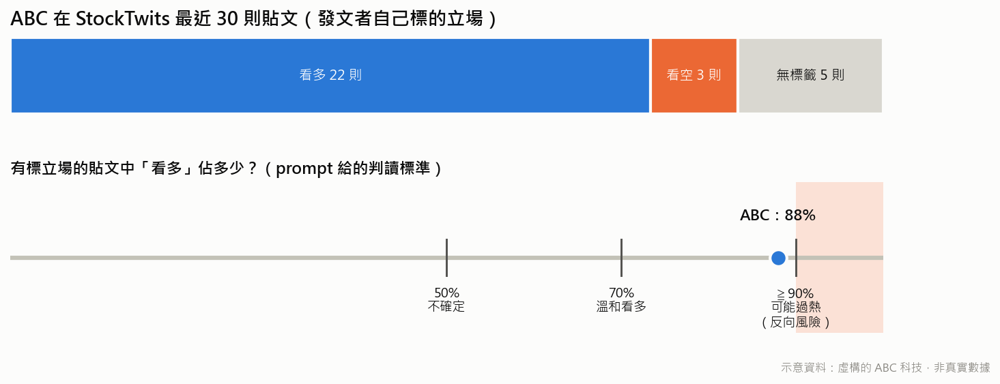

任務說明給 AI 的判讀標準：

| 看多比例 | 判讀 |
|---|---|
| 約 50% | 不確定 |
| 約 70% | 溫和看多 |
| **90% 以上** | **可能過熱，要注意「反向風險」** |

ABC 是 **88%**，接近過熱門檻。而且只有 25 則有標立場，**樣本很小**，任務說明也提醒要看實際則數，不能只看百分比。

**為什麼「太多人看多」反而是風險？—— 反向指標**

有個老故事：1929 年股災前，有人發現連擦鞋童都在跟他推薦股票，於是把股票全賣了。邏輯是：當**所有人**都已經看多、都已經買進，就沒有剩下的買家能把價格繼續推高，任何壞消息都可能引發賣壓。所以「極度樂觀」本身就是一種風險。

### 5.4 看落差：不同來源的看法一致嗎？

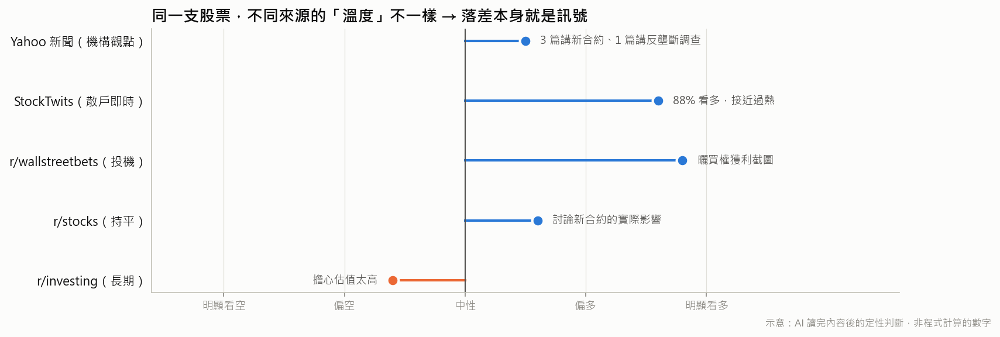

不同來源的「個性」不同，任務說明也有提醒：r/wallstreetbets 常常很狂熱（也常是反向指標）、r/stocks 比較持平、r/investing 偏長期投資。

**ABC 的狀況：** 散戶（StockTwits、r/wallstreetbets）很興奮，機構新聞溫和偏多，長期投資者（r/investing）反而擔心估值。**這個落差本身就是訊號**：可能是散戶看到了新聞還沒反映的題材，也可能是散戶在追高、而謹慎的投資人在觀望。

### 5.5 社群情緒分析師交出的報告（ABC）

它的輸出有**固定格式**，不管用哪家 AI，產出的欄位都一樣：

| 欄位 | ABC 的結果 | 說明 |
|---|---|---|
| 情緒等級 | **Mildly Bullish（溫和看多）** | 六選一：Bullish／Mildly Bullish／Neutral／Mixed／Mildly Bearish／Bearish |
| 分數 | **6.5 / 10** | 0 極度看空、5 中性、10 極度看多 |
| 信心度 | **medium（中）** | 依資料量與品質；ABC 樣本小，所以不給 high |
| 敘述 | 主流話題是新合約；散戶接近過熱；反壟斷調查是風險 | 各來源分析、落差、主流敘事、催化劑與風險，加上摘要表 |

📌 **本段重點**
- 情緒分析師的資料是程式先抓好的，AI 只負責判讀，避免捏造貼文。
- 看兩件事：**情緒有多一面倒**（太一面倒反而危險），以及**不同來源之間有沒有落差**。
- ABC：溫和看多，但散戶接近過熱。

<details>
<summary>▶ 深入看：任務說明裡的 8 條分析規則（完整版）</summary>

出自 `sentiment_analyst.py` 的 `_build_system_message`：

1. **把 StockTwits 的看多／看空比例當作領先的散戶情緒訊號。** 70/30 是溫和看多；≥ 90/10 可能過度延伸、有反向風險；50/50 是不確定。要依實際則數判斷，不能只看百分比。若經過 Jev 過濾，它的立場統計是分類器對所有相關貼文的判讀，要和使用者自己的標籤一起看。
2. **找跨來源的落差。** 新聞偏空但 StockTwits 一面倒看多，這個落差本身就是訊號。
3. **Reddit 要讀內容。** 因為沒有按讚與留言數，要從內文判斷，不能只看標題，也不能推測熱度。
4. **區分「意見」和「事件」。** 「ABC 宣布 5 億美元合約」是事件；「重押 ABC，要噴到月球」是意見。兩者都是輸入，但權重要不同。
5. **找反覆出現的主題。** 各來源一直出現的話題，就是目前主導情緒的敘事。
6. **誠實面對資料限制。** 貼文很少、或某來源顯示 `<unavailable>`，要在信心度和敘述中明確說明。
7. **找出催化劑與風險。** 即將到來的財報、新品、競爭威脅、總經消息等。
8. **過去的情緒不能預測未來。** 結論是給交易員參考的訊號，不是價格預測。

**Mixed 和 Neutral 的差別：** Mixed 是各來源方向明顯不同；Neutral 只能用在所有來源都真的沒什麼聲音時。

</details>

<details>
<summary>▶ 深入看：資料抓取細節、Jev 過濾、加密貨幣</summary>

- **StockTwits**：用公開 API（`api.stocktwits.com/api/2/streams/symbol/{ticker}.json`），不需金鑰，最多 30 則（`dataflows/vendors/stocktwits.py`）。
- **Reddit**：只能用 RSS 搜尋（JSON 介面會擋匿名請求），所以沒有分數和留言數。抓取失敗會標示 `<unavailable>`，**絕不會假裝成「沒有貼文」**，因為兩者意義完全不同（`dataflows/vendors/reddit.py`，issue #1295）。
- **加密貨幣**：分析加密貨幣時，Reddit 改看 r/CryptoCurrency、r/CryptoMarkets 等社群。
- **Jev 過濾（選配）**：如果有設定 `TYPESAFE_API_KEY`，每則貼文會先被問兩個問題：「這則是在講這家公司嗎？」「看多還是看空？」離題的貼文會被刪掉，並統計立場（`agents/post_screen.py`）。例如搜尋 `$AI` 可能撈到一堆在講「人工智慧」而不是 C3.ai 這家公司的貼文。
- **固定格式輸出**：用結構化輸出（`agents/schemas.py` 的 `SentimentReport`）；如果 AI 供應商不支援，會退回自由文字，但仍維持相同的標頭格式。

</details>

<details>
<summary>▶ 深入看：回測時情緒分析不可靠</summary>

程式註解直接承認：「These feeds serve recent items and are not archived, so a historical run's sentiment inputs are not point-in-time.」

StockTwits 和 Reddit 只提供最近的貼文。雖然程式會依日期過濾，但如果回測日期是一年前，很可能根本抓不到當時的貼文。**回測時，情緒分析的可靠度是四位分析師中最低的。**

</details>

---

## Part 6：四份報告交出去之後

🎯 **這段要回答：** 四份報告怎麼被用來做決策？為什麼分析師不直接喊買賣？

四位分析師都完成後，**多方研究員**和**空方研究員**會同時拿到四份報告。多方找支持「買」的證據，空方找支持「不買」的證據，然後辯論：

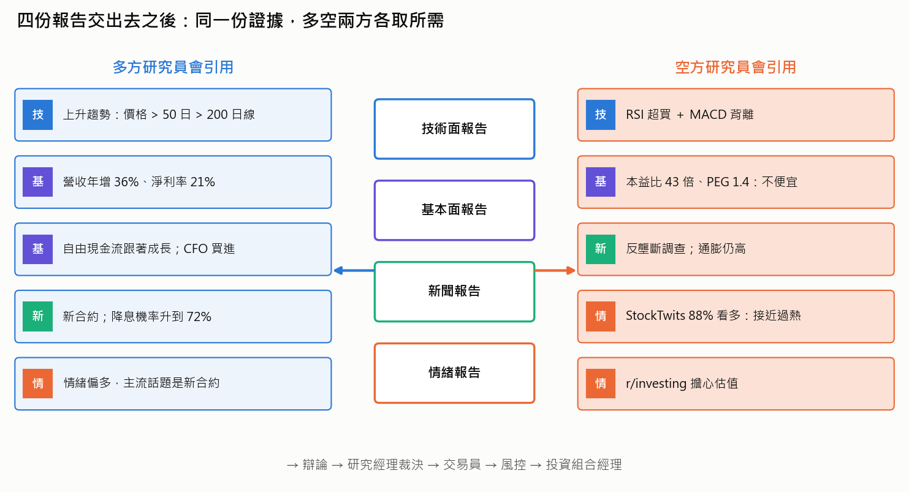

注意一件事：**同一份報告，兩邊都能引用。** 技術面報告裡有「上升趨勢」（多方用），也有「超買和背離」（空方用）；新聞報告裡有「新合約」（多方用），也有「反壟斷調查」（空方用）。

這就是為什麼分析師只負責「客觀蒐證」：把正反證據都完整交出去，交給後面的辯論和經理權衡，比讓單一 AI 直接喊買賣更不容易偏頗。之後會依序經過研究經理裁決、交易員提出具體交易（例如用 ATR 決定停損）、三位風控辯論，最後由投資組合經理給出評等。

### ABC 走完一遍的總結

| 分析師 | 一句話結論 | 偏多證據 | 偏空證據 |
|---|---|---|---|
| 技術面 | 大趨勢向上，但短期過熱 | 均線多頭排列 | RSI 85、MACD 背離、量能變弱 |
| 基本面 | 好公司，但不便宜 | 高成長、高獲利、現金流佳、CFO 買進 | PE 43、PEG 1.4 |
| 新聞 | 有催化劑也有風險，總經偏順風 | 新合約、降息機率升 | 反壟斷調查、通膨仍高 |
| 社群情緒 | 溫和看多，散戶接近過熱 | 主流話題正面 | 88% 看多、樣本小 |

📌 **本段重點**
- 四份報告同時交給多空研究員，同一份證據兩邊都會引用。
- 分析師的價值在於「把正反證據都完整交出來」，而不是下結論。

<details>
<summary>▶ 深入看：研究員收到的報告格式</summary>

`agents/researchers/bull_researcher.py` 把四份報告依序放進任務說明：

```text
Market research report:        ← 技術面報告
Social media sentiment report: ← 情緒報告
Latest world affairs news:     ← 新聞報告
Company fundamentals report:   ← 基本面報告
```

如果某位分析師沒被選用，對應欄位會標示為「absent」（`report_or_absent`），研究員會知道少了哪個角度。

</details>

---

## Part 7：總整理 —— 四位分析師一張表

| | 技術面 | 基本面 | 新聞 | 社群情緒 |
|---|---|---|---|---|
| **核心問題** | 市場現在怎麼對待這支股票？ | 公司好不好？貴不貴？ | 外在世界發生什麼事？ | 大家現在的感覺如何？ |
| **主要數據** | 每日 OHLCV、技術指標 | 三大報表、估值指標、內部人交易 | 公司／全球新聞、FRED 經濟數據、預測市場 | Yahoo 新聞、StockTwits、Reddit |
| **資料來源** | Yahoo Finance | SEC EDGAR、Yahoo Finance | Yahoo、FRED、Polymarket | Yahoo、StockTwits、Reddit |
| **時間尺度** | 天～一年 | 季～年 | 7 天新聞 + 1 年總經 | 7 天 |
| **想得到什麼** | 趨勢、力道、過熱程度、停損距離 | 體質、估值、警訊 | 催化劑、風險、總經順逆風 | 情緒溫度、是否過熱、跨來源落差 |
| **AI 自己叫工具？** | 是 | 是 | 是 | 否，資料先抓好 |
| **防幻覺設計** | 以核實快照為準 | 單位、幣別標清楚 | 用 FRED 數字佐證 | 資料直接給、區分「抓取失敗」與「沒有資料」 |
| **回測可靠度** | 高 | 中低（只剩 SEC 報表） | 中（預測市場被扣留） | 低（社群無歷史存檔） |
| **輸出格式** | 自由報告 + 摘要表 | 自由報告 + 摘要表 | 自由報告 + 摘要表 | 固定欄位：等級、分數、信心度、敘述 |

---

## Part 8：延伸討論 —— 對自己做策略研究的啟示

🎯 **這段要回答：** 如果要參考 TradingAgents 的思路設計自己的策略（例如在 LEAN 裡），要注意什麼？

1. **「不偷看未來」是整套系統最在意的事。** 從截斷日期、SEC EDGAR 申報日，到扣留沒有歷史版本的資料，都是為了讓回測可信。自己做回測也要注意這個問題（叫做**前視偏差**，look-ahead bias）。
2. **回測時四位分析師拿到的資訊量差很多。** 技術面最完整、情緒面最不可靠。用 TradingAgents 做歷史回測，結果可能過度依賴技術面和 SEC 報表。
3. **技術指標是 AI 每次自己挑的**，同一支股票跑兩次可能選到不同的指標組合，結果不完全可重現。只有核實快照的 11 個指標是固定的。
4. **四個角度的時間尺度不同。** 系統評估決策好壞的預設持有期是 5 個交易日（`holding_period_days`），屬於短線，這時情緒和技術面相對重要。
5. **報告是文字，不是數字訊號。** 除了情緒分數，其他報告都是自然語言，由後面的 AI 讀文字做判斷。要轉成量化策略，得自己把概念（例如「RSI > 70 且 MACD 柱狀圖縮短」）定義成明確規則。

<details>
<summary>▶ 深入看：各資料在回測時的狀況一覽</summary>

| 資料 | 即時分析 | 回測（分析日期在過去） |
|---|---|---|
| 價格 OHLCV、技術指標 | ✅ | ✅ 依日期截斷 |
| 公司概況（市值、PE 等） | ✅ | ❌ 扣留 |
| 三大報表 | ✅ | ⚠️ 只有 SEC EDGAR（美國公司）可用 |
| 內部人交易 | ✅ | ❌ 扣留 |
| 公司／全球新聞 | ✅ | ⚠️ 依日期過濾，涵蓋不到會標示 |
| FRED 經濟數據 | ✅ | ✅ 依日期截斷 |
| Polymarket 預測市場 | ✅ | ❌ 扣留 |
| StockTwits／Reddit | ✅ | ⚠️ 只能抓到最近的貼文，舊日期幾乎抓不到 |

</details>

---

## 附錄 A：名詞小辭典

| 名詞 | 白話解釋 |
|---|---|
| 股票代號（Ticker） | 股票的簡稱，例如 AAPL（蘋果）、2330.TW（台積電） |
| 多頭／看多（Bullish） | 認為價格會漲 |
| 空頭／看空（Bearish） | 認為價格會跌 |
| OHLCV | 開盤、最高、最低、收盤價與成交量 |
| K 線 | 用一根「蠟燭」畫出一天的開高低收 |
| 趨勢（Trend） | 價格在一段時間內的大方向 |
| 移動平均線（SMA／EMA） | 過去 N 天的平均價格；EMA 對近期權重較大 |
| 黃金交叉／死亡交叉 | 短均線由下往上／由上往下穿過長均線 |
| 動能（Momentum） | 價格變動的速度和力道 |
| 超買／超賣 | 短期漲太多／跌太多 |
| 背離（Divergence） | 價格和指標走向不一致，例如價格創新高但動能指標沒有 |
| 波動度（Volatility） | 價格上下跳動的劇烈程度 |
| 支撐／壓力 | 價格常止跌的位置／常遇到賣壓的位置 |
| 停損（Stop-loss） | 事先設定「跌到這裡就認賠出場」的價位 |
| 部位（Position） | 持有某支股票的數量 |
| 營收／淨利 | 賣了多少東西／扣完所有成本費用稅金後真正賺的 |
| 自由現金流 | 營業賺進的現金 − 買設備的錢，可以自由運用的現金 |
| EPS | 每股盈餘：每一股分到多少獲利 |
| 本益比（PE） | 股價 ÷ EPS，以目前獲利要幾年回本 |
| PEG | 本益比 ÷ 成長率，考慮成長後的貴賤 |
| TTM | 過去 12 個月的合計 |
| 估值（Valuation） | 評估一家公司值多少錢 |
| 槓桿（Leverage） | 借錢經營或投資，放大獲利也放大風險 |
| 內部人交易 | 董事、高管、大股東買賣自家股票 |
| 總經（Macro） | 總體經濟：利率、通膨、就業、GDP 等 |
| 聯準會（Fed） | 美國的中央銀行，負責制定利率 |
| 通膨（Inflation） | 物價上漲的速度 |
| 殖利率 | 債券：持有到期的年化報酬率；股票：配息 ÷ 股價 |
| 殖利率曲線倒掛 | 短期利率高於長期利率，常被視為衰退前兆 |
| 預測市場 | 用真錢押注事件是否發生的市場，價格就是市場認為的機率 |
| 催化劑（Catalyst） | 可能引發股價大幅變動的事件 |
| 反向指標 | 當所有人都看同一個方向時，反而可能是反轉訊號 |
| 前視偏差（Look-ahead bias） | 回測時不小心用到「當時還不知道」的資料，讓結果看起來比實際好 |
| ADR | 美國存託憑證，外國公司在美國掛牌的形式，例如台積電的 TSM |

## 附錄 B：程式碼位置對照

| 內容 | 檔案 |
|---|---|
| 技術面分析師 | `tradingagents/agents/analysts/market_analyst.py` |
| 基本面分析師 | `tradingagents/agents/analysts/fundamentals_analyst.py` |
| 新聞分析師 | `tradingagents/agents/analysts/news_analyst.py` |
| 社群情緒分析師 | `tradingagents/agents/analysts/sentiment_analyst.py` |
| 工具呼叫迴圈、20 輪上限的收尾 | `tradingagents/agents/analysts/turn.py` |
| 所有工具定義 | `tradingagents/agents/tools.py` |
| 工具 → 資料來源的對應 | `tradingagents/dataflows/router.py` |
| 不偷看未來的規則 | `tradingagents/dataflows/date_window.py` |
| 核實快照 | `tradingagents/dataflows/vendors/yahoo/snapshot.py` |
| 基本面（Yahoo） | `tradingagents/dataflows/vendors/yahoo/fundamentals.py` |
| 財報（SEC EDGAR） | `tradingagents/dataflows/vendors/sec_edgar.py` |
| 經濟數據（FRED） | `tradingagents/dataflows/vendors/fred.py` |
| 預測市場（Polymarket） | `tradingagents/dataflows/vendors/polymarket.py` |
| StockTwits／Reddit | `tradingagents/dataflows/vendors/stocktwits.py`、`reddit.py` |
| 情緒報告的固定格式 | `tradingagents/agents/schemas.py`（`SentimentReport`） |
| 預設設定（資料來源、篇數、天數） | `tradingagents/default_config.py` |
| 流程圖（誰先誰後） | `tradingagents/graph/setup.py` |
